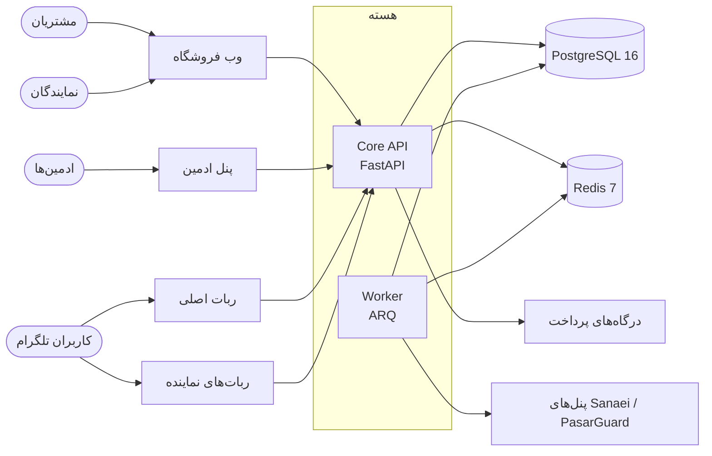

<div align="center">

# ملورین (Melorin)

**پلتفرم چندفروشگاهی فروش VPN: فروشگاه اصلی، نمایندگان با فروشگاه، دامنه و ربات تلگرام اختصاصی، خرید مبتنی بر کیف پول و ساخت خودکار سرویس روی پنل‌های Sanaei و PasarGuard.**

[](https://github.com/archerhabibi/melorin-py/actions/workflows/ci.yml)


[English](README.md) · [نصب](#-نصب-سریع) · [معماری](#-معماری) · [عملیات](#-عملیات-روزمره) · [توسعه](#-توسعهٔ-محلی) · [مستندات](#-مستندات)

</div>

---

## 🚀 نصب سریع

با کاربر **root** روی یک سرور تازهٔ Ubuntu / Debian اجرا کنید:

```bash
bash <(curl -fsSL https://raw.githubusercontent.com/archerhabibi/melorin-py/main/get.sh)
```

همین، کل نصب است. این دستور پروژه را در `/opt/melorin` قرار می‌دهد، دستور `melorin` را می‌سازد و منو را باز می‌کند.
گزینهٔ **1) Install** را بزنید؛ فقط پنج مورد می‌پرسد، اشاره‌کردن هر دو دامنه به سرور را بررسی می‌کند و بقیهٔ نصب خودکار انجام می‌شود.

| از قبل آماده کنید | نمونه |
|---|---|
| **دامنهٔ سایت فروش**، رکورد A به آی‌پی سرور | `shop.example.com` |
| **دامنهٔ ادمین**، رکورد A به آی‌پی سرور | `admin.example.com` |
| **ایمیل ادمین** (نام کاربری ادمین اول) | `you@example.com` |
| **توکن ربات تلگرام** از @BotFather (ورودی مخفی) | `123456:ABC...` |
| **آیدی عددی تلگرام ادمین اصلی** (از ربات @userinfobot، نه @username): هشدارهای مدیریتی به آن ارسال می‌شود | `123456789` |

**سرور:** ۴ گیگ رم (4 GB) و ۲ هسته CPU، Ubuntu 22.04+ (مجموع سقف حافظهٔ کانتینرها ۳٫۵ گیگابایت است). پورت‌های **80 و 443 باید آزاد باشند**؛ گواهی TLS را Caddy خودکار می‌گیرد.
اگر این پورت‌ها را پراکسی دیگری گرفته، منو خودش تشخیص می‌دهد و به [حالت پراکسی خارجی](#نصب-پشت-reverse-proxy-موجود-external_proxy) می‌رود.

**در پایان نصاب رمز یک‌بارمصرف ادمین و seed مربوط به TOTP را چاپ می‌کند؛ همان لحظه هر دو را ذخیره کنید.**

### بعد از نصب: سه کار

1. به `https://admin.example.com` بروید، با ایمیل ادمین وارد شوید، seed را به برنامهٔ احراز هویت اضافه کنید و رمز را عوض کنید.
2. **فایل `/opt/melorin/secrets/backup/age-identity.txt` را خارج از سرور نگه دارید.** تنها کلیدی است که پشتیبان‌ها را باز می‌کند؛ بدون آن بازیابی ممکن نیست.
3. از پنل ادمین، پنل‌های VPN (Sanaei / PasarGuard)، روش‌های پرداخت و در صورت نیاز نمایندگان را اضافه کنید. راهنماها در [`docs/`](#-مستندات) هستند.

> ربات‌های نماینده به تنظیم زمان نصب نیاز ندارند. کانتینر `telegram_reseller` همیشه روشن است، از هسته می‌پرسد کدام ربات‌ها را اجرا کند و تا وقتی نماینده‌ای نباشد بیکار می‌ماند.
> نماینده، دامنه و توکن رباتش را از **ادمین ← نمایندگان** اضافه کنید؛ توکن‌ها رمزنگاری‌شده ذخیره می‌شوند و ری‌استارت یا تغییر `.env` لازم نیست.

---

## 📑 فهرست

- [نصب سریع](#-نصب-سریع) · [منو و میان‌برها](#دستور-melorin) · [نصب پیشرفته](#نصب-پیشرفته)
- [قابلیت‌ها](#-قابلیتها) · [معماری](#-معماری) · [وب‌اپ‌ها](#-وباپها) · [امنیت](#-امنیت)
- [یکپارچه‌سازی‌های اختیاری](#-یکپارچهسازیهای-اختیاری) · [به‌روزرسانی](#-بهروزرسانی) · [عملیات](#-عملیات-روزمره) · [ثبت تغییرات](#-ثبت-تغییرات-اجباری-است)
- [توسعهٔ محلی](#-توسعهٔ-محلی) · [ساختار پروژه](#-ساختار-پروژه) · [مستندات](#-مستندات) · [وضعیت انتشار](#-وضعیت-انتشار)

---

## ✨ قابلیت‌ها

| حوزه | چه دریافت می‌کنید |
|---|---|
| **فروشگاه‌ها** | یک فروشگاه اصلی و فروشگاه‌های نماینده؛ هر کدام با ارز، کیف پول، مقصد پرداخت، دامنه (TLS بر حسب نیاز) و ربات تلگرام جدا؛ ایزوله‌سازی کامل فروشگاه‌ها |
| **خرید** | خرید با کیف پول؛ رسید کارت‌به‌کارت (با تأیید خودکار از روی پیامک بانک، راهنما: `docs/20-Card-Receipt-Auto-Verification.md`) و زرین‌پال فقط کیف پول همان فروشگاه را شارژ می‌کنند؛ دفتر کل دوطرفه |
| **کاتالوگ** | بسته‌های فروش روی چند پنل، قیمت‌گذاری هر فروشگاه، کوپن (دامنه، سهمیه، سقف برای هر مشتری، بازهٔ زمانی، سقف تخفیف) |
| **ساخت سرویس** | ساخت خودکار اکانت روی Sanaei و PasarGuard (و آداپتر Mock)؛ تلاش مجدد، بازبینی دستی، تطبیق، تمدید و استعلام |
| **نمایندگان** | درخواست دومرحله‌ای (وب یا ربات)، سقف بدهی، Reseller API با scope و webhook امضاشده، قیمت‌گذاری هر نماینده |
| **رشد** | ارجاع با تخصیص اولین تماس، کمیسیون و پاداش قابل تنظیم، برگشت و بازپس‌گیری در صورت بازپرداخت |
| **هویت** | کد ایمیلی، رمز + TOTP، گوگل، ورود با ربات و OIDC تلگرام، اتصال کانال‌ها، پیوند ایمیل تأییدشده با بررسی تعارض (بدون ادغام بی‌صدا) |
| **عملیات** | پشتیبان رمزنگاری‌شدهٔ روزانه با restore drill هفتگی، Prometheus + Alertmanager، deploy وابسته به CI با rollback خودکار، لاگ ممیزی، ثبت خودکار تغییرات |

---

## 🧭 معماری



**قانون اصلی:** وب‌ها و ربات‌ها هرگز به دیتابیس دست نمی‌زنند و قیمت‌گذاری، کیف پول، سفارش، پرداخت و ساخت سرویس را خودشان پیاده نمی‌کنند؛ فقط هسته را صدا می‌زنند.

| جزء | مسیر | نقش |
|---|---|---|
| API هسته (`api`) | `apps/api/melorin` | FastAPI؛ تنها مالک PostgreSQL و همهٔ قوانین کسب‌وکار |
| Worker (`worker`) | `apps/api/melorin/worker` | ARQ + Redis: outbox، تلاش مجدد ساخت سرویس، انقضا، سلامت پنل‌ها، تطبیق، پشتیبان رمزنگاری‌شدهٔ روزانه |
| وب فروشگاه (`store_web`) | `apps/store-web` | ویترین مشتری، داشبورد، کنسول نماینده |
| پنل ادمین (`admin_web`) | `apps/admin-web` | پنل مدیریت |
| ربات اصلی (`telegram_main`) | `apps/telegram-main` | ربات تلگرام اصلی؛ فقط انتقال پیام |
| ربات‌های نماینده (`telegram_reseller`) | `apps/telegram-reseller` | یک پردازش برای همهٔ ربات‌های نماینده که هسته آن را هدایت می‌کند |
| PostgreSQL 16 / Redis 7 | compose | مرجع مالی / صف، rate limit و heartbeat کارگر |
| Caddy | `infra/Caddyfile` | TLS و مسیریابی (پروفایل `local-proxy`؛ در حالت پراکسی خارجی خاموش است) |
| Prometheus + Alertmanager | `infra/` | متریک، قوانین هشدار و ارسال به تلگرام و/یا ایمیل |

لایه‌بندی داخل هسته با import-linter اجباری است: `domain` ← `kernel` ← `core` ← `modules`؛ `channels/*` فقط adapter هستند و هرگز admin، reseller، reports یا worker را import نمی‌کنند.

---

## 🖥️ وب‌اپ‌ها

هر دو اپ React + Vite + Tailwind CSS 4 با رابط فارسی راست‌به‌چپ، فونت Vazirmatn خودمیزبان، تم روشن/تیره و هوک مشترک دیالوگ دسترس‌پذیر (`useDialog`: قفل فوکوس، Esc، بازگردانی فوکوس، قفل اسکرول) هستند.

- **وب فروشگاه** (`apps/store-web`): کاتالوگ و خرید با کیف پول، شارژ کیف پول با رسید، داشبورد (اکانت‌های VPN، سفارش‌ها، ارجاع، تیکت، اعلان‌ها)، صفحهٔ اشتراک / نتیجهٔ خرید، استعلام و تمدید اکانت، ورود با گوگل / تلگرام / ایمیل، کنسول و قیمت‌گذاری نماینده (lazy-load). دامنهٔ اختصاصی نماینده همان ویترین را با نام فروشگاه او نشان می‌دهد.
- **پنل ادمین** (`apps/admin-web`): code splitting در سطح مسیر؛ صفحه‌های پنل‌ها، بسته‌های فروش و محصولات یک زبان بصری مشترک دارند (`src/kit.jsx` و بلوک «Infra v2» در `src/styles.css`): نوار KPI که فیلتر هم هست، حلقهٔ آمادگی فروش، گیج ظرفیت، نوار وضعیت روی کارت‌ها (سبز = قابل فروش، قرمز = غیرقابل فروش، خاکستری = خاموش)، مرتب‌سازی «مشکل‌دارها اول» و سوییچ کارت/جدول. صفحه‌های دیگر: نمایندگان و درخواست‌ها، پرداخت‌ها و رسیدها، تیکت‌ها، بازبینی پیوند هویت، سلامت زیرساخت و تنظیمات یکپارچه‌سازی.

گیت‌های کیفیت (CI و `make quality-gate`): ESLint 9 (react، hooks، jsx-a11y) با **ratchet هشدار** که فقط پایین می‌رود، Prettier، Vitest، `npm audit`، بررسی lockfile و **بودجهٔ JS بارگذاری اول** برای هر اپ (`scripts/check_bundle_budget.py`).

---

## 🔐 امنیت

ورود ادمین با TOTP · کوکی refresh از نوع HttpOnly با access token فقط در حافظه · rate limit مبتنی بر Redis که fail-closed است · allowlist صریح CORS و هدرهای امنیتی · secret با حداقل دسترسی برای رانرهای ربات · وابستگی‌های پایتون با hash قفل‌شده، `pip-audit` و `npm audit` در CI، imageهای پایه با digest · پشتیبان رمزنگاری‌شده با age · محدودیت IP ادمین (اختیاری، به‌طور پیش‌فرض خاموش).
جزئیات: [docs/06-Security.md](docs/06-Security.md).

secretهای production مقدار یک‌بار-مصرف یا فقط‌زمان-اجرا هستند: `.env` را root-owned با دسترسی `600` نگه دارید، توکن را در خط فرمان وارد نکنید و هر توکن افشاشده را بچرخانید.

---

## دستور melorin

بعد از نصب، منو را هر زمان با `melorin` (یا `bash /opt/melorin/melorin.sh`) باز کنید:

| گزینه | کار |
|---|---|
| `1` Install | نصب خاموش؛ دامنهٔ فروش، دامنهٔ ادمین، ایمیل ادمین و توکن ربات را می‌پرسد |
| `2` Update | دریافت کد جدید، build، migration و ری‌استارت (`.env` حفظ می‌شود) |
| `3` Edit .env | ویرایش توکن ربات / دامنهٔ فروش / دامنهٔ ادمین یا باز کردن `.env` در ویرایشگر |
| `4` Web panel | آدرس فروشگاه و ادمین، health، ریست رمز ادمین، غیرفعال‌کردن محدودیت IP |
| `5` Service | وضعیت / استارت / توقف / ری‌استارت / لاگ کانتینرها |
| `6` Status | خلاصهٔ سلامت (نسخه، ربات، کانتینرها، آمادگی API، دیسک، رم، کلید پشتیبان) |
| `7` Uninstall | حذف کامل (برای تأیید `DELETE` تایپ کنید) |
| `0` Exit | خروج |

میان‌بر: `melorin status` · `melorin update` · `melorin restart` · `melorin logs [service]` · `melorin panel`.

متغیرهای اختیاری دستور یک‌خطی: `REPO_REF` (شاخه، تگ یا commit؛ پیش‌فرض `main` یعنی آخرین نسخه، برای کنترل سخت‌گیرانهٔ production یک تگ/commit بازبینی‌شده بدهید)، `REPO_URL` (فورک private یا آدرس deploy key فقط‌خواندنی)، `APP_DIR` (پیش‌فرض `/opt/melorin`).

---

## نصب پیشرفته

<details>
<summary><b>نصب بدون تعامل (اتوماسیون)</b></summary>

منو از `scripts/install_server.sh` استفاده می‌کند و می‌توان آن را مستقیم اجرا کرد:

```bash
curl -fsSL https://raw.githubusercontent.com/archerhabibi/melorin-py/main/scripts/install_server.sh -o install.sh
# پیش از اجرا، اسکریپت دانلودشده را با checksum انتشار تطبیق دهید.
sha256sum install.sh
DOMAIN=shop.example.com ADMIN_DOMAIN=admin.example.com ADMIN_EMAIL=you@example.com REPO_REF=<commit-یا-تگ-بازبینی-شده> bash install.sh
```

در اجرای مستقیم حتماً `REPO_REF` را خودتان بدهید (خود اسکریپت یک pin پیش‌فرض داخلی دارد که لزوماً نسخهٔ موردنظر شما نیست). اگر ریپو private است، اسکریپت را دستی به سرور ببرید و `REPO_URL` را با deploy key فقط‌خواندنی بدهید. نصاب:

- Docker را نصب می‌کند و پروژه را در `/opt/melorin` قرار می‌دهد؛
- **توکن ربات اصلی تلگرام** را می‌گیرد، تنها رباتی که موقع نصب تنظیم می‌شود (پرسش تعاملی یا `MAIN_BOT_TOKEN=...`؛ پرسش تعاملی بهتر است تا توکن در history و لیست پردازش‌ها نماند)؛
- همهٔ secretها (دیتابیس، JWT، کلید رمزنگاری، توکن سرویس و متریک، secret هر رانر ربات، رمز ادمین) را در `.env` می‌سازد؛ ورودی‌ها پیش از انتشار `.env` اعتبارسنجی می‌شوند و اجرای ناموفق فایل نیمه‌کاره باقی نمی‌گذارد؛
- کلید پشتیبان رمزنگاری‌شده را می‌سازد، `alembic upgrade head` می‌زند، سرویس‌ها را بالا می‌آورد و bootstrap ادمین (idempotent) را اجرا می‌کند؛
- پس از ساخت ادمین، رمز اولیه و seed مربوط به TOTP را از `.env` حذف می‌کند و ثبت‌کنندهٔ خودکار تغییرات (cron) را نصب می‌کند.

اجرای دوباره‌اش بی‌خطر است؛ `.env` و کلید پشتیبان موجود هرگز بازنویسی نمی‌شوند.

</details>

### نصب پشت Reverse Proxy موجود (`EXTERNAL_PROXY`)

<details>
<summary><b>وقتی سرویس دیگری پورت‌های 80/443 را دارد</b></summary>

منو این وضعیت را تشخیص می‌دهد و حالت را پیشنهاد می‌دهد (یا نصب را با `EXTERNAL_PROXY=true` اجرا کنید). نصاب فقط پورت‌های loopback را باز می‌کند: فروشگاه `127.0.0.1:18080`، ادمین `127.0.0.1:18081` و API روی `127.0.0.1:18000`.

- `/api/*` و `/health/*` را به API و هر hostname را به پورت وب مربوطه بدهید.
- دامنهٔ نمایندگان هم به پورت فروشگاه می‌رود. اگر پراکسی شما گواهی را on-demand می‌گیرد، با `GET 127.0.0.1:18000/api/v1/tls/ask?domain=<host>` کنترلش کنید (۲۰۰ = دامنهٔ ثبت‌شده، ۴۰۴ = رد).
- هنگام به‌روزرسانی همیشه از همان override استفاده کنید: `docker compose -f docker-compose.yml -f docker-compose.external.yml up -d --build`.

محدودیت IP ادمین اختیاری و به‌طور پیش‌فرض خاموش است و موقع نصب پرسیده نمی‌شود. برای فعال‌کردن: پنل ادمین ← تنظیمات ← یکپارچه‌سازی‌ها ← «دسترسی ادمین (محدودیت IP)». اگر قفل شدید:

```bash
docker compose exec -T api python -m melorin.cli disable-admin-ip-allowlist
```

اگر رمز ادمین گم شد (بدون ماندن در history):

```bash
docker compose exec -T api python -m melorin.cli reset-admin-password admin@example.com
```

</details>

---

## 🔌 یکپارچه‌سازی‌های اختیاری

در زمان اجرا از پنل ادمین (تنظیمات ← یکپارچه‌سازی‌ها) فعال می‌شوند؛ بدون rebuild و بدون ویرایش `.env`:

- **SMTP:** بدون آن فقط ورود با کد ایمیلی کار نمی‌کند.
- **ورود با گوگل:** جریان ID-token؛ فقط Client ID لازم است. راهنما: [docs/GOOGLE-LOGIN-SETUP.md](docs/GOOGLE-LOGIN-SETUP.md).
- **ورود با تلگرام:** OIDC / تأیید با ربات. راهنما: [docs/TELEGRAM-LOGIN-SETUP.md](docs/TELEGRAM-LOGIN-SETUP.md) و [docs/TELEGRAM-WEB-LOGIN.md](docs/TELEGRAM-WEB-LOGIN.md).
- **پشتیبان S3 (خارج از سرور):** پشتیبان رمزنگاری‌شدهٔ age هر روز ساعت ۰۲:۰۰ UTC در volume محلی `api_storage` ذخیره می‌شود و اگر S3 فعال باشد روی آن هم کپی می‌شود.

---

## 🔄 به‌روزرسانی

**ساده‌ترین راه:** `melorin` را بزنید و **2) Update** را انتخاب کنید. کد را می‌گیرد، روی خود سرور build می‌کند، migration می‌زند و ری‌استارت می‌کند؛ `.env` حفظ می‌شود.

**خودکار و وابسته به CI:** `.github/workflows/deploy.yml` **فقط بعد از یک اجرای سبز `CI` روی push به `main`** اجرا می‌شود و دقیقاً همان commitی را deploy می‌کند که CI تست کرده است. اجرای دستی هم بررسی می‌کند که ref روی `main` باشد و CI سبز داشته باشد. `scripts/deploy.sh` را با SSH روی سرور اجرا می‌کند و آن:

1. قفل می‌گیرد و اگر فایل‌های tracked دستی ویرایش شده باشند اجرا نمی‌شود؛
2. پیش از deploy یک پشتیبان رمزنگاری‌شدهٔ دیتابیس می‌گیرد (اگر شکست بخورد متوقف می‌شود)؛
3. imageها را build می‌کند (یا در حالت registry می‌کشد)، `alembic upgrade head` می‌زند و سرویس‌ها را بالا می‌آورد؛
4. منتظر `/health/ready` (دیتابیس + Redis + heartbeat کارگر) و سالم‌شدن سرویس‌های اصلی می‌ماند؛
5. در صورت هر خطا **خودکار به commit قبلی برمی‌گردد**، دوباره build و بررسی می‌کند (کد خروج ۱ = rollback انجام شد، ۲ = rollback شکست خورد و دخالت دستی لازم است).

<details>
<summary><b>راه‌اندازی یک‌بارهٔ deploy خودکار</b></summary>

1. روی سرور کاربری بسازید که مالک `/opt/melorin` و عضو گروه `docker` باشد (`adduser --disabled-password deploy` ، `usermod -aG docker deploy` ، `chown -R deploy:deploy /opt/melorin`).
2. یک جفت کلید SSH مخصوص بسازید، کلید عمومی را به `authorized_keys` همان کاربر اضافه کنید و host key را با `ssh-keyscan -t ed25519 -p 22 IP_سرور` بگیرید.
3. در GitHub (Settings ← Secrets and variables ← Actions) این secretها را بسازید: `DEPLOY_HOST`، `DEPLOY_USER`، `DEPLOY_PORT`، `DEPLOY_SSH_KEY` (کلید خصوصی) و `DEPLOY_KNOWN_HOSTS`. کلید خصوصی فقط همان‌جا بماند.
4. از تب Actions یک‌بار workflow را اجرا کنید و سبز بودنش را ببینید.

**حالت registry (اختیاری):** برای اینکه روی production هرگز build نشود، متغیر repository به‌نام `DEPLOY_IMAGE_REGISTRY` (مثلاً `ghcr.io/<owner>/melorin`) و همان مقدار را با نام `MELORIN_IMAGE_REGISTRY` در `.env` سرور بگذارید. جزئیات: [docs/RUNBOOK.md](docs/RUNBOOK.md).

</details>

deploy یا rollback دستی روی سرور (همان مسیر workflow):

```bash
cd /opt/melorin && scripts/deploy.sh --ref <sha-یا-تگ>   # ref قدیمی‌تر = rollback؛ --db-downgrade فقط وقتی downgradeها واقعی‌اند
```

rollback فقط **کد** را برمی‌گرداند؛ schema روی نسخهٔ جدید می‌ماند مگر اینکه `--db-downgrade` بدهید.

---

## 🛠️ عملیات روزمره

```bash
docker compose ps                          # در حالت پراکسی خارجی -f docker-compose.external.yml را اضافه کنید
docker compose logs --tail=200 api worker telegram_main telegram_reseller
curl https://shop.example.com/health/live  # /health/ready علاوه بر آن Redis و heartbeat کارگر را هم می‌سنجد
scripts/ops_log.sh                         # ثبت یادداشت (قبل / مشکل / اقدام / بعد) در لاگ سرور
```

| موضوع | نکته |
|---|---|
| **هشدارها** | Prometheus و Alertmanager در stack هستند. دست‌کم یک گیرنده در `.env` تنظیم کنید: تلگرام (`ALERT_TELEGRAM_BOT_TOKEN` و `ALERT_TELEGRAM_CHAT_ID`) و/یا ایمیل (`ALERT_SMTP_*` و `ALERT_EMAIL_TO`)؛ وگرنه هشدارها ارزیابی می‌شوند ولی به جایی نمی‌رسند. `/metrics` توکن لازم دارد و روی دامنه‌های عمومی مسدود است |
| **پشتیبان** | روزانه، رمزنگاری‌شده، نگهداری ۳۰ روزه. workflow هفتگی `restore-drill.yml` جدیدترین پشتیبان خارج از سرور را در یک دیتابیس موقت بازیابی می‌کند تا کارکردش اثبات شود (تا وقتی secretهایش تنظیم نشود رد می‌شود). کلید age را **خارج از سرور** نگه دارید |
| **حافظه** | هر کانتینر سقف دارد و مجموع سقف‌ها ۳٫۵ گیگابایت است (دلیل پیشنهاد ۴ گیگ رم)؛ اگر سرویسی سقف نداشته باشد CI شکست می‌خورد |
| **قطعی Redis** | در staging/production تا وقتی Redis از کار افتاده هیچ‌کس نمی‌تواند وارد شود (rate limit عمداً fail-closed است) |
| **حوادث** | PostgreSQL، Redis، پنل‌ها، درگاه‌ها، چک‌لیست انتشار، rollback، دامنهٔ نمایندگان، زنجیرهٔ تأمین: [docs/RUNBOOK.md](docs/RUNBOOK.md) |

---

## 📝 ثبت تغییرات اجباری است

**هر تغییری (کد، تنظیمات یا کار روی سرور) باید ثبت شود.** ثبت خودکار انجام می‌شود؛ دلیل را شما اضافه می‌کنید.

| کجا | چه کسی ثبت می‌کند | دلیل را چطور اضافه کنید |
|---|---|---|
| `docs/CHANGE_LOG.md` (کد در git) | workflow به‌نام `Changelog` روی هر push به `main` | trailerهای commit: `Problem:` `Action:` `After:` (و در صورت نیاز `Before:` و `Area:`)؛ `make setup-git` قالبش را فعال می‌کند |
| `var/ops-log.md` روی سرور | `scripts/ops_watch.sh` (cron، هر ۵ دقیقه: تغییر commit، نام کلیدهای `.env`، فایل‌های دستکاری‌شده، ری‌استارت کانتینر) و workflow مربوط به deploy | `scripts/ops_log.sh` |

هر ورودی شامل **قبل**، **مشکل**، **اقدام**، **بعد (نتیجهٔ تأییدشده)** و چه کسی/چه زمانی است. ورودی‌های خودکار هرگز چیزی از خود نمی‌سازند و secret هرگز در لاگ نمی‌آید. جزئیات: [CONTRIBUTING.md](CONTRIBUTING.md). این قانون برای همه است: اعضای تیم، پیمانکاران و دستیارهای هوش مصنوعی.

---

## 💻 توسعهٔ محلی

پیش‌نیازها: Docker با Compose، Python 3.12، Node 22.

```bash
cp .env.example .env
# MELORIN_JWT_SECRET (حداقل ۳۲ کاراکتر)، MELORIN_ENCRYPTION_KEY (کلید Fernet) و مقادیر bootstrap ادمین را تنظیم کنید
make setup-git                    # اختیاری: قالب commit برای trailerهای change log

# بدون Caddy؛ override پورت‌های loopback را باز می‌کند (فروشگاه 18080، ادمین 18081، API 18000)
docker compose -f docker-compose.yml -f docker-compose.external.yml up -d --build
docker compose -f docker-compose.yml -f docker-compose.external.yml run --rm api alembic upgrade head
docker compose -f docker-compose.yml -f docker-compose.external.yml exec -T api python -m melorin.cli bootstrap   # ساخت ادمین اول (idempotent)
curl http://127.0.0.1:18000/health/live
```

مستندات API (`/docs`) فقط با `MELORIN_ENV=development` فعال است و Caddy آن را پنهان می‌کند؛ پس مستقیم `http://127.0.0.1:18000/docs` را باز کنید. برای امتحان پراکسی داخلی از `COMPOSE_PROFILES=local-proxy` استفاده کنید.

بدون Docker (به PostgreSQL و Redis طبق `.env` نیاز دارد): `make api` · `make worker` · `cd apps/store-web && npm ci && npm run dev` (برای `apps/admin-web` هم همین‌طور).

### بررسی‌ها

| دستور | کار |
|---|---|
| `make install-verify` | preflight تمیز محلی: `.venv`، requirementهای قفل‌شده، import هستهٔ API و compile کد و تست‌ها؛ بدون ادعا دربارهٔ PostgreSQL، Redis، Docker، ارائه‌دهنده‌ها، تلگرام یا restore |
| `make lint` | قراردادهای لایه‌بندی import-linter، `ruff check` و `ruff format --check` |
| `make test` | تست‌های API (به‌طور پیش‌فرض روی SQLite درون‌حافظه) |
| `make guards` | گاردهای ایستا: G001–G010، پیکربندی کیفیت، بودجهٔ حافظه/عملیات، به‌روز بودن اسناد تولیدشده |
| `make quality-gate` | کل gate محلی که CI هم اجرا می‌کند |
| `make web-lint` / `make web-format` | ESLint / Prettier برای هر دو وب |
| `make api-client` | به‌روزرسانی snapshot مربوط به OpenAPI و تولید/typecheck/تست `packages/api-client` |
| `make docs` | بازتولید `docs/STATUS.md` و جدول مسیرها در `docs/API.md` |
| `make migration-smoke` | ارتقای یک PostgreSQL به head و تأیید revision ثبت‌شده (داخل محیط API) |

مسیرهای تست: مجموعهٔ پیش‌فرض روی SQLite اجرا می‌شود؛ با `TEST_PG_URL=postgresql+asyncpg://...` همان تست‌ها روی PostgreSQL (schema جدا برای هر تست، به‌علاوهٔ تست‌های همزمانی) اجرا می‌شوند؛ `pytest -m integration` به PostgreSQL و Redis نیاز دارد. وب‌ها Vitest دارند (`npm test`) و تست ربات‌ها در `apps/telegram-main/tests` است. CI برای پوشش تست backend یک کف دارد که فقط اجازهٔ افزایش دارد. جزئیات: [docs/09-Testing.md](docs/09-Testing.md).

تغییر دیتابیس به migration نیاز دارد (`make revision`)؛ CI روی یک PostgreSQL خالی `alembic upgrade head` و `alembic check` را اجرا می‌کند. downgrade مربوط به baseline اولیه عمداً مسدود است.

---

## 🗂️ ساختار پروژه

```text
apps/
  api/                 هستهٔ FastAPI: domain، kernel (ORM)، زیرساخت، modules، channels، worker
  admin-web/           پنل ادمین React
  store-web/           ویترین، داشبورد و کنسول نماینده (React)
  telegram-main/       ربات تلگرام اصلی
  telegram-reseller/   ناظر ربات‌های نماینده
packages/api-client/   کلاینت تایپ‌شده از snapshot مربوط به OpenAPI هسته (اگر قدیمی باشد CI شکست می‌خورد؛ فعلاً وابستگی وب‌اپ‌ها نیست)
docs/                  نیازمندی‌ها، معماری، راهنمای عملیات، تصمیم‌ها، وضعیت تولیدشده
infra/                 Caddyfile، تنظیمات Prometheus و قوانین هشدار، Alertmanager
scripts/               نصاب، deploy با rollback، پشتیبان / restore drill، ثبت خودکار تغییرات، گاردها، smoke
secrets/               فایل‌های secret زمان اجرا (فقط placeholderهای *.example commit می‌شوند)
get.sh, melorin.sh     ورودی نصب یک‌خطی و منوی مدیریت سرور
.github/workflows/     ci، deploy، changelog، pin-images، restore-drill (Dependabot: pip، npm، Docker)
```

---

## 📚 مستندات

| نیاز | مرجع |
|---|---|
| فهرست اسناد و نیازمندی‌ها | [docs/00-README.md](docs/00-README.md) و [docs/01-Requirements-SRS.md](docs/01-Requirements-SRS.md) |
| معماری، طراحی فنی، مدل داده، قراردادهای API | `docs/02` تا `docs/05`؛ فهرست مسیرهای تولیدشده: [docs/API.md](docs/API.md) |
| امنیت، مالی/سفارش/ساخت سرویس، عملیات و DR، تست، نقشهٔ راه | `docs/06` تا `docs/10` |
| کانال‌ها، تمدید، ایزوله‌سازی فروشگاه، اتصال کانال، دامنهٔ ارجاع/کوپن | `docs/11`، `docs/13`، `docs/14`، `docs/16`، `docs/17` |
| راهنمای عملیات | [docs/RUNBOOK.md](docs/RUNBOOK.md) |
| تصمیم‌ها و موارد باز | [docs/DECISIONS.md](docs/DECISIONS.md) |
| سیاست مستندسازی | [docs/DOCUMENTATION-POLICY.md](docs/DOCUMENTATION-POLICY.md) |

هر وقت تنظیم، مسیر، مرحلهٔ نصب یا قاعدهٔ امنیتی عوض شد، این فایل، `README.md` و راهنمای عملیات را در همان تغییر به‌روز کنید و سپس `make docs` را اجرا کنید.

---

## ⚠️ وضعیت انتشار

ملورین یک پلتفرم کامل و قابل اجراست، نه ادعایی بر اینکه اعتبارنامه‌های بیرونی، قرارداد درگاه‌ها، DNS، TLS، نسخهٔ پنل‌ها، تصمیم‌های مالی باز و تست بازیابی production کامل شده‌اند. پیش از ترافیک واقعی، `docs/DECISIONS.md` را تعیین‌تکلیف کنید، secretها را تنظیم کنید و مجموعهٔ کامل E2E / امنیت / تاب‌آوری SRS را روی staging اجرا کنید.

وضعیت رسمی انتشار فقط در `docs/RELEASE-EVIDENCE-MATRIX.md` است و تا پیوست‌شدن شواهد اجرا و production «بسته» می‌ماند. اعداد اندازه‌گیری‌شده (head مایگریشن، تعداد API و تست) فقط در `docs/STATUS.md` (تولید خودکار) آمده است. گزارش‌های فازهای قبلی (تگ git با نام `docs-history-2026-10-22`، فهرست در `docs/HISTORY.md`) تغییرات را شرح می‌دهند، نه تأیید را.
آداپتر PasarGuard با خانوادهٔ API فعلی `/api/user/by-username`، `/api/user/by-id` و `/api/user/from_template` و قراردادهای PGClockBot هم‌راستاست؛ PGClockBot (MIT، بتا) مرجع API بوده و داخل هسته کپی نشده است.
