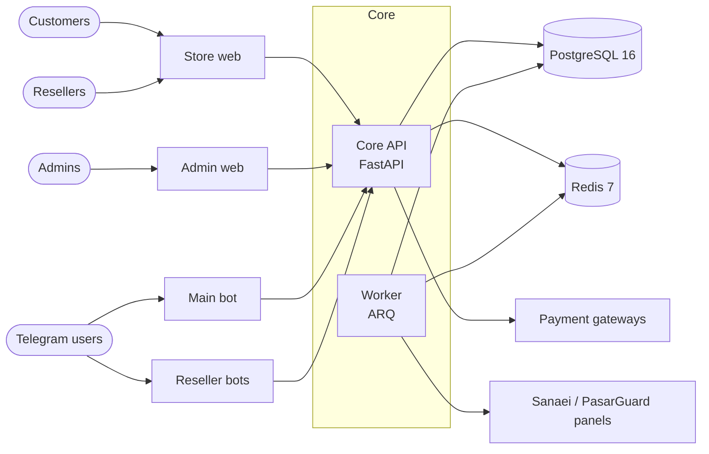

<div align="center">

# Melorin

**Multi-store VPN sales platform: a main store, resellers with their own stores, domains and Telegram bots, wallet-first checkout and automatic provisioning on Sanaei / PasarGuard panels.**

[](https://github.com/archerhabibi/melorin-py/actions/workflows/ci.yml)


[فارسی](README.fa.md) · [Install](#-quick-install) · [Architecture](#-architecture) · [Operations](#-operating) · [Development](#-local-development) · [Docs](#-documentation)

</div>

---

## 🚀 Quick install

Run as **root** on a fresh Ubuntu / Debian server:

```bash
bash <(curl -fsSL https://raw.githubusercontent.com/archerhabibi/melorin-py/main/get.sh)
```

That is the whole installation. The command downloads the project to `/opt/melorin`, registers the `melorin` command and opens the menu.
Choose **1) Install**: it asks only four things, checks that both domains point at this server, then installs everything unattended.

| Have ready | Example |
|---|---|
| **Store domain** (sales site), A record → server IP | `shop.example.com` |
| **Admin domain** (admin panel), A record → server IP | `admin.example.com` |
| **Admin e-mail** (login of the first admin) | `you@example.com` |
| **Telegram bot token** from @BotFather (hidden input) | `123456:ABC...` |

**Server:** 4 GB RAM and 2 vCPU, Ubuntu 22.04+ (container memory caps add up to 3.5 GiB). Ports **80 and 443 must be free**; Caddy obtains TLS certificates automatically.
Port 80/443 already used by another proxy? The menu detects it and switches to [external proxy mode](#existing-reverse-proxy-external_proxy).

**At the end the installer prints a one-time admin password and a TOTP seed. Save both immediately.**

### After the install: three things to do

1. Open `https://admin.example.com`, sign in with the admin e-mail, add the TOTP seed to an authenticator app and change the password.
2. **Copy `/opt/melorin/secrets/backup/age-identity.txt` off the server.** It is the only key that can decrypt backups; without it they cannot be restored.
3. In the Admin panel add your VPN panels (Sanaei / PasarGuard), payment methods and, when you need them, resellers. Guides are in [`docs/`](#-documentation).

> Reseller bots need no install-time setup. The `telegram_reseller` container is always on, asks Core which bots to run and idles while there are none.
> Add a reseller, its domain and bot token in **Admin → Resellers**; tokens are stored encrypted and no restart or `.env` change is needed.

---

## 📑 Contents

- [Quick install](#-quick-install) · [Menu and shortcuts](#the-melorin-command) · [Advanced install](#advanced-install)
- [Features](#-features) · [Architecture](#-architecture) · [Web apps](#-web-apps) · [Security](#-security)
- [Optional integrations](#-optional-integrations) · [Updating](#-updating) · [Operating](#-operating) · [Change log rule](#-change-log-is-mandatory)
- [Local development](#-local-development) · [Repository layout](#-repository-layout) · [Documentation](#-documentation) · [Release status](#-release-status)

---

## ✨ Features

| Area | What you get |
|---|---|
| **Stores** | One main store plus reseller stores, each with its own currency, wallets, payment destinations, domain (on-demand TLS) and Telegram bot; strict store isolation |
| **Checkout** | Wallet-first purchase; manual card receipts and Zarinpal only top up the current store wallet; double-entry ledger |
| **Catalog** | Sales bundles over several panels, per-store pricing, coupons (scope, quotas, per-customer limits, time windows, maximum discount) |
| **Provisioning** | Automatic account creation on Sanaei, PasarGuard (and a Mock adapter); retry, manual review, reconciliation, renewal and inquiry |
| **Resellers** | Two-step applications (web or bot), debt limit, scoped Reseller API with signed outgoing webhooks, per-reseller pricing |
| **Growth** | First-touch referral attribution, configurable commissions and rewards, refund reversal and clawback |
| **Identity** | E-mail code, password + TOTP, Google, Telegram bot and OIDC login, channel binding, verified-email linking with conflict review (no silent merges) |
| **Operations** | Encrypted daily backups with weekly restore drill, Prometheus + Alertmanager, CI-gated deploy with automatic rollback, audit log, automatic change log |

---

## 🧭 Architecture



**Rule of the house:** channels (web apps, bots) never touch the database and never implement pricing, wallet, order, payment or provisioning rules. They only call Core.

| Component | Path | Role |
|---|---|---|
| Core API (`api`) | `apps/api/melorin` | FastAPI; the only owner of PostgreSQL and of every business rule |
| Worker (`worker`) | `apps/api/melorin/worker` | ARQ + Redis: outbox, provisioning retries, expiry, panel health, reconciliation, daily encrypted backup |
| Store web (`store_web`) | `apps/store-web` | Customer storefront, dashboard, reseller console |
| Admin web (`admin_web`) | `apps/admin-web` | Admin panel |
| Main bot (`telegram_main`) | `apps/telegram-main` | Main Telegram bot; transport only |
| Reseller bots (`telegram_reseller`) | `apps/telegram-reseller` | One process hosting every reseller bot, driven by Core |
| PostgreSQL 16 / Redis 7 | compose | Financial source of truth / queues, rate limits, worker heartbeat |
| Caddy | `infra/Caddyfile` | TLS and routing (profile `local-proxy`; off in external-proxy mode) |
| Prometheus + Alertmanager | `infra/` | Metrics, alert rules, delivery to Telegram and/or e-mail |

Layering inside Core is enforced by import-linter: `domain` ← `kernel` ← `core` ← feature `modules`; `channels/*` are adapters and never import admin, reseller, reports or the worker.

---

## 🖥️ Web apps

Both apps are React + Vite + Tailwind CSS 4 with a right-to-left Persian UI, self-hosted Vazirmatn font, light/dark themes and a shared accessible dialog hook (`useDialog`: focus trap, Esc, focus restore, scroll lock).

- **Store web** (`apps/store-web`): catalog and wallet-first purchase, wallet top-up with receipts, dashboard (VPN accounts, orders, referral, tickets, notifications), subscription / purchase-result page, account inquiry and renewal, Google / Telegram / e-mail login, reseller console and pricing (lazy-loaded). A reseller's own domain serves the same storefront under that store's name.
- **Admin web** (`apps/admin-web`): route-level code splitting; the Panels, Sales bundles and Products screens share one visual language (`src/kit.jsx` + the "Infra v2" block of `src/styles.css`): a KPI bar that doubles as a filter, a sales-readiness ring, capacity gauges, status stripes (green = can sell, red = cannot, grey = off), "problems first" sorting and a cards/table toggle. More screens cover resellers and applications, payments and receipts, tickets, identity-link reviews, infrastructure health and integration settings.

Quality gates (CI and `make quality-gate`): ESLint 9 (react, hooks, jsx-a11y) with a **warning ratchet** that only goes down, Prettier, Vitest, `npm audit`, lockfile verification and per-app **first-load JS budgets** (`scripts/check_bundle_budget.py`).

---

## 🔐 Security

Admin sign-in with TOTP · HttpOnly refresh cookie with an in-memory access token · Redis-backed rate limiting that fails closed · explicit CORS allowlists and security headers · least-privilege secrets for bot runners · hash-locked Python dependencies, `pip-audit` and `npm audit` in CI, digest-pinned base images · age-encrypted backups · optional admin IP allowlist (off by default).
Details: [docs/06-Security.md](docs/06-Security.md).

Production secrets are one-time bootstrap or runtime-only values: keep `.env` root-owned with mode `600`, never pass tokens on the command line, and rotate any bot token that was exposed.

---

## The `melorin` command

After installation the menu opens at any time with `melorin` (or `bash /opt/melorin/melorin.sh`):

| Option | Action |
|---|---|
| `1` Install | Quiet install; asks store domain, admin domain, admin e-mail, bot token |
| `2` Update | Pull the latest code, rebuild, run migrations, restart (`.env` is kept) |
| `3` Edit .env | Change bot token / store domain / admin domain, or open `.env` in an editor |
| `4` Web panel | Store and admin URLs, health check, admin password reset, IP-allowlist break-glass |
| `5` Service | Container status / start / stop / restart / logs |
| `6` Status | Health summary (version, bot, containers, API readiness, disk, memory, backup key) |
| `7` Uninstall | Complete removal (type `DELETE` to confirm) |
| `0` Exit | Leave the menu |

Shortcuts: `melorin status` · `melorin update` · `melorin restart` · `melorin logs [service]` · `melorin panel`.

Optional environment overrides for the one-liner: `REPO_REF` (branch, tag or commit; default `main` = latest, pin a reviewed tag or commit for strict production control), `REPO_URL` (private fork or read-only deploy-key URL), `APP_DIR` (default `/opt/melorin`).

---

## Advanced install

<details>
<summary><b>Non-interactive install (automation)</b></summary>

The menu calls `scripts/install_server.sh`, which can also be run directly:

```bash
curl -fsSL https://raw.githubusercontent.com/archerhabibi/melorin-py/main/scripts/install_server.sh -o install.sh
# Verify the downloaded script against the release checksum before running it.
sha256sum install.sh
DOMAIN=shop.example.com ADMIN_DOMAIN=admin.example.com ADMIN_EMAIL=you@example.com REPO_REF=<reviewed-commit-or-tag> bash install.sh
```

When run directly, always set `REPO_REF` yourself (the script carries its own built-in default pin, which is not necessarily the release you want). If the repository is private, copy the script to the server and set `REPO_URL` to a read-only deploy-key URL. The installer will:

- install Docker and clone the project to `/opt/melorin`;
- take the **main Telegram bot token**, the only bot configured at install time (interactive prompt or `MAIN_BOT_TOKEN=...`; prefer the prompt so the token stays out of shell history and process listings);
- generate every secret (database, JWT, encryption key, service and metrics tokens, per-runner bot secrets, admin password) into `.env`, validating inputs first so a failed run leaves no partial environment file;
- create the key pair for encrypted local backups, run `alembic upgrade head`, start all services and run the idempotent admin bootstrap;
- remove the bootstrap password and TOTP seed from `.env` once the admin exists, and install the automatic change recorder (cron).

It is safe to run again: an existing `.env` and backup key are never overwritten.

</details>

### Existing reverse proxy (`EXTERNAL_PROXY`)

<details>
<summary><b>Another service already owns ports 80/443</b></summary>

The menu detects this and offers the mode automatically (or install with `EXTERNAL_PROXY=true`). The installer then binds only loopback ports: store `127.0.0.1:18080`, admin `127.0.0.1:18081`, API `127.0.0.1:18000`.

- Route `/api/*` and `/health/*` to the API and each hostname to its matching web port.
- Reseller store domains go to the store port as well. If your proxy issues certificates on demand, gate them with `GET 127.0.0.1:18000/api/v1/tls/ask?domain=<host>` (200 = registered reseller domain, 404 = refuse).
- During updates keep using the same override: `docker compose -f docker-compose.yml -f docker-compose.external.yml up -d --build`.

The admin IP allowlist is optional and OFF by default; nothing is asked at install time. To restrict the admin API use Admin panel → Settings → Integrations → "Admin access (IP allowlist)". If you lock yourself out:

```bash
docker compose exec -T api python -m melorin.cli disable-admin-ip-allowlist
```

Lost admin password (reset without leaving it in shell history):

```bash
docker compose exec -T api python -m melorin.cli reset-admin-password admin@example.com
```

</details>

---

## 🔌 Optional integrations

Configured at runtime in the Admin panel under *Settings → Integrations* (no rebuild, no `.env` edit):

- **SMTP**: without it only e-mail-code login is unavailable.
- **Google sign-in**: ID-token flow, only a Client ID is needed. Guide: [docs/GOOGLE-LOGIN-SETUP.md](docs/GOOGLE-LOGIN-SETUP.md).
- **Telegram login**: OIDC / bot-approved website login. Guides: [docs/TELEGRAM-LOGIN-SETUP.md](docs/TELEGRAM-LOGIN-SETUP.md), [docs/TELEGRAM-WEB-LOGIN.md](docs/TELEGRAM-WEB-LOGIN.md).
- **Off-site S3 backup**: backups are always written age-encrypted to the local `api_storage` volume every day at 02:00 UTC; with S3 enabled the encrypted file is also copied there.

---

## 🔄 Updating

**Simplest:** run `melorin` and choose **2) Update**. It pulls the code, rebuilds on the host, migrates and restarts; `.env` is kept.

**Automatic, CI-gated deploy:** `.github/workflows/deploy.yml` runs **only after a green `CI` run on a push to `main`** and deploys exactly the commit CI tested. A manual run re-checks that the ref is on `main` and has a green CI. It streams `scripts/deploy.sh` to the server over SSH, which:

1. takes a lock and refuses to run over hand-edited tracked files;
2. takes an encrypted pre-deploy database backup (aborts if that fails);
3. builds the images (or pulls them in registry mode), runs `alembic upgrade head` and starts the stack;
4. waits for `/health/ready` (database + Redis + worker heartbeat) and for every core service to be healthy;
5. on any failure **restores the previous commit** automatically, rebuilds and re-verifies (exit code 1 = rolled back, 2 = rollback failed, intervene).

<details>
<summary><b>One-time setup of automatic deploy</b></summary>

1. On the server create a user that owns `/opt/melorin` and is in the `docker` group (`adduser --disabled-password deploy`, `usermod -aG docker deploy`, `chown -R deploy:deploy /opt/melorin`).
2. Create a dedicated SSH key pair, add the public key to that user's `authorized_keys`, get the host key with `ssh-keyscan -t ed25519 -p 22 SERVER_IP`.
3. In GitHub (Settings → Secrets and variables → Actions) create `DEPLOY_HOST`, `DEPLOY_USER`, `DEPLOY_PORT`, `DEPLOY_SSH_KEY` (private key) and `DEPLOY_KNOWN_HOSTS`. Keep the private key only there.
4. Run the workflow once from the Actions tab and check it is green.

Optional **registry mode** (build once in CI, pull on the server, never build on production): set the repository variable `DEPLOY_IMAGE_REGISTRY` (e.g. `ghcr.io/<owner>/melorin`) and the same `MELORIN_IMAGE_REGISTRY` in the server's `.env`. Details: [docs/RUNBOOK.md](docs/RUNBOOK.md).

</details>

Manual deploy or rollback on the server (same code path as the workflow):

```bash
cd /opt/melorin && scripts/deploy.sh --ref <sha-or-tag>   # an older ref = rollback; --db-downgrade only if the downgrades are real
```

Rollback restores **code**; the schema stays at the new revision unless `--db-downgrade` is given.

---

## 🛠️ Operating

```bash
docker compose ps                          # add -f docker-compose.external.yml in external-proxy mode
docker compose logs --tail=200 api worker telegram_main telegram_reseller
curl https://shop.example.com/health/live  # /health/ready also needs Redis and a fresh worker heartbeat
scripts/ops_log.sh                         # add a note (before / problem / action / after) to the server log
```

| Topic | What to know |
|---|---|
| **Alerts** | Prometheus and Alertmanager ship in the stack. Set at least one receiver in `.env`: Telegram (`ALERT_TELEGRAM_BOT_TOKEN`, `ALERT_TELEGRAM_CHAT_ID`) and/or e-mail (`ALERT_SMTP_*`, `ALERT_EMAIL_TO`); otherwise alerts are evaluated but delivered nowhere. `/metrics` needs a bearer token and is blocked on public hostnames |
| **Backups** | Daily, encrypted, 30-day retention by default. The weekly `restore-drill.yml` workflow restores the newest off-site backup into a scratch database to prove it works (skipped until its secrets are set). Keep the age identity **off the server** |
| **Memory** | Every container has a cap; the caps sum to 3.5 GiB (hence 4 GB RAM). CI fails when a service has no cap |
| **Redis down** | In staging/production nobody can sign in while Redis is down (rate limiting fails closed on purpose) |
| **Incidents** | PostgreSQL, Redis, panels, gateways, release checks, rollback, reseller domains, supply chain: [docs/RUNBOOK.md](docs/RUNBOOK.md) |

---

## 📝 Change log is mandatory

**Every change (code, configuration or server action) must be recorded.** It is recorded automatically; you add the reason.

| Where | Recorded by | You add the reason with |
|---|---|---|
| `docs/CHANGE_LOG.md` (code in git) | the `Changelog` workflow on every push to `main` | commit trailers `Problem:` `Action:` `After:` (`Before:`, `Area:`); `make setup-git` installs a template |
| `var/ops-log.md` on the server | `scripts/ops_watch.sh` (cron, every 5 min: new commit, `.env` key names, hand-edited files, container restarts) and the deploy workflow | `scripts/ops_log.sh` |

Each entry has **before**, **problem**, **action**, **after (verified)** and who/when. Auto-generated entries never invent facts, and secrets never go in a log. Details: [CONTRIBUTING.md](CONTRIBUTING.md). This applies equally to people, contractors and AI assistants.

---

## 💻 Local development

Requirements: Docker with Compose, Python 3.12, Node 22.

```bash
cp .env.example .env
# set MELORIN_JWT_SECRET (32+ chars), MELORIN_ENCRYPTION_KEY (a Fernet key), bootstrap admin values
make setup-git                    # optional: commit template for change-log trailers

# Without the bundled Caddy; the override publishes loopback ports (store 18080, admin 18081, API 18000)
docker compose -f docker-compose.yml -f docker-compose.external.yml up -d --build
docker compose -f docker-compose.yml -f docker-compose.external.yml run --rm api alembic upgrade head
docker compose -f docker-compose.yml -f docker-compose.external.yml exec -T api python -m melorin.cli bootstrap   # idempotent first admin
curl http://127.0.0.1:18000/health/live
```

API docs (`/docs`) are served only when `MELORIN_ENV=development` and the bundled Caddy hides them, so open `http://127.0.0.1:18000/docs` directly. To try the bundled proxy locally use `COMPOSE_PROFILES=local-proxy`.

Without Docker (needs PostgreSQL and Redis from `.env`): `make api` · `make worker` · `cd apps/store-web && npm ci && npm run dev` (same for `apps/admin-web`).

### Checks

| Command | What it does |
|---|---|
| `make install-verify` | Clean local preflight: `.venv`, pinned API requirements, import of the Core app, compile of API and tests. No claim about PostgreSQL, Redis, Docker, providers, Telegram or restore |
| `make lint` | import-linter layering contracts, `ruff check`, `ruff format --check` |
| `make test` | API test suite (`apps/api`), in-memory SQLite by default |
| `make guards` | Static guards: G001-G010, quality config, ops/memory budget, generated docs up to date |
| `make quality-gate` | The full local gate that CI mirrors |
| `make web-lint` / `make web-format` | ESLint / Prettier for both web apps |
| `make api-client` | Refresh the OpenAPI snapshot; regenerate, type-check and test `packages/api-client` |
| `make docs` | Regenerate `docs/STATUS.md` and the route tables in `docs/API.md` |
| `make migration-smoke` | Upgrade a PostgreSQL database to head and verify the recorded revision (inside the API environment) |

Test lanes: the default suite runs on in-memory SQLite; `TEST_PG_URL=postgresql+asyncpg://...` runs the same tests on PostgreSQL (private schema per test, plus concurrency tests SQLite cannot prove); `pytest -m integration` needs PostgreSQL and Redis. Web apps use Vitest (`npm test`); the bots have tests under `apps/telegram-main/tests`. CI enforces a backend coverage floor that only goes up. See [docs/09-Testing.md](docs/09-Testing.md).

Database changes need an Alembic migration (`make revision`); CI runs `alembic upgrade head` and `alembic check` on an empty PostgreSQL. Downgrade of the initial baseline is intentionally blocked.

---

## 🗂️ Repository layout

```text
apps/
  api/                 FastAPI Core: domain, kernel (ORM), infrastructure, modules, channels, worker
  admin-web/           React admin panel
  store-web/           React storefront, dashboard, reseller console
  telegram-main/       main Telegram bot
  telegram-reseller/   reseller-bot supervisor
packages/api-client/   typed client generated from Core's OpenAPI snapshot (CI fails when stale; not yet used by the web apps)
docs/                  requirements, architecture, runbook, decisions, generated status
infra/                 Caddyfile, Prometheus config and alert rules, Alertmanager entrypoint
scripts/               installer, deploy with rollback, backup / restore drill, change-log automation, guards, smoke tests
secrets/               runtime secret files (only *.example placeholders are committed)
get.sh, melorin.sh     one-line installer entry point and the server menu
.github/workflows/     ci, deploy, changelog, pin-images, restore-drill (Dependabot covers pip, npm, Docker)
```

---

## 📚 Documentation

| Need | Read |
|---|---|
| Index and requirements | [docs/00-README.md](docs/00-README.md), [docs/01-Requirements-SRS.md](docs/01-Requirements-SRS.md) |
| Architecture, technical design, data model, API contracts | `docs/02` – `docs/05`; generated route list [docs/API.md](docs/API.md) |
| Security, finance / order / provisioning, operations and DR, testing, roadmap | `docs/06` – `docs/10` |
| Channels, renewal, store isolation, channel binding, referral / coupon scope | `docs/11`, `docs/13`, `docs/14`, `docs/16`, `docs/17` |
| Operations runbook | [docs/RUNBOOK.md](docs/RUNBOOK.md) |
| Decisions and open items | [docs/DECISIONS.md](docs/DECISIONS.md) |
| Rules for changing docs | [docs/DOCUMENTATION-POLICY.md](docs/DOCUMENTATION-POLICY.md) |

When a setting, route, install step or security rule changes, update this README, `README.fa.md` and the runbook in the same change, then run `make docs`.

---

## ⚠️ Release status

Melorin is a complete, runnable platform, not a claim that external credentials, gateway contracts, DNS, TLS, panel versions, open financial decisions or production restore tests are done. Resolve `docs/DECISIONS.md`, configure secrets and run the full SRS E2E / security / resilience suite on staging before production traffic.

Release status is authoritative only in `docs/RELEASE-EVIDENCE-MATRIX.md`; it stays fail-closed until runtime and production evidence is attached. Current measurements (migration head, API surface, test counts) are in the generated `docs/STATUS.md`. Historical phase reports (git tag `docs-history-2026-10-22`, indexed in `docs/HISTORY.md`) describe changes, not approval.
The PasarGuard adapter follows the current `/api/user/by-username`, `/api/user/by-id` and `/api/user/from_template` API family and PGClockBot's conventions; PGClockBot (MIT, beta) was an API reference and was not copied into Core.
