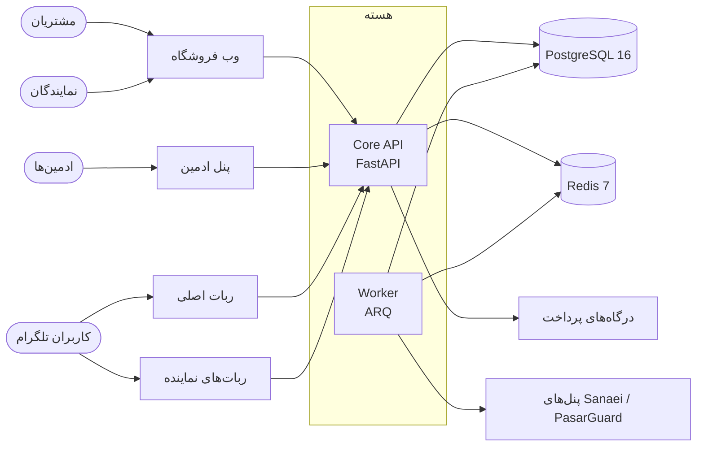
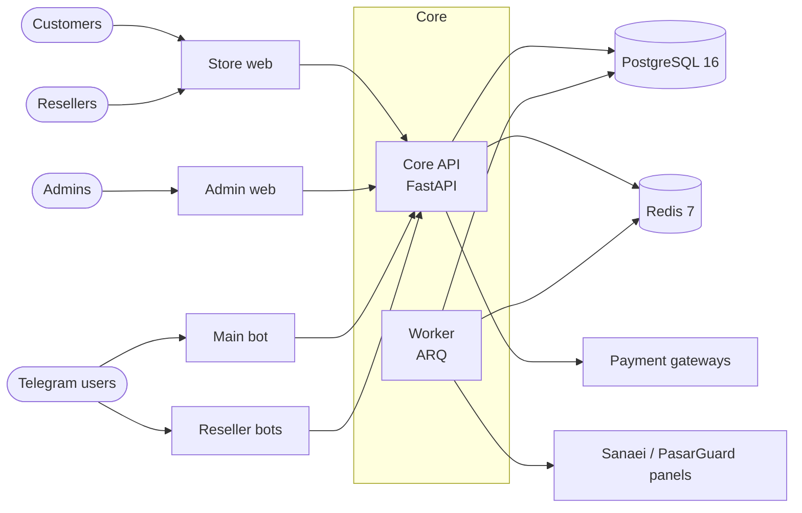

# مرور محصول / Product Overview

> **وضعیت / Status:** مرجع جاری / Current canonical
> **آخرین بازبینی / Last review:** 2026-11-16
> **فهرست / Index:** [00](00-DOCUMENTATION-INDEX.md)

## بخش فارسی

**هدف:** هدف، دامنه و مرز محصول Melorin.

Melorin یک پلتفرم فروش و مدیریت VPN است: فروشگاه اصلی، فروشگاه‌های نمایندگان، ربات‌های تلگرام، پنل ادمین و API مرکزی. معماری Modular Monolith است و کاربران هیچ منطق مالی/هویتی را در فرانت‌اند اجرا نمی‌کنند. جزئیات: [02](02-REQUIREMENTS-SRS.md) و [05](05-SYSTEM-ARCHITECTURE.md). نسخهٔ منتشرنشده است و سازگاری با داده/مهاجرت قدیمی الزام نیست.

## English section

**Purpose:** Purpose, scope and boundaries of Melorin.

Melorin is a VPN sales and management platform: a main store, reseller stores, Telegram bots, an admin panel and a central API. It is a Modular Monolith and the front ends never run financial or identity logic. See [02](02-REQUIREMENTS-SRS.md) and [05](05-SYSTEM-ARCHITECTURE.md). The product is unreleased; compatibility with legacy data/migrations is not required.


## مواد ادغام‌شده / Merged source material

### منبع / Source: `README.fa.md` (previous full version)

<div align="center">

#### ملورین (Melorin)

**پلتفرم چندفروشگاهی فروش VPN: فروشگاه اصلی، نمایندگان با فروشگاه، دامنه و ربات تلگرام اختصاصی، خرید مبتنی بر کیف پول و ساخت خودکار سرویس روی پنل‌های Sanaei و PasarGuard.**

[](https://github.com/archerhabibi/melorin-py/actions/workflows/ci.yml)


[English](README.md) · [نصب](#-نصب-سریع) · [معماری](#-معماری) · [عملیات](#-عملیات-روزمره) · [توسعه](#-توسعهٔ-محلی) · [مستندات](#-مستندات)

</div>

---

##### 🚀 نصب سریع

با کاربر **root** روی یک سرور تازهٔ Ubuntu / Debian اجرا کنید:

```bash
bash <(curl -fsSL https://raw.githubusercontent.com/archerhabibi/melorin-py/main/get.sh)
```

همین، کل نصب است. این دستور پروژه را در `/opt/melorin` قرار می‌دهد، دستور `melorin` را می‌سازد و منو را باز می‌کند.
گزینهٔ **1) Install** را بزنید؛ فقط پنج مورد می‌پرسد، اشاره‌کردن هر دو دامنه به سرور را بررسی می‌کند و بقیهٔ نصب خودکار انجام می‌شود.

| از قبل آماده کنید | نمونه |
|---|---|
| **دامنهٔ سایت فروش**، رکورد A به آی‌پی سرور | `shop.example.com` |
| **دامنهٔ ادمین**، رکورد A به آی‌پی سرور | `admin.example.com` |
| **ایمیل ادمین** (نام کاربری ادمین اول) | `you@example.com` |
| **توکن ربات تلگرام** از @BotFather (ورودی مخفی) | `123456:ABC...` |
| **آیدی عددی تلگرام ادمین اصلی** (از ربات @userinfobot، نه @username): هشدارهای مدیریتی به آن ارسال می‌شود | `123456789` |

**سرور:** ۴ گیگ رم (4 GB) و ۲ هسته CPU، Ubuntu 22.04+ (مجموع سقف حافظهٔ کانتینرها ۳٫۵ گیگابایت است). پورت‌های **80 و 443 باید آزاد باشند**؛ گواهی TLS را Caddy خودکار می‌گیرد.
اگر این پورت‌ها را پراکسی دیگری گرفته، منو خودش تشخیص می‌دهد و به [حالت پراکسی خارجی](#نصب-پشت-reverse-proxy-موجود-external_proxy) می‌رود.

**در پایان نصاب رمز یک‌بارمصرف ادمین و seed مربوط به TOTP را چاپ می‌کند؛ همان لحظه هر دو را ذخیره کنید.**

###### بعد از نصب: سه کار

1. به `https://admin.example.com` بروید، با ایمیل ادمین وارد شوید، seed را به برنامهٔ احراز هویت اضافه کنید و رمز را عوض کنید.
2. **فایل `/opt/melorin/secrets/backup/age-identity.txt` را خارج از سرور نگه دارید.** تنها کلیدی است که پشتیبان‌ها را باز می‌کند؛ بدون آن بازیابی ممکن نیست.
3. از پنل ادمین، پنل‌های VPN (Sanaei / PasarGuard)، روش‌های پرداخت و در صورت نیاز نمایندگان را اضافه کنید. راهنماها در [`docs/`](#-مستندات) هستند.

> ربات‌های نماینده به تنظیم زمان نصب نیاز ندارند. کانتینر `telegram_reseller` همیشه روشن است، از هسته می‌پرسد کدام ربات‌ها را اجرا کند و تا وقتی نماینده‌ای نباشد بیکار می‌ماند.
> نماینده، دامنه و توکن رباتش را از **ادمین ← نمایندگان** اضافه کنید؛ توکن‌ها رمزنگاری‌شده ذخیره می‌شوند و ری‌استارت یا تغییر `.env` لازم نیست.

---

##### 📑 فهرست

- [نصب سریع](#-نصب-سریع) · [منو و میان‌برها](#دستور-melorin) · [نصب پیشرفته](#نصب-پیشرفته)
- [قابلیت‌ها](#-قابلیتها) · [معماری](#-معماری) · [وب‌اپ‌ها](#-وباپها) · [امنیت](#-امنیت)
- [یکپارچه‌سازی‌های اختیاری](#-یکپارچهسازیهای-اختیاری) · [به‌روزرسانی](#-بهروزرسانی) · [عملیات](#-عملیات-روزمره) · [ثبت تغییرات](#-ثبت-تغییرات-اجباری-است)
- [توسعهٔ محلی](#-توسعهٔ-محلی) · [ساختار پروژه](#-ساختار-پروژه) · [مستندات](#-مستندات) · [وضعیت انتشار](#-وضعیت-انتشار)

---

##### ✨ قابلیت‌ها

| حوزه | چه دریافت می‌کنید |
|---|---|
| **فروشگاه‌ها** | یک فروشگاه اصلی و فروشگاه‌های نماینده؛ هر کدام با ارز، کیف پول، مقصد پرداخت، دامنه (TLS بر حسب نیاز) و ربات تلگرام جدا؛ ایزوله‌سازی کامل فروشگاه‌ها |
| **خرید** | خرید با کیف پول؛ رسید کارت‌به‌کارت (با تأیید خودکار از روی پیامک بانک، راهنما: `docs/15-PAYMENTS-WALLET-FINANCE.md`) و زرین‌پال فقط کیف پول همان فروشگاه را شارژ می‌کنند؛ دفتر کل دوطرفه |
| **کاتالوگ** | بسته‌های فروش روی چند پنل، قیمت‌گذاری هر فروشگاه، کوپن (دامنه، سهمیه، سقف برای هر مشتری، بازهٔ زمانی، سقف تخفیف) |
| **ساخت سرویس** | ساخت خودکار اکانت روی Sanaei و PasarGuard (و آداپتر Mock)؛ تلاش مجدد، بازبینی دستی، تطبیق، تمدید و استعلام |
| **نمایندگان** | درخواست دومرحله‌ای (وب یا ربات)، سقف بدهی، Reseller API با scope و webhook امضاشده، قیمت‌گذاری هر نماینده |
| **رشد** | ارجاع با تخصیص اولین تماس، کمیسیون و پاداش قابل تنظیم، برگشت و بازپس‌گیری در صورت بازپرداخت |
| **هویت** | کد ایمیلی، رمز + TOTP، گوگل، ورود با ربات و OIDC تلگرام، اتصال کانال‌ها، پیوند ایمیل تأییدشده با بررسی تعارض (بدون ادغام بی‌صدا) |
| **عملیات** | پشتیبان رمزنگاری‌شدهٔ روزانه با restore drill هفتگی، Prometheus + Alertmanager، deploy وابسته به CI با rollback خودکار، لاگ ممیزی، ثبت خودکار تغییرات |

---

##### 🧭 معماری



**قانون اصلی:** وب‌ها و ربات‌ها هرگز به دیتابیس دست نمی‌زنند و قیمت‌گذاری، کیف پول، سفارش، پرداخت و ساخت سرویس را خودشان پیاده نمی‌کنند؛ فقط هسته را صدا می‌زنند.

| جزء | مسیر | نقش |
|---|---|---|
| API هسته (`api`) | `apps/api/melorin` | FastAPI؛ تنها مالک PostgreSQL و همهٔ قوانین کسب‌وکار |
| Worker (`worker`) | `apps/api/melorin/worker` | ARQ + Redis: outbox، تلاش مجدد ساخت سرویس، انقضا، سلامت پنل‌ها، تطبیق، پشتیبان رمزنگاری‌شدهٔ روزانه |
| وب فروشگاه (`store_web`) | `apps/store-web` | ویترین مشتری، داشبورد، کنسول نماینده |
| پنل ادمین (`admin_web`) | `apps/admin-web` | پنل مدیریت |
| ربات اصلی (`telegram_main`) | `apps/telegram-main` | ربات تلگرام اصلی؛ فقط انتقال پیام |
| ربات‌های نماینده (`telegram_reseller`) | `apps/telegram-reseller` | یک پردازش برای همهٔ ربات‌های نماینده که هسته آن را هدایت می‌کند |
| PostgreSQL 16 / Redis 7 | compose | مرجع مالی / صف، rate limit و heartbeat کارگر |
| Caddy | `infra/Caddyfile` | TLS و مسیریابی (پروفایل `local-proxy`؛ در حالت پراکسی خارجی خاموش است) |
| Prometheus + Alertmanager | `infra/` | متریک، قوانین هشدار و ارسال به تلگرام و/یا ایمیل |

لایه‌بندی داخل هسته با import-linter اجباری است: `domain` ← `kernel` ← `core` ← `modules`؛ `channels/*` فقط adapter هستند و هرگز admin، reseller، reports یا worker را import نمی‌کنند.

---

##### 🖥️ وب‌اپ‌ها

هر دو اپ React + Vite + Tailwind CSS 4 با رابط فارسی راست‌به‌چپ، فونت Vazirmatn خودمیزبان، تم روشن/تیره و هوک مشترک دیالوگ دسترس‌پذیر (`useDialog`: قفل فوکوس، Esc، بازگردانی فوکوس، قفل اسکرول) هستند.

- **وب فروشگاه** (`apps/store-web`): کاتالوگ و خرید با کیف پول، شارژ کیف پول با رسید، داشبورد (اکانت‌های VPN، سفارش‌ها، ارجاع، تیکت، اعلان‌ها)، صفحهٔ اشتراک / نتیجهٔ خرید، استعلام و تمدید اکانت، ورود با گوگل / تلگرام / ایمیل، کنسول و قیمت‌گذاری نماینده (lazy-load). دامنهٔ اختصاصی نماینده همان ویترین را با نام فروشگاه او نشان می‌دهد.
- **پنل ادمین** (`apps/admin-web`): code splitting در سطح مسیر؛ صفحه‌های پنل‌ها، بسته‌های فروش و محصولات یک زبان بصری مشترک دارند (`src/kit.jsx` و بلوک «Infra v2» در `src/styles.css`): نوار KPI که فیلتر هم هست، حلقهٔ آمادگی فروش، گیج ظرفیت، نوار وضعیت روی کارت‌ها (سبز = قابل فروش، قرمز = غیرقابل فروش، خاکستری = خاموش)، مرتب‌سازی «مشکل‌دارها اول» و سوییچ کارت/جدول. صفحه‌های دیگر: نمایندگان و درخواست‌ها، پرداخت‌ها و رسیدها، تیکت‌ها، بازبینی پیوند هویت، سلامت زیرساخت و تنظیمات یکپارچه‌سازی.

گیت‌های کیفیت (CI و `make quality-gate`): ESLint 9 (react، hooks، jsx-a11y) با **ratchet هشدار** که فقط پایین می‌رود، Prettier، Vitest، `npm audit`، بررسی lockfile و **بودجهٔ JS بارگذاری اول** برای هر اپ (`scripts/check_bundle_budget.py`).

---

##### 🔐 امنیت

ورود ادمین با TOTP · کوکی refresh از نوع HttpOnly با access token فقط در حافظه · rate limit مبتنی بر Redis که fail-closed است · allowlist صریح CORS و هدرهای امنیتی · secret با حداقل دسترسی برای رانرهای ربات · وابستگی‌های پایتون با hash قفل‌شده، `pip-audit` و `npm audit` در CI، imageهای پایه با digest · پشتیبان رمزنگاری‌شده با age · محدودیت IP ادمین (اختیاری، به‌طور پیش‌فرض خاموش).
جزئیات: [docs/12-SECURITY-AUTHORIZATION.md](docs/12-SECURITY-AUTHORIZATION.md).

secretهای production مقدار یک‌بار-مصرف یا فقط‌زمان-اجرا هستند: `.env` را root-owned با دسترسی `600` نگه دارید، توکن را در خط فرمان وارد نکنید و هر توکن افشاشده را بچرخانید.

---

##### دستور melorin

بعد از نصب، منو را هر زمان با `melorin` (یا `bash /opt/melorin/melorin.sh`) باز کنید:

| گزینه | کار |
|---|---|
| `1` Install | نصب خاموش؛ دامنهٔ فروش، دامنهٔ ادمین، ایمیل ادمین و توکن ربات را می‌پرسد |
| `2` Update | دریافت کد جدید، build، migration و ری‌استارت (`.env` حفظ می‌شود) |
| `3` Edit .env | ویرایش توکن ربات / دامنهٔ فروش / دامنهٔ ادمین یا باز کردن `.env` در ویرایشگر |
| `4` Web panel | آدرس فروشگاه و ادمین، health، ریست رمز ادمین، غیرفعال‌کردن محدودیت IP |
| `5` Service | وضعیت / استارت / توقف / ری‌استارت / لاگ کانتینرها |
| `6` Status | خلاصهٔ سلامت (نسخه، ربات، کانتینرها، آمادگی API، دیسک، رم، کلید پشتیبان) |
| `7` Uninstall | حذف کامل (برای تأیید `DELETE` تایپ کنید) |
| `0` Exit | خروج |

میان‌بر: `melorin status` · `melorin update` · `melorin restart` · `melorin logs [service]` · `melorin panel`.

متغیرهای اختیاری دستور یک‌خطی: `REPO_REF` (شاخه، تگ یا commit؛ پیش‌فرض `main` یعنی آخرین نسخه، برای کنترل سخت‌گیرانهٔ production یک تگ/commit بازبینی‌شده بدهید)، `REPO_URL` (فورک private یا آدرس deploy key فقط‌خواندنی)، `APP_DIR` (پیش‌فرض `/opt/melorin`).

---

##### نصب پیشرفته

<details>
<summary><b>نصب بدون تعامل (اتوماسیون)</b></summary>

منو از `scripts/install_server.sh` استفاده می‌کند و می‌توان آن را مستقیم اجرا کرد:

```bash
curl -fsSL https://raw.githubusercontent.com/archerhabibi/melorin-py/main/scripts/install_server.sh -o install.sh
# پیش از اجرا، اسکریپت دانلودشده را با checksum انتشار تطبیق دهید.
sha256sum install.sh
DOMAIN=shop.example.com ADMIN_DOMAIN=admin.example.com ADMIN_EMAIL=you@example.com REPO_REF=<commit-یا-تگ-بازبینی-شده> bash install.sh
```

در اجرای مستقیم حتماً `REPO_REF` را خودتان بدهید (خود اسکریپت یک pin پیش‌فرض داخلی دارد که لزوماً نسخهٔ موردنظر شما نیست). اگر ریپو private است، اسکریپت را دستی به سرور ببرید و `REPO_URL` را با deploy key فقط‌خواندنی بدهید. نصاب:

- Docker را نصب می‌کند و پروژه را در `/opt/melorin` قرار می‌دهد؛
- **توکن ربات اصلی تلگرام** را می‌گیرد، تنها رباتی که موقع نصب تنظیم می‌شود (پرسش تعاملی یا `MAIN_BOT_TOKEN=...`؛ پرسش تعاملی بهتر است تا توکن در history و لیست پردازش‌ها نماند)؛
- همهٔ secretها (دیتابیس، JWT، کلید رمزنگاری، توکن سرویس و متریک، secret هر رانر ربات، رمز ادمین) را در `.env` می‌سازد؛ ورودی‌ها پیش از انتشار `.env` اعتبارسنجی می‌شوند و اجرای ناموفق فایل نیمه‌کاره باقی نمی‌گذارد؛
- کلید پشتیبان رمزنگاری‌شده را می‌سازد، `alembic upgrade head` می‌زند، سرویس‌ها را بالا می‌آورد و bootstrap ادمین (idempotent) را اجرا می‌کند؛
- پس از ساخت ادمین، رمز اولیه و seed مربوط به TOTP را از `.env` حذف می‌کند و ثبت‌کنندهٔ خودکار تغییرات (cron) را نصب می‌کند.

اجرای دوباره‌اش بی‌خطر است؛ `.env` و کلید پشتیبان موجود هرگز بازنویسی نمی‌شوند.

</details>

###### نصب پشت Reverse Proxy موجود (`EXTERNAL_PROXY`)

<details>
<summary><b>وقتی سرویس دیگری پورت‌های 80/443 را دارد</b></summary>

منو این وضعیت را تشخیص می‌دهد و حالت را پیشنهاد می‌دهد (یا نصب را با `EXTERNAL_PROXY=true` اجرا کنید). نصاب فقط پورت‌های loopback را باز می‌کند: فروشگاه `127.0.0.1:18080`، ادمین `127.0.0.1:18081` و API روی `127.0.0.1:18000`.

- `/api/*` و `/health/*` را به API و هر hostname را به پورت وب مربوطه بدهید.
- دامنهٔ نمایندگان هم به پورت فروشگاه می‌رود. اگر پراکسی شما گواهی را on-demand می‌گیرد، با `GET 127.0.0.1:18000/api/v1/tls/ask?domain=<host>` کنترلش کنید (۲۰۰ = دامنهٔ ثبت‌شده، ۴۰۴ = رد).
- هنگام به‌روزرسانی همیشه از همان override استفاده کنید: `docker compose -f docker-compose.yml -f docker-compose.external.yml up -d --build`.

محدودیت IP ادمین اختیاری و به‌طور پیش‌فرض خاموش است و موقع نصب پرسیده نمی‌شود. برای فعال‌کردن: پنل ادمین ← تنظیمات ← یکپارچه‌سازی‌ها ← «دسترسی ادمین (محدودیت IP)». اگر قفل شدید:

```bash
docker compose exec -T api python -m melorin.cli disable-admin-ip-allowlist
```

اگر رمز ادمین گم شد (بدون ماندن در history):

```bash
docker compose exec -T api python -m melorin.cli reset-admin-password admin@example.com
```

</details>

---

##### 🔌 یکپارچه‌سازی‌های اختیاری

در زمان اجرا از پنل ادمین (تنظیمات ← یکپارچه‌سازی‌ها) فعال می‌شوند؛ بدون rebuild و بدون ویرایش `.env`:

- **SMTP:** بدون آن فقط ورود با کد ایمیلی کار نمی‌کند.
- **ورود با گوگل:** جریان ID-token؛ فقط Client ID لازم است. راهنما: [docs/08-IDENTITY-ACCOUNT-PERSON.md](docs/08-IDENTITY-ACCOUNT-PERSON.md).
- **ورود با تلگرام:** OIDC / تأیید با ربات. راهنما: [docs/08-IDENTITY-ACCOUNT-PERSON.md](docs/08-IDENTITY-ACCOUNT-PERSON.md) و [docs/08-IDENTITY-ACCOUNT-PERSON.md](docs/08-IDENTITY-ACCOUNT-PERSON.md).
- **پشتیبان S3 (خارج از سرور):** پشتیبان رمزنگاری‌شدهٔ age هر روز ساعت ۰۲:۰۰ UTC در volume محلی `api_storage` ذخیره می‌شود و اگر S3 فعال باشد روی آن هم کپی می‌شود.

---

##### 🔄 به‌روزرسانی

**ساده‌ترین راه:** `melorin` را بزنید و **2) Update** را انتخاب کنید. کد را می‌گیرد، روی خود سرور build می‌کند، migration می‌زند و ری‌استارت می‌کند؛ `.env` حفظ می‌شود.

**خودکار و وابسته به CI:** `.github/workflows/deploy.yml` **فقط بعد از یک اجرای سبز `CI` روی push به `main`** اجرا می‌شود و دقیقاً همان commitی را deploy می‌کند که CI تست کرده است. اجرای دستی هم بررسی می‌کند که ref روی `main` باشد و CI سبز داشته باشد. `scripts/deploy.sh` را با SSH روی سرور اجرا می‌کند و آن:

1. قفل می‌گیرد و اگر فایل‌های tracked دستی ویرایش شده باشند اجرا نمی‌شود؛
2. پیش از deploy یک پشتیبان رمزنگاری‌شدهٔ دیتابیس می‌گیرد (اگر شکست بخورد متوقف می‌شود)؛
3. imageها را build می‌کند (یا در حالت registry می‌کشد)، `alembic upgrade head` می‌زند و سرویس‌ها را بالا می‌آورد؛
4. منتظر `/health/ready` (دیتابیس + Redis + heartbeat کارگر) و سالم‌شدن سرویس‌های اصلی می‌ماند؛
5. در صورت هر خطا **خودکار به commit قبلی برمی‌گردد**، دوباره build و بررسی می‌کند (کد خروج ۱ = rollback انجام شد، ۲ = rollback شکست خورد و دخالت دستی لازم است).

<details>
<summary><b>راه‌اندازی یک‌بارهٔ deploy خودکار</b></summary>

1. روی سرور کاربری بسازید که مالک `/opt/melorin` و عضو گروه `docker` باشد (`adduser --disabled-password deploy` ، `usermod -aG docker deploy` ، `chown -R deploy:deploy /opt/melorin`).
2. یک جفت کلید SSH مخصوص بسازید، کلید عمومی را به `authorized_keys` همان کاربر اضافه کنید و host key را با `ssh-keyscan -t ed25519 -p 22 IP_سرور` بگیرید.
3. در GitHub (Settings ← Secrets and variables ← Actions) این secretها را بسازید: `DEPLOY_HOST`، `DEPLOY_USER`، `DEPLOY_PORT`، `DEPLOY_SSH_KEY` (کلید خصوصی) و `DEPLOY_KNOWN_HOSTS`. کلید خصوصی فقط همان‌جا بماند.
4. از تب Actions یک‌بار workflow را اجرا کنید و سبز بودنش را ببینید.

**حالت registry (اختیاری):** برای اینکه روی production هرگز build نشود، متغیر repository به‌نام `DEPLOY_IMAGE_REGISTRY` (مثلاً `ghcr.io/<owner>/melorin`) و همان مقدار را با نام `MELORIN_IMAGE_REGISTRY` در `.env` سرور بگذارید. جزئیات: [docs/18-OPERATIONS-DEPLOYMENT-DR.md](docs/18-OPERATIONS-DEPLOYMENT-DR.md).

</details>

deploy یا rollback دستی روی سرور (همان مسیر workflow):

```bash
cd /opt/melorin && scripts/deploy.sh --ref <sha-یا-تگ>   # ref قدیمی‌تر = rollback؛ --db-downgrade فقط وقتی downgradeها واقعی‌اند
```

rollback فقط **کد** را برمی‌گرداند؛ schema روی نسخهٔ جدید می‌ماند مگر اینکه `--db-downgrade` بدهید.

---

##### 🛠️ عملیات روزمره

```bash
docker compose ps                          # در حالت پراکسی خارجی -f docker-compose.external.yml را اضافه کنید
docker compose logs --tail=200 api worker telegram_main telegram_reseller
curl https://shop.example.com/health/live  # /health/ready علاوه بر آن Redis و heartbeat کارگر را هم می‌سنجد
scripts/ops_log.sh                         # ثبت یادداشت (قبل / مشکل / اقدام / بعد) در لاگ سرور
```

| موضوع | نکته |
|---|---|
| **هشدارها** | Prometheus و Alertmanager در stack هستند. دست‌کم یک گیرنده در `.env` تنظیم کنید: تلگرام (`ALERT_TELEGRAM_BOT_TOKEN` و `ALERT_TELEGRAM_CHAT_ID`) و/یا ایمیل (`ALERT_SMTP_*` و `ALERT_EMAIL_TO`)؛ وگرنه هشدارها ارزیابی می‌شوند ولی به جایی نمی‌رسند. `/metrics` توکن لازم دارد و روی دامنه‌های عمومی مسدود است |
| **پشتیبان** | روزانه، رمزنگاری‌شده، نگهداری ۳۰ روزه. workflow هفتگی `restore-drill.yml` جدیدترین پشتیبان خارج از سرور را در یک دیتابیس موقت بازیابی می‌کند تا کارکردش اثبات شود (تا وقتی secretهایش تنظیم نشود رد می‌شود). کلید age را **خارج از سرور** نگه دارید |
| **حافظه** | هر کانتینر سقف دارد و مجموع سقف‌ها ۳٫۵ گیگابایت است (دلیل پیشنهاد ۴ گیگ رم)؛ اگر سرویسی سقف نداشته باشد CI شکست می‌خورد |
| **قطعی Redis** | در staging/production تا وقتی Redis از کار افتاده هیچ‌کس نمی‌تواند وارد شود (rate limit عمداً fail-closed است) |
| **حوادث** | PostgreSQL، Redis، پنل‌ها، درگاه‌ها، چک‌لیست انتشار، rollback، دامنهٔ نمایندگان، زنجیرهٔ تأمین: [docs/18-OPERATIONS-DEPLOYMENT-DR.md](docs/18-OPERATIONS-DEPLOYMENT-DR.md) |

---

##### 📝 ثبت تغییرات اجباری است

**هر تغییری (کد، تنظیمات یا کار روی سرور) باید ثبت شود.** ثبت خودکار انجام می‌شود؛ دلیل را شما اضافه می‌کنید.

| کجا | چه کسی ثبت می‌کند | دلیل را چطور اضافه کنید |
|---|---|---|
| `docs/06-ARCHITECTURE-DECISIONS.md` (کد در git) | workflow به‌نام `Changelog` روی هر push به `main` | trailerهای commit: `Problem:` `Action:` `After:` (و در صورت نیاز `Before:` و `Area:`)؛ `make setup-git` قالبش را فعال می‌کند |
| `var/ops-log.md` روی سرور | `scripts/ops_watch.sh` (cron، هر ۵ دقیقه: تغییر commit، نام کلیدهای `.env`، فایل‌های دستکاری‌شده، ری‌استارت کانتینر) و workflow مربوط به deploy | `scripts/ops_log.sh` |

هر ورودی شامل **قبل**، **مشکل**، **اقدام**، **بعد (نتیجهٔ تأییدشده)** و چه کسی/چه زمانی است. ورودی‌های خودکار هرگز چیزی از خود نمی‌سازند و secret هرگز در لاگ نمی‌آید. جزئیات: [CONTRIBUTING.md](CONTRIBUTING.md). این قانون برای همه است: اعضای تیم، پیمانکاران و دستیارهای هوش مصنوعی.

---

##### 💻 توسعهٔ محلی

پیش‌نیازها: Docker با Compose، Python 3.12، Node 22.

```bash
cp .env.example .env
# MELORIN_JWT_SECRET (حداقل ۳۲ کاراکتر)، MELORIN_ENCRYPTION_KEY (کلید Fernet) و مقادیر bootstrap ادمین را تنظیم کنید
make setup-git                    # اختیاری: قالب commit برای trailerهای change log

# بدون Caddy؛ override پورت‌های loopback را باز می‌کند (فروشگاه 18080، ادمین 18081، API 18000)
docker compose -f docker-compose.yml -f docker-compose.external.yml up -d --build
docker compose -f docker-compose.yml -f docker-compose.external.yml run --rm api alembic upgrade head
docker compose -f docker-compose.yml -f docker-compose.external.yml exec -T api python -m melorin.cli bootstrap   # ساخت ادمین اول (idempotent)
curl http://127.0.0.1:18000/health/live
```

مستندات API (`/docs`) فقط با `MELORIN_ENV=development` فعال است و Caddy آن را پنهان می‌کند؛ پس مستقیم `http://127.0.0.1:18000/docs` را باز کنید. برای امتحان پراکسی داخلی از `COMPOSE_PROFILES=local-proxy` استفاده کنید.

بدون Docker (به PostgreSQL و Redis طبق `.env` نیاز دارد): `make api` · `make worker` · `cd apps/store-web && npm ci && npm run dev` (برای `apps/admin-web` هم همین‌طور).

###### بررسی‌ها

| دستور | کار |
|---|---|
| `make install-verify` | preflight تمیز محلی: `.venv`، requirementهای قفل‌شده، import هستهٔ API و compile کد و تست‌ها؛ بدون ادعا دربارهٔ PostgreSQL، Redis، Docker، ارائه‌دهنده‌ها، تلگرام یا restore |
| `make lint` | قراردادهای لایه‌بندی import-linter، `ruff check` و `ruff format --check` |
| `make test` | تست‌های API (به‌طور پیش‌فرض روی SQLite درون‌حافظه) |
| `make guards` | گاردهای ایستا: G001–G010، پیکربندی کیفیت، بودجهٔ حافظه/عملیات، به‌روز بودن اسناد تولیدشده |
| `make quality-gate` | کل gate محلی که CI هم اجرا می‌کند |
| `make web-lint` / `make web-format` | ESLint / Prettier برای هر دو وب |
| `make api-client` | به‌روزرسانی snapshot مربوط به OpenAPI و تولید/typecheck/تست `packages/api-client` |
| `make docs` | بازتولید `docs/STATUS.md` و جدول مسیرها در `docs/API.md` |
| `make migration-smoke` | ارتقای یک PostgreSQL به head و تأیید revision ثبت‌شده (داخل محیط API) |

مسیرهای تست: مجموعهٔ پیش‌فرض روی SQLite اجرا می‌شود؛ با `TEST_PG_URL=postgresql+asyncpg://...` همان تست‌ها روی PostgreSQL (schema جدا برای هر تست، به‌علاوهٔ تست‌های همزمانی) اجرا می‌شوند؛ `pytest -m integration` به PostgreSQL و Redis نیاز دارد. وب‌ها Vitest دارند (`npm test`) و تست ربات‌ها در `apps/telegram-main/tests` است. CI برای پوشش تست backend یک کف دارد که فقط اجازهٔ افزایش دارد. جزئیات: [docs/20-TESTING-QUALITY-RELEASE.md](docs/20-TESTING-QUALITY-RELEASE.md).

تغییر دیتابیس به migration نیاز دارد (`make revision`)؛ CI روی یک PostgreSQL خالی `alembic upgrade head` و `alembic check` را اجرا می‌کند. downgrade مربوط به baseline اولیه عمداً مسدود است.

---

##### 🗂️ ساختار پروژه

```text
apps/
  api/                 هستهٔ FastAPI: domain، kernel (ORM)، زیرساخت، modules، channels، worker
  admin-web/           پنل ادمین React
  store-web/           ویترین، داشبورد و کنسول نماینده (React)
  telegram-main/       ربات تلگرام اصلی
  telegram-reseller/   ناظر ربات‌های نماینده
packages/api-client/   کلاینت تایپ‌شده از snapshot مربوط به OpenAPI هسته (اگر قدیمی باشد CI شکست می‌خورد؛ فعلاً وابستگی وب‌اپ‌ها نیست)
docs/                  نیازمندی‌ها، معماری، راهنمای عملیات، تصمیم‌ها، وضعیت تولیدشده
infra/                 Caddyfile، تنظیمات Prometheus و قوانین هشدار، Alertmanager
scripts/               نصاب، deploy با rollback، پشتیبان / restore drill، ثبت خودکار تغییرات، گاردها، smoke
secrets/               فایل‌های secret زمان اجرا (فقط placeholderهای *.example commit می‌شوند)
get.sh, melorin.sh     ورودی نصب یک‌خطی و منوی مدیریت سرور
.github/workflows/     ci، deploy، changelog، pin-images، restore-drill (Dependabot: pip، npm، Docker)
```

---

##### 📚 مستندات

| نیاز | مرجع |
|---|---|
| فهرست اسناد و نیازمندی‌ها | [docs/00-DOCUMENTATION-INDEX.md](docs/00-DOCUMENTATION-INDEX.md) و [docs/02-REQUIREMENTS-SRS.md](docs/02-REQUIREMENTS-SRS.md) |
| معماری، طراحی فنی، مدل داده، قراردادهای API | `docs/02` تا `docs/05`؛ فهرست مسیرهای تولیدشده: [docs/API.md](docs/API.md) |
| امنیت، مالی/سفارش/ساخت سرویس، عملیات و DR، تست، نقشهٔ راه | `docs/06` تا `docs/10` |
| کانال‌ها، تمدید، ایزوله‌سازی فروشگاه، اتصال کانال، دامنهٔ ارجاع/کوپن | `docs/11`، `docs/13`، `docs/14`، `docs/16`، `docs/17` |
| راهنمای عملیات | [docs/18-OPERATIONS-DEPLOYMENT-DR.md](docs/18-OPERATIONS-DEPLOYMENT-DR.md) |
| تصمیم‌ها و موارد باز | [docs/06-ARCHITECTURE-DECISIONS.md](docs/06-ARCHITECTURE-DECISIONS.md) |
| سیاست مستندسازی | [docs/00-DOCUMENTATION-INDEX.md](docs/00-DOCUMENTATION-INDEX.md) |

هر وقت تنظیم، مسیر، مرحلهٔ نصب یا قاعدهٔ امنیتی عوض شد، این فایل، `README.md` و راهنمای عملیات را در همان تغییر به‌روز کنید و سپس `make docs` را اجرا کنید.

---

##### ⚠️ وضعیت انتشار

ملورین یک پلتفرم کامل و قابل اجراست، نه ادعایی بر اینکه اعتبارنامه‌های بیرونی، قرارداد درگاه‌ها، DNS، TLS، نسخهٔ پنل‌ها، تصمیم‌های مالی باز و تست بازیابی production کامل شده‌اند. پیش از ترافیک واقعی، `docs/06-ARCHITECTURE-DECISIONS.md` را تعیین‌تکلیف کنید، secretها را تنظیم کنید و مجموعهٔ کامل E2E / امنیت / تاب‌آوری SRS را روی staging اجرا کنید.

وضعیت رسمی انتشار فقط در `docs/20-TESTING-QUALITY-RELEASE.md` است و تا پیوست‌شدن شواهد اجرا و production «بسته» می‌ماند. اعداد اندازه‌گیری‌شده (head مایگریشن، تعداد API و تست) فقط در `docs/STATUS.md` (تولید خودکار) آمده است. گزارش‌های فازهای قبلی (تگ git با نام `docs-history-2026-10-22`، فهرست در `docs/06-ARCHITECTURE-DECISIONS.md`) تغییرات را شرح می‌دهند، نه تأیید را.
آداپتر PasarGuard با خانوادهٔ API فعلی `/api/user/by-username`، `/api/user/by-id` و `/api/user/from_template` و قراردادهای PGClockBot هم‌راستاست؛ PGClockBot (MIT، بتا) مرجع API بوده و داخل هسته کپی نشده است.

### Source: `README.md` (previous full version)

<div align="center">

#### Melorin

**Multi-store VPN sales platform: a main store, resellers with their own stores, domains and Telegram bots, wallet-first checkout and automatic provisioning on Sanaei / PasarGuard panels.**

[](https://github.com/archerhabibi/melorin-py/actions/workflows/ci.yml)


[فارسی](README.fa.md) · [Install](#-quick-install) · [Architecture](#-architecture) · [Operations](#-operating) · [Development](#-local-development) · [Docs](#-documentation)

</div>

---

##### 🚀 Quick install

Run as **root** on a fresh Ubuntu / Debian server:

```bash
bash <(curl -fsSL https://raw.githubusercontent.com/archerhabibi/melorin-py/main/get.sh)
```

That is the whole installation. The command downloads the project to `/opt/melorin`, registers the `melorin` command and opens the menu.
Choose **1) Install**: it asks only five things, checks that both domains point at this server, then installs everything unattended.

| Have ready | Example |
|---|---|
| **Store domain** (sales site), A record → server IP | `shop.example.com` |
| **Admin domain** (admin panel), A record → server IP | `admin.example.com` |
| **Admin e-mail** (login of the first admin) | `you@example.com` |
| **Telegram bot token** from @BotFather (hidden input) | `123456:ABC...` |
| **Numeric Telegram ID of the main admin** (from @userinfobot, not the @username): admin alerts are delivered to it | `123456789` |

**Server:** 4 GB RAM and 2 vCPU, Ubuntu 22.04+ (container memory caps add up to 3.5 GiB). Ports **80 and 443 must be free**; Caddy obtains TLS certificates automatically.
Port 80/443 already used by another proxy? The menu detects it and switches to [external proxy mode](#existing-reverse-proxy-external_proxy).

**At the end the installer prints a one-time admin password and a TOTP seed. Save both immediately.**

###### After the install: three things to do

1. Open `https://admin.example.com`, sign in with the admin e-mail, add the TOTP seed to an authenticator app and change the password.
2. **Copy `/opt/melorin/secrets/backup/age-identity.txt` off the server.** It is the only key that can decrypt backups; without it they cannot be restored.
3. In the Admin panel add your VPN panels (Sanaei / PasarGuard), payment methods and, when you need them, resellers. Guides are in [`docs/`](#-documentation).

> Reseller bots need no install-time setup. The `telegram_reseller` container is always on, asks Core which bots to run and idles while there are none.
> Add a reseller, its domain and bot token in **Admin → Resellers**; tokens are stored encrypted and no restart or `.env` change is needed.

---

##### 📑 Contents

- [Quick install](#-quick-install) · [Menu and shortcuts](#the-melorin-command) · [Advanced install](#advanced-install)
- [Features](#-features) · [Architecture](#-architecture) · [Web apps](#-web-apps) · [Security](#-security)
- [Optional integrations](#-optional-integrations) · [Updating](#-updating) · [Operating](#-operating) · [Change log rule](#-change-log-is-mandatory)
- [Local development](#-local-development) · [Repository layout](#-repository-layout) · [Documentation](#-documentation) · [Release status](#-release-status)

---

##### ✨ Features

| Area | What you get |
|---|---|
| **Stores** | One main store plus reseller stores, each with its own currency, wallets, payment destinations, domain (on-demand TLS) and Telegram bot; strict store isolation |
| **Checkout** | Wallet-first purchase; manual card receipts (auto-verified against the bank deposit SMS, see `docs/15-PAYMENTS-WALLET-FINANCE.md`) and Zarinpal only top up the current store wallet; double-entry ledger |
| **Catalog** | Sales bundles over several panels, per-store pricing, coupons (scope, quotas, per-customer limits, time windows, maximum discount) |
| **Provisioning** | Automatic account creation on Sanaei, PasarGuard (and a Mock adapter); retry, manual review, reconciliation, renewal and inquiry |
| **Resellers** | Two-step applications (web or bot), debt limit, scoped Reseller API with signed outgoing webhooks, per-reseller pricing |
| **Growth** | First-touch referral attribution, configurable commissions and rewards, refund reversal and clawback |
| **Identity** | E-mail code, password + TOTP, Google, Telegram bot and OIDC login, channel binding, verified-email linking with conflict review (no silent merges), person-level account linking (Telegram, several Google and e-mail logins on one profile; re-authentication for unlink; separate, admin-approved wallet consolidation through the ledger; site tab and bot button, see docs/25) |
| **Operations** | Encrypted daily backups with weekly restore drill, Prometheus + Alertmanager, CI-gated deploy with automatic rollback, audit log, automatic change log |

---

##### 🧭 Architecture



**Rule of the house:** channels (web apps, bots) never touch the database and never implement pricing, wallet, order, payment or provisioning rules. They only call Core.

| Component | Path | Role |
|---|---|---|
| Core API (`api`) | `apps/api/melorin` | FastAPI; the only owner of PostgreSQL and of every business rule |
| Worker (`worker`) | `apps/api/melorin/worker` | ARQ + Redis: outbox, provisioning retries, expiry, panel health, reconciliation |
| Backup (`backup`) | `apps/api/melorin/worker/backup_main.py` | Own container (T-R14): daily encrypted local/S3 backup and panel backup, runs the same jobs the Worker used to run; records `backup_runs` |
| Store web (`store_web`) | `apps/store-web` | Customer storefront, dashboard, reseller console |
| Admin web (`admin_web`) | `apps/admin-web` | Admin panel |
| Main bot (`telegram_main`) | `apps/telegram-main` | Main Telegram bot; transport only |
| Reseller bots (`telegram_reseller`) | `apps/telegram-reseller` | One process hosting every reseller bot, driven by Core |
| PostgreSQL 16 / Redis 7 | compose | Financial source of truth / queues, rate limits, worker heartbeat |
| Caddy | `infra/Caddyfile` | TLS and routing (profile `local-proxy`; off in external-proxy mode) |
| Prometheus + Alertmanager | `infra/` | Metrics, alert rules, delivery to Telegram and/or e-mail |

Layering inside Core is enforced by import-linter: `domain` ← `kernel` ← `core` ← feature `modules`; `channels/*` are adapters and never import admin, reseller, reports or the worker.

---

##### 🖥️ Web apps

Both apps are React + Vite + Tailwind CSS 4 with a right-to-left Persian UI, self-hosted Vazirmatn font, light/dark themes and a shared accessible dialog hook (`useDialog`: focus trap, Esc, focus restore, scroll lock).

- **Store web** (`apps/store-web`): catalog and wallet-first purchase, wallet top-up with receipts, dashboard (VPN accounts, orders, referral, tickets, notifications), subscription / purchase-result page, account inquiry and renewal, Google / Telegram / e-mail login, reseller console and pricing (lazy-loaded). A reseller's own domain serves the same storefront under that store's name.
- **Admin web** (`apps/admin-web`): route-level code splitting; the Panels, Sales bundles and Products screens share one visual language (`src/kit.jsx` + the "Infra v2" block of `src/styles.css`): a KPI bar that doubles as a filter, a sales-readiness ring, capacity gauges, status stripes (green = can sell, red = cannot, grey = off), "problems first" sorting and a cards/table toggle. More screens cover resellers and applications, payments and receipts, tickets, identity-link reviews, infrastructure health and integration settings.

Quality gates (CI and `make quality-gate`): ESLint 9 (react, hooks, jsx-a11y) with a **warning ratchet** that only goes down, Prettier, Vitest, `npm audit`, lockfile verification and per-app **first-load JS budgets** (`scripts/check_bundle_budget.py`).

---

##### 🔐 Security

Admin sign-in with TOTP · HttpOnly refresh cookie with an in-memory access token · Redis-backed rate limiting that fails closed · explicit CORS allowlists and security headers · least-privilege secrets for bot runners · hash-locked Python dependencies, `pip-audit` and `npm audit` in CI, digest-pinned base images · age-encrypted backups · optional admin IP allowlist (off by default).
Details: [docs/12-SECURITY-AUTHORIZATION.md](docs/12-SECURITY-AUTHORIZATION.md).

Production secrets are one-time bootstrap or runtime-only values: keep `.env` root-owned with mode `600`, never pass tokens on the command line, and rotate any bot token that was exposed.

---

##### The `melorin` command

After installation the menu opens at any time with `melorin` (or `bash /opt/melorin/melorin.sh`):

| Option | Action |
|---|---|
| `1` Install | Quiet install; asks store domain, admin domain, admin e-mail, bot token |
| `2` Update | Pull the latest code, rebuild, run migrations, restart (`.env` is kept) |
| `3` Edit .env | Change bot token / store domain / admin domain, or open `.env` in an editor |
| `4` Web panel | Store and admin URLs, health check, admin password reset, IP-allowlist break-glass |
| `5` Service | Container status / start / stop / restart / logs |
| `6` Status | Health summary (version, bot, containers, API readiness, disk, memory, backup key) |
| `7` Uninstall | Complete removal (type `DELETE` to confirm) |
| `0` Exit | Leave the menu |

Shortcuts: `melorin status` · `melorin update` · `melorin restart` · `melorin logs [service]` · `melorin panel`.

Optional environment overrides for the one-liner: `REPO_REF` (branch, tag or commit; default `main` = latest, pin a reviewed tag or commit for strict production control), `REPO_URL` (private fork or read-only deploy-key URL), `APP_DIR` (default `/opt/melorin`).

---

##### Advanced install

<details>
<summary><b>Non-interactive install (automation)</b></summary>

The menu calls `scripts/install_server.sh`, which can also be run directly:

```bash
curl -fsSL https://raw.githubusercontent.com/archerhabibi/melorin-py/main/scripts/install_server.sh -o install.sh
# Verify the downloaded script against the release checksum before running it.
sha256sum install.sh
DOMAIN=shop.example.com ADMIN_DOMAIN=admin.example.com ADMIN_EMAIL=you@example.com REPO_REF=<reviewed-commit-or-tag> bash install.sh
```

When run directly, always set `REPO_REF` yourself (the script carries its own built-in default pin, which is not necessarily the release you want). If the repository is private, copy the script to the server and set `REPO_URL` to a read-only deploy-key URL. The installer will:

- install Docker and clone the project to `/opt/melorin`;
- take the **main Telegram bot token**, the only bot configured at install time (interactive prompt or `MAIN_BOT_TOKEN=...`; prefer the prompt so the token stays out of shell history and process listings);
- generate every secret (database, JWT, encryption key, service and metrics tokens, per-runner bot secrets, admin password) into `.env`, validating inputs first so a failed run leaves no partial environment file;
- create the key pair for encrypted local backups, run `alembic upgrade head`, start all services and run the idempotent admin bootstrap;
- remove the bootstrap password and TOTP seed from `.env` once the admin exists, and install the automatic change recorder (cron).

It is safe to run again: an existing `.env` and backup key are never overwritten.

</details>

###### Existing reverse proxy (`EXTERNAL_PROXY`)

<details>
<summary><b>Another service already owns ports 80/443</b></summary>

The menu detects this and offers the mode automatically (or install with `EXTERNAL_PROXY=true`). The installer then binds only loopback ports: store `127.0.0.1:18080`, admin `127.0.0.1:18081`, API `127.0.0.1:18000`.

- Route `/api/*` and `/health/*` to the API and each hostname to its matching web port.
- Reseller store domains go to the store port as well. If your proxy issues certificates on demand, gate them with `GET 127.0.0.1:18000/api/v1/tls/ask?domain=<host>` (200 = registered reseller domain, 404 = refuse).
- During updates keep using the same override: `docker compose -f docker-compose.yml -f docker-compose.external.yml up -d --build`.

The admin IP allowlist is optional and OFF by default; nothing is asked at install time. To restrict the admin API use Admin panel → Settings → Integrations → "Admin access (IP allowlist)". If you lock yourself out:

```bash
docker compose exec -T api python -m melorin.cli disable-admin-ip-allowlist
```

Lost admin password (reset without leaving it in shell history):

```bash
docker compose exec -T api python -m melorin.cli reset-admin-password admin@example.com
```

</details>

---

##### 🔌 Optional integrations

Configured at runtime in the Admin panel under *Settings → Integrations* (no rebuild, no `.env` edit):

- **SMTP**: without it only e-mail-code login is unavailable.
- **Google sign-in**: ID-token flow, only a Client ID is needed. Guide: [docs/08-IDENTITY-ACCOUNT-PERSON.md](docs/08-IDENTITY-ACCOUNT-PERSON.md).
- **Telegram login**: OIDC / bot-approved website login. Guides: [docs/08-IDENTITY-ACCOUNT-PERSON.md](docs/08-IDENTITY-ACCOUNT-PERSON.md), [docs/08-IDENTITY-ACCOUNT-PERSON.md](docs/08-IDENTITY-ACCOUNT-PERSON.md).
- **Off-site S3 backup**: backups are always written age-encrypted to the local `api_storage` volume every day at 02:00 UTC; with S3 enabled the encrypted file is also copied there.

---

##### 🔄 Updating

**Simplest:** run `melorin` and choose **2) Update**. It pulls the code, rebuilds on the host, migrates and restarts; `.env` is kept.

**Automatic, CI-gated deploy:** `.github/workflows/deploy.yml` runs **only after a green `CI` run on a push to `main`** and deploys exactly the commit CI tested. A manual run re-checks that the ref is on `main` and has a green CI. It streams `scripts/deploy.sh` to the server over SSH, which:

1. takes a lock and refuses to run over hand-edited tracked files;
2. takes an encrypted pre-deploy database backup (aborts if that fails);
3. builds the images (or pulls them in registry mode), runs `alembic upgrade head` and starts the stack;
4. waits for `/health/ready` (database + Redis + worker heartbeat) and for every core service to be healthy;
5. on any failure **restores the previous commit** automatically, rebuilds and re-verifies (exit code 1 = rolled back, 2 = rollback failed, intervene).

<details>
<summary><b>One-time setup of automatic deploy</b></summary>

1. On the server create a user that owns `/opt/melorin` and is in the `docker` group (`adduser --disabled-password deploy`, `usermod -aG docker deploy`, `chown -R deploy:deploy /opt/melorin`).
2. Create a dedicated SSH key pair, add the public key to that user's `authorized_keys`, get the host key with `ssh-keyscan -t ed25519 -p 22 SERVER_IP`.
3. In GitHub (Settings → Secrets and variables → Actions) create `DEPLOY_HOST`, `DEPLOY_USER`, `DEPLOY_PORT`, `DEPLOY_SSH_KEY` (private key) and `DEPLOY_KNOWN_HOSTS`. Keep the private key only there.
4. Run the workflow once from the Actions tab and check it is green.

Optional **registry mode** (build once in CI, pull on the server, never build on production): set the repository variable `DEPLOY_IMAGE_REGISTRY` (e.g. `ghcr.io/<owner>/melorin`) and the same `MELORIN_IMAGE_REGISTRY` in the server's `.env`. Details: [docs/18-OPERATIONS-DEPLOYMENT-DR.md](docs/18-OPERATIONS-DEPLOYMENT-DR.md).

</details>

Manual deploy or rollback on the server (same code path as the workflow):

```bash
cd /opt/melorin && scripts/deploy.sh --ref <sha-or-tag>   # an older ref = rollback; --db-downgrade only if the downgrades are real
```

Rollback restores **code**; the schema stays at the new revision unless `--db-downgrade` is given.

---

##### 🛠️ Operating

```bash
docker compose ps                          # add -f docker-compose.external.yml in external-proxy mode
docker compose logs --tail=200 api worker telegram_main telegram_reseller
curl https://shop.example.com/health/live  # /health/ready also needs Redis and a fresh worker heartbeat
scripts/ops_log.sh                         # add a note (before / problem / action / after) to the server log
```

| Topic | What to know |
|---|---|
| **Alerts** | Prometheus and Alertmanager ship in the stack. Set at least one receiver in `.env`: Telegram (`ALERT_TELEGRAM_BOT_TOKEN`, `ALERT_TELEGRAM_CHAT_ID`) and/or e-mail (`ALERT_SMTP_*`, `ALERT_EMAIL_TO`); otherwise alerts are evaluated but delivered nowhere. `/metrics` needs a bearer token and is blocked on public hostnames |
| **Backups** | Daily, encrypted, 30-day retention by default. The weekly `restore-drill.yml` workflow restores the newest off-site backup into a scratch database to prove it works (skipped until its secrets are set). Keep the age identity **off the server** |
| **Memory** | Every container has a cap; the caps sum to 3.5 GiB (hence 4 GB RAM). CI fails when a service has no cap |
| **Redis down** | In staging/production nobody can sign in while Redis is down (rate limiting fails closed on purpose) |
| **Incidents** | PostgreSQL, Redis, panels, gateways, release checks, rollback, reseller domains, supply chain: [docs/18-OPERATIONS-DEPLOYMENT-DR.md](docs/18-OPERATIONS-DEPLOYMENT-DR.md) |

---

##### 📝 Change log is mandatory

**Every change (code, configuration or server action) must be recorded.** It is recorded automatically; you add the reason.

| Where | Recorded by | You add the reason with |
|---|---|---|
| `docs/06-ARCHITECTURE-DECISIONS.md` (code in git) | the `Changelog` workflow on every push to `main` | commit trailers `Problem:` `Action:` `After:` (`Before:`, `Area:`); `make setup-git` installs a template |
| `var/ops-log.md` on the server | `scripts/ops_watch.sh` (cron, every 5 min: new commit, `.env` key names, hand-edited files, container restarts) and the deploy workflow | `scripts/ops_log.sh` |

Each entry has **before**, **problem**, **action**, **after (verified)** and who/when. Auto-generated entries never invent facts, and secrets never go in a log. Details: [CONTRIBUTING.md](CONTRIBUTING.md). This applies equally to people, contractors and AI assistants.

---

##### 💻 Local development

Requirements: Docker with Compose, Python 3.12, Node 22.

```bash
cp .env.example .env
# set MELORIN_JWT_SECRET (32+ chars), MELORIN_ENCRYPTION_KEY (a Fernet key), bootstrap admin values
make setup-git                    # optional: commit template for change-log trailers

# Without the bundled Caddy; the override publishes loopback ports (store 18080, admin 18081, API 18000)
docker compose -f docker-compose.yml -f docker-compose.external.yml up -d --build
docker compose -f docker-compose.yml -f docker-compose.external.yml run --rm api alembic upgrade head
docker compose -f docker-compose.yml -f docker-compose.external.yml exec -T api python -m melorin.cli bootstrap   # idempotent first admin
curl http://127.0.0.1:18000/health/live
```

API docs (`/docs`) are served only when `MELORIN_ENV=development` and the bundled Caddy hides them, so open `http://127.0.0.1:18000/docs` directly. To try the bundled proxy locally use `COMPOSE_PROFILES=local-proxy`.

Without Docker (needs PostgreSQL and Redis from `.env`): `make api` · `make worker` · `cd apps/store-web && npm ci && npm run dev` (same for `apps/admin-web`).

###### Checks

| Command | What it does |
|---|---|
| `make install-verify` | Clean local preflight: `.venv`, pinned API requirements, import of the Core app, compile of API and tests. No claim about PostgreSQL, Redis, Docker, providers, Telegram or restore |
| `make lint` | import-linter layering contracts, `ruff check`, `ruff format --check` |
| `make test` | API test suite (`apps/api`), in-memory SQLite by default |
| `make guards` | Static guards: G001-G010, quality config, ops/memory budget, generated docs up to date |
| `make quality-gate` | The full local gate that CI mirrors |
| `make web-lint` / `make web-format` | ESLint / Prettier for both web apps |
| `make api-client` | Refresh the OpenAPI snapshot; regenerate, type-check and test `packages/api-client` |
| `make docs` | Regenerate `docs/STATUS.md` and the route tables in `docs/API.md` |
| `make migration-smoke` | Upgrade a PostgreSQL database to head and verify the recorded revision (inside the API environment) |

Test lanes: the default suite runs on in-memory SQLite; `TEST_PG_URL=postgresql+asyncpg://...` runs the same tests on PostgreSQL (private schema per test, plus concurrency tests SQLite cannot prove); `pytest -m integration` needs PostgreSQL and Redis. Web apps use Vitest (`npm test`); the bots have tests under `apps/telegram-main/tests`. CI enforces a backend coverage floor that only goes up. See [docs/20-TESTING-QUALITY-RELEASE.md](docs/20-TESTING-QUALITY-RELEASE.md).

Database changes need an Alembic migration (`make revision`); CI runs `alembic upgrade head` and `alembic check` on an empty PostgreSQL. Downgrade of the initial baseline is intentionally blocked.

---

##### 🗂️ Repository layout

```text
apps/
  api/                 FastAPI Core: domain, kernel (ORM), infrastructure, modules, channels, worker
  admin-web/           React admin panel
  store-web/           React storefront, dashboard, reseller console
  telegram-main/       main Telegram bot
  telegram-reseller/   reseller-bot supervisor
packages/api-client/   typed client generated from Core's OpenAPI snapshot (CI fails when stale; not yet used by the web apps)
docs/                  requirements, architecture, runbook, decisions, generated status
infra/                 Caddyfile, Prometheus config and alert rules, Alertmanager entrypoint
scripts/               installer, deploy with rollback, backup / restore drill, change-log automation, guards, smoke tests
secrets/               runtime secret files (only *.example placeholders are committed)
get.sh, melorin.sh     one-line installer entry point and the server menu
.github/workflows/     ci, deploy, changelog, pin-images, restore-drill (Dependabot covers pip, npm, Docker)
```

---

##### 📚 Documentation

| Need | Read |
|---|---|
| Index and requirements | [docs/00-DOCUMENTATION-INDEX.md](docs/00-DOCUMENTATION-INDEX.md), [docs/02-REQUIREMENTS-SRS.md](docs/02-REQUIREMENTS-SRS.md) |
| Architecture, technical design, data model, API contracts | `docs/02` – `docs/05`; generated route list [docs/API.md](docs/API.md) |
| Security, finance / order / provisioning, operations and DR, testing, roadmap | `docs/06` – `docs/10` |
| Channels, renewal, store isolation, channel binding, referral / coupon scope | `docs/11`, `docs/13`, `docs/14`, `docs/16`, `docs/17` |
| Operations runbook | [docs/18-OPERATIONS-DEPLOYMENT-DR.md](docs/18-OPERATIONS-DEPLOYMENT-DR.md) |
| Decisions and open items | [docs/06-ARCHITECTURE-DECISIONS.md](docs/06-ARCHITECTURE-DECISIONS.md) |
| Rules for changing docs | [docs/00-DOCUMENTATION-INDEX.md](docs/00-DOCUMENTATION-INDEX.md) |

When a setting, route, install step or security rule changes, update this README, `README.fa.md` and the runbook in the same change, then run `make docs`.

---

##### ⚠️ Release status

Melorin is a complete, runnable platform, not a claim that external credentials, gateway contracts, DNS, TLS, panel versions, open financial decisions or production restore tests are done. Resolve `docs/06-ARCHITECTURE-DECISIONS.md`, configure secrets and run the full SRS E2E / security / resilience suite on staging before production traffic.

Release status is authoritative only in `docs/20-TESTING-QUALITY-RELEASE.md`; it stays fail-closed until runtime and production evidence is attached. Current measurements (migration head, API surface, test counts) are in the generated `docs/STATUS.md`. Historical phase reports (git tag `docs-history-2026-10-22`, indexed in `docs/06-ARCHITECTURE-DECISIONS.md`) describe changes, not approval.
The PasarGuard adapter follows the current `/api/user/by-username`, `/api/user/by-id` and `/api/user/from_template` API family and PGClockBot's conventions; PGClockBot (MIT, beta) was an API reference and was not copied into Core.

## منابع و ارجاع‌ها / References

- کد و تست‌های مرتبط در `apps/` و `scripts/`؛ سند فهرست: [00](00-DOCUMENTATION-INDEX.md).
