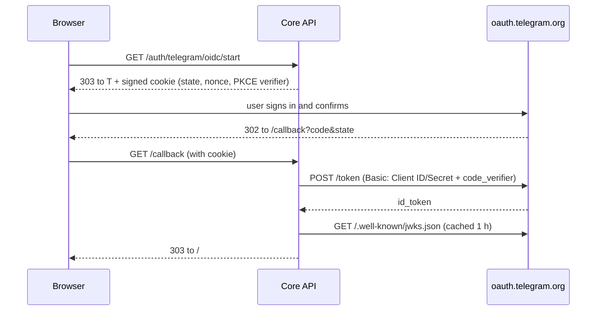
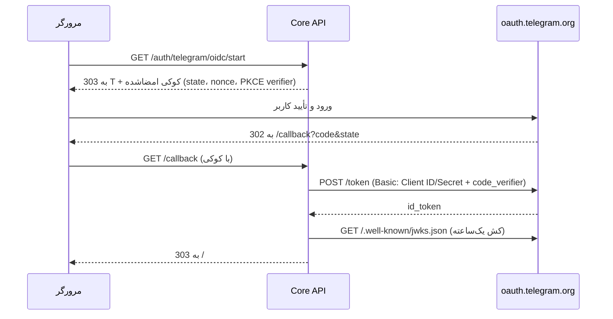
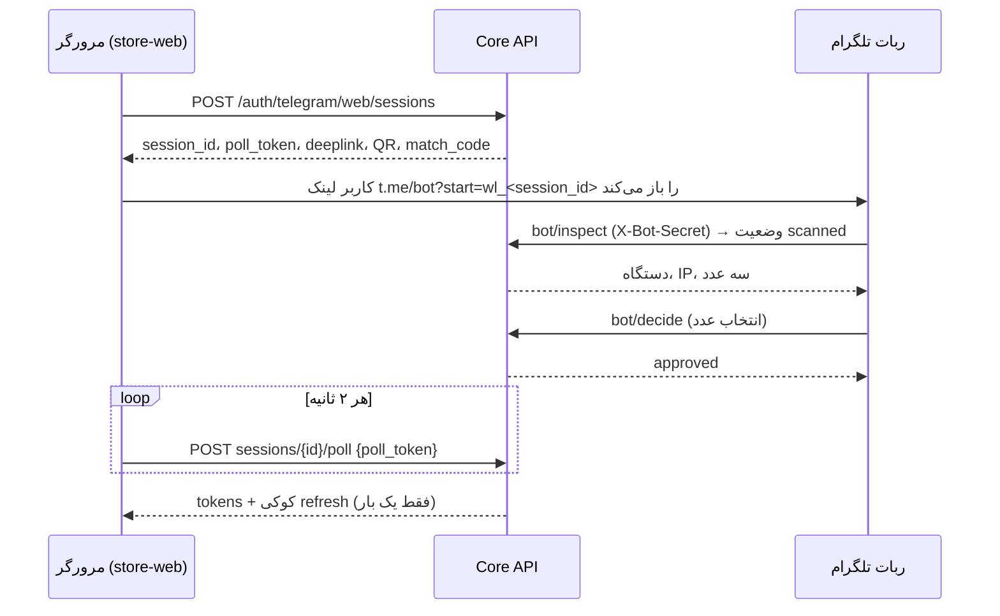

# هویت، حساب و شخص / Identity, Account & Person

> **وضعیت / Status:** مرجع جاری / Current canonical
> **آخرین بازبینی / Last review:** 2026-11-16
> **فهرست / Index:** [00](00-DOCUMENTATION-INDEX.md)

## بخش فارسی

**هدف:** یک انسان، یک حساب مرکزی، یک تجربهٔ کیف پول — با چند روش ورود معتبر.

**مفاهیم.** `Person` مرجع هویت یک انسان است. هر `User` یک حساب عملیاتی است و هر `Identity` (telegram یا google یا email) یک روش ورود است. `Person.central_user_id` حساب مرکزی را مشخص می‌کند؛ اگر کاربر انتخاب نکرد، قدیمی‌ترین حساب انتخاب می‌شود (قاعدهٔ قطعی و قابل ممیزی). حساب‌های قدیمی هرگز حذف نمی‌شوند؛ `Person` ادغام‌شده با `merged_into_id` به مقصد اشاره می‌کند و کیف پول مبدأ با وضعیت `consolidated` و `consolidated_into_id` نگه داشته می‌شود.

**گام اول: اتصال هویت (Linking).** اتصال فقط با اثبات مالکیت هر هویت (ایمیل‌کد، OAuth گوگل، تأیید در ربات) و رضایت صریح کاربر انجام می‌شود؛ یکسان بودن ایمیل کافی نیست. هر Person فقط یک تلگرام فعال دارد و در تعارض، کاربر می‌گوید کدام نگه دارد (`keep_telegram`). قطع اتصال نباید هیچ روش ورود قابل استفاده‌ای باقی نگذارد نکند. ورود با هر روش تأییدشده، نشست جدید برای حساب مرکزی صادر می‌کند و خرید، پرداخت و تمدید از همان حساب انجام می‌شود.

**گام دوم: یکپارچه‌سازی (Consolidation).** پس از تأیید اتصال، همان جریان محصولی بلافاصله preflight را اجرا می‌کند (`linking._continue_with_consolidation`)؛ اگر مانعی نباشد انتقال بدون تأیید دستی ادمین انجام می‌شود (`identity_consolidation_auto_approve` پیش‌فرض روشن؛ دکمهٔ خاموش‌کنندهٔ اضطراری). موانع به صف بررسی ادمین می‌روند: پرداخت معلق، سفارش در جریان، حساب نماینده، بدهی، حساب مدیری. شکست در consolidation هرگز اتصال هویت را برنمی‌گرداند.

**قوانین کیف پول.** هر انتقال یک تراکنش متوازن دفترکل با کلید idempotency است؛ تغییر مستقیم `balance` ممنوع است. جمع قبل و بعد تطبیق داده می‌شود و کیف پول‌ها قفل می‌شوند. هر (Store، Currency) یک استخر مستقل است و هرگز با دیگری جمع نمی‌شود. درخواست‌های جدید موجودی و پرداخت از طریق `wallet.service` به کیف پول مرکزی هدایت می‌شوند (حداکثر چهار هاپ).

**پیشنهاد ورود با حساب قبلی.** اگر حساب مرتبط شناسایی شود، به کاربر پیشنهاد می‌شود با حساب قبلی وارد شود یا «فعلاً نه» بگوید. انتخاب «فعلاً نه» هیچ‌وقت خرید را مسدود نمی‌کند.

**ادمین.** همهٔ رویدادهای اتصال، رضایت، انتخاب حساب مرکزی و انتقال در audit فقط‌افزودنی ثبت می‌شوند؛ صفحهٔ «هویت» تاریخچهٔ موفق/ناموفق را نشان می‌دهد. API: مسیرهای `/identity/link/*`، `/identity/unlink`، `/identity/consolidation` و `/identity/consolidation-status`.

**کد و تست:** `modules/identity/account_linking/{linking,consolidation,persons}.py`، `domain/account_linking.py`، `modules/wallet/service.py`؛ تست‌ها: `tests/service/test_account_linking_service.py`، `tests/http/test_identity_consolidation_http.py`.

**احراز مجدد برای تغییرهای حساس (قطع روش ورود):** هر حساب همان عاملی را اثبات می‌کند که واقعاً دارد، از قوی به ضعیف: `password` (رمز فعلی) ← `email_code` (کد ایمیل) ← `google` (توکن تازهٔ Google که به nonce همان مرورگر بسته است و باید متعلق به یکی از Googleهای همان Person باشد) ← `telegram_code` (کد یک‌بارمصرفی که ربات به تلگرام فعالِ Person می‌فرستد) ← `session` (فقط وقتی هیچ عامل دیگری وجود ندارد). کدها مخصوص همان کاربر و یک‌بارمصرف‌اند و تلگرام لغوشده هرگز کد دریافت نمی‌کند. محافظ «آخرین روش ورود» پس از اثبات هم همچنان اعمال می‌شود. کد: `modules/identity/account_linking/reauth.py`؛ تست: `tests/http/test_identity_reauth_strong_http.py`.

## English section

**Purpose:** one human, one central account, one wallet experience — with several valid sign-in methods.

**Concepts.** `Person` is the identity of one human. Each `User` is an operational account and each `Identity` (telegram, google or email) is a sign-in method. `Person.central_user_id` names the central account; when the user makes no choice the oldest account is picked (a fixed, auditable rule). Old accounts are never deleted: a merged `Person` points to its target through `merged_into_id`, and source wallets are kept with status `consolidated` and `consolidated_into_id`.

**Step one: identity linking.** Linking happens only after proof of ownership of every identity (email code, Google OAuth, confirmation in the bot) and explicit user consent; an equal email address is not enough. A Person has at most one active Telegram and, on conflict, the user states which to keep (`keep_telegram`). Unlinking must leave at least one other usable sign-in. Signing in with any verified method issues a new session for the central account, and purchases, payments and renewals run from it.

**Step two: consolidation.** After a link is confirmed, the same product flow runs the preflight immediately (`linking._continue_with_consolidation`). When it is clean, the transfer completes without a manual admin approval (`identity_consolidation_auto_approve`, on by default; the switch is an emergency kill-switch). Blockers go to the admin review queue: pending payment, in-flight order, reseller account, debt, admin account. A consolidation failure never undoes the identity link.

**Wallet rules.** Every transfer is a balanced ledger transaction with an idempotency key; directly changing `balance` is forbidden. Before/after totals are reconciled and wallets are locked. Each (Store, Currency) is its own pool and is never summed with another. New balance and payment requests are routed to the central wallet through `wallet.service` (at most four hops).

**"Sign in with your previous account" offer.** If a related account is detected, the user is offered to sign in with it or to answer "not now". "Not now" never blocks a purchase.

**Admin.** Link, consent, central-account choice and transfer events are written to an append-only audit; the Identity screen shows successful and failed operations. API: `/identity/link/*`, `/identity/unlink`, `/identity/consolidation`, `/identity/consolidation-status`.

**Code and tests:** `modules/identity/account_linking/{linking,consolidation,persons}.py`, `domain/account_linking.py`, `modules/wallet/service.py`; tests: `tests/service/test_account_linking_service.py`, `tests/http/test_identity_consolidation_http.py`.

**Re-authentication for sensitive changes (unlinking a sign-in method):** each account proves the strongest factor it really owns: `password` (current password) -> `email_code` -> `google` (a fresh Google ID token bound to this browser's nonce and belonging to one of the person's own Google logins) -> `telegram_code` (a single-use code the bot sends to the person's active Telegram) -> `session` (only when no other factor exists). Codes are bound to the user and single use, and a revoked Telegram never receives one. The "last sign-in method" guard still applies after the proof. Code: `modules/identity/account_linking/reauth.py`; tests: `tests/http/test_identity_reauth_strong_http.py`.

## مواد ادغام‌شده / Merged source material

> متن اصلی اسناد قبلی بدون حذف محتوا در این بخش حفظ شده است (هر متن به زبان اصلی خود). / Original text of the previous documents, preserved without dropping content (each in its original language).

### منبع / Source: `08-IDENTITY-ACCOUNT-PERSON.md`

#### 23 — Automatic identity verification (website login through the Telegram bot)

Goal: the identity check of a returning visitor needs **no manual step** whenever it is safe to skip one, and the
manual step that remains is exactly the number-match confirmation of `08-IDENTITY-ACCOUNT-PERSON.md`.

##### Three levels, decided by the server

| level    | when                                                                                   | what the visitor does                         |
|----------|----------------------------------------------------------------------------------------|-----------------------------------------------|
| `silent` | known browser **and** same network (/24 IPv4, /48 IPv6) **and** same browser/OS family **and** seen within the silent window | nothing: signed in when the page opens        |
| `auto`   | known browser, any network, inside the trust window                                    | opens the bot link; that is the whole approval |
| `manual` | unknown / expired / revoked browser                                                    | number match in the bot (unchanged)           |

A manual approval is what *earns* trust (`remember`, default on). Trust is per store and per Telegram account.

##### The device key
* Minted by the **server** (`secrets.token_urlsafe(32)`) and kept by the browser in the **HttpOnly** cookie `melorin_dk`
  (`Secure` outside development, `SameSite=Lax`, path `/api/v1/auth/telegram/web`). Page scripts and any XSS cannot read it,
  and the storefront stores nothing in `localStorage`/`sessionStorage`.
* The database stores only `SHA-256("trusted-device:" + key)` (`trusted_devices.key_hash`, unique).
* A relayed phishing link cannot reach `auto`/`silent`: the attacker's browser does not hold a key the victim approved.
* A device key replayed from a different browser/OS family (e.g. Chrome key used by Firefox) never gets `silent`; it gets `auto`, and the owner's approval refreshes the stored label.
* A key approved for one account is never re-bound to another (`device_account_mismatch`).

##### Account rules are shared
`web._complete` is the single approval point for both paths, so disabled accounts, closed registration and the
"admins use the admin panel" rule apply identically to automatic and manual verification. A silent attempt for an account that is
no longer eligible revokes the device and falls back to the manual path (which explains the refusal).

##### Owner control
* Every automatic login sends the owner a Telegram notice (deduplicated per device per day).
* `/devices` in the bot lists trusted browsers; each can be removed; **"this was not me"** revokes all devices of that Telegram
  account in that store **and** its web refresh tokens at once.
* The browser can drop its own trust with `POST /auth/telegram/web/devices/forget` (cookie is the proof).
* Limits: at most 10 live devices per account (oldest make room), sliding expiry, rate-limited endpoints, audit events on every step.

##### Identity-link conflicts settle themselves
The same verified identity (e-mail, Google, Telegram) on two accounts used to wait in the admin review queue. Now
`modules/identity/auto_link.py` decides with the pure rule in `domain/identity_auto_link.py`:

| situation | result |
|---|---|
| one account is an **empty shell** (no orders, payments, VPN accounts, tickets, referral, store, non-zero wallet or ledger history, no password, no 2FA, not admin) | the shell is folded into the other account: identities, e-mail, trusted devices and store memberships move, its sessions end, it is deactivated and archived (never deleted) |
| both are shells | the older account lives on |
| **both hold records**, either is inactive or an admin, or several candidates | never merged: stays in the admin queue (`/admin/identity-link-reviews`) |

* "Empty shell" is decided from the **schema itself** (every foreign key to `users.id` outside a short disposable list), so a
  table added later protects its rows without anyone updating a list.
* Proof of ownership comes from the flow that raised the conflict (e-mail code, verified Google token, bot link code).
* From a shell's own session the merge ends that session and the API answers `IDENTITY_MERGED` (409): sign in again.
* Audit: `identity.auto_merged` (audit log) and `identity_auto_merged` (security event); the review row stays with status
  `linked`, no resolver and note `auto:<rule>`.
* `identity_auto_link_job` (worker, every 10 minutes) settles reviews that became safe after they were queued.
* Switch: `IDENTITY_AUTO_LINK` (default `true`; `false` = every conflict waits for an admin).

##### Reseller applications verify themselves
A reseller application brings two identifiers (store domain, Telegram bot). Both are now proven by Core on a schedule
(`modules/reseller/auto_verify.py`), so the admin only decides *whether* to approve, never *whether the data is real*.

| check | how | retry |
|---|---|---|
| bot | `getMe` with the stored token; a Telegram outage no longer leaves the bot "unverified" for an admin to click | back-off 2 min, 5 min, 15 min, 1 h, then every 6 h |
| domain control | DNS TXT `_melorin-verify.<domain>` = `melorin-verify=<code>` **or** file `https://<domain>/.well-known/melorin-verify.txt` with the same content | same schedule; applicant can press "verify now" (6 per 5 min) |

* `<code>` is `HMAC(jwt_secret, application id + domain)`: nothing extra is stored, a code from another application or
  another domain never matches, and the applicant reads it from `GET /reseller/applications/{id}/verification`.
* DNS is read through DNS-over-HTTPS (no new dependency); the HTTP proof refuses hosts that resolve to private/loopback
  addresses (SSRF) and never follows redirects. Both only read.
* When bot **and** domain are proven, admins get one notification ("ready to decide") and the audit log records
  `reseller.application_auto_verified`. The admin list shows `domain_verified`, `auto_verified`, `verify_error`, `verify_next_at`.
* Retry window: `RESELLER_VERIFY_WINDOW_DAYS` (default 7) after filing; "verify now" opens a fresh window.
* Switches: `RESELLER_AUTO_VERIFY` (default `true`), `RESELLER_REQUIRE_DOMAIN_PROOF` (default `false`; `true` = approval of an
  application whose domain is not proven is refused with `DOMAIN_PROOF_REQUIRED`).
* Worker job `reseller_auto_verify_job` (every 2 minutes); migration `0034`.
* Tests: `apps/api/tests/test_identify_reseller_auto_verify.py`.

##### Reseller approval can be automatic (opt-in)
`modules/reseller/auto_approve.py`. When bot **and** domain are proven, the only open question left for an admin is "do we want
this reseller at all". An operator who has decided that in advance sets `RESELLER_AUTO_APPROVE=true` (**default `false`**: it grants a store)
and the application approves itself through the same `create_reseller_store` code as the manual path.

| guard rail (any miss = stays for an admin, nothing is ever rejected automatically) | |
|---|---|
| status `pending`, details present, bot **and** domain verified | |
| applicant active, not guest, not admin, account older than `RESELLER_AUTO_APPROVE_MIN_ACCOUNT_DAYS` (7) | |
| target store active, applicant still an active member, no reseller store for that pair yet | |
| domain and bot still free (`ensure_identity_free`, same as manual) | |
| debt limit is the fixed `RESELLER_AUTO_APPROVE_DEBT_LIMIT` (default 0: the reseller pays before it sells) | |

All-or-nothing (savepoint). Audit `reseller.application_auto_approved` (actor `system`), `review_reason = auto:fully_proven`,
`auto_approved = true` in the admin list; the owner gets the usual approval notice and admins get "approved automatically".

##### Approved resellers keep proving who they are
`modules/reseller/recheck.py`, worker `reseller_identity_recheck_job` (every 30 min; each store is due every `RESELLER_RECHECK_HOURS`, 24).
Re-checks (only reads): the DNS/well-known domain proof is still there (when it was proven), and the store's bot token is still accepted by
Telegram **and** is still the same bot.

| round result | effect |
|---|---|
| all good | failures reset; if the identity was lost, admins are told it recovered |
| failed round 1 | owner gets a warning; retry in 6 h (one DNS hiccup proves nothing) |
| `RESELLER_RECHECK_FAIL_LIMIT` (3) consecutive failed rounds | `identity_lost_at` set, audit `reseller.identity_lost`, admins and owner notified; store suspended **only if** `RESELLER_RECHECK_SUSPEND=true` (default `false`) |
| Telegram unreachable | neutral: no failure, retry in 1 h |

Recovery never un-suspends a store by itself; that stays an admin decision. Suspended stores are not re-checked. Migration `0035`
also schedules the first re-check of already-approved stores that proved their domain.
Admin list fields: `auto_approved`, `recheck_failures`, `recheck_error`, `recheck_next_at`, `identity_lost`.
Switches: `RESELLER_AUTO_APPROVE`, `RESELLER_AUTO_APPROVE_DEBT_LIMIT`, `RESELLER_AUTO_APPROVE_MIN_ACCOUNT_DAYS`, `RESELLER_RECHECK`,
`RESELLER_RECHECK_HOURS`, `RESELLER_RECHECK_FAIL_LIMIT`, `RESELLER_RECHECK_SUSPEND`. Tests: `apps/api/tests/test_identify_reseller_lifecycle.py`.

##### Admin screen «هویت» (one screen, three tabs)
Panel → سیستم → «هویت» (`apps/admin-web/src/IdentityHubView.jsx`; deep link `#/identity?tab=review|auto|devices`, the old
`#/identity-auto` bookmark opens the devices tab). It replaces the two former menu entries «بررسی هویت» and «هویت خودکار», which
overlapped: conflicts Core settled itself were visible in both.

| tab | content | who acts |
|---|---|---|
| **نیاز به بررسی** | the manual queue (`IdentityReviewsView`, `/admin/identity-link-reviews`): conflicts Core could not settle. The tab shows the number of open ones | an admin decides |
| **انجام‌شده خودکار** | automatic merges (read-only report, see below) | nobody |
| **دستگاه‌های مورداعتماد** | trusted browsers, revoke one / the whole account (see below) | an admin may revoke |

Rows settled by Core (`resolution_note` starting with `auto:`) carry `auto: true` in `GET /admin/identity-link-reviews` and are
hidden from the manual queue (also from its «متصل شده» / «همه» counters); they appear only in «انجام‌شده خودکار».
`IdentityAutoView` is reused by the hub with `section="merges"` / `section="devices"`. Backing code: `modules/admin/identity_auto.py`:

* **Trusted devices** (`GET /admin/trusted-devices?status=active|expired|revoked|all&q=&store_id=`): owner, store, browser label,
  Telegram id, last network, uses, last seen, expiry. Search by name, e-mail, label or Telegram id. The device key and its hash
  are never returned.
* **Revoke**: one device (`POST /admin/trusted-devices/{id}/revoke`) or every live device of one account
  (`POST /admin/trusted-devices/revoke-account`). The next login from those browsers needs the manual number match again.
  The account's web sessions are not touched (the owner's own "this was not me" in the bot also ends them). Both are audited
  (`trusted_device.revoked_by_admin`, `trusted_device.account_revoked_by_admin`).
* **Automatic merges** (`GET /admin/identity-auto-merges?days=`): read from `identity.auto_merged` audit events, with a card of the
  kept account and of the archived empty shell, the rule and the providers moved.
* **Summary** (`GET /admin/trusted-devices/summary`): live devices, accounts with devices, revoked devices, merges in 30 days.
* Tests: `apps/api/tests/test_identify_admin_overview.py`, `apps/admin-web/tests/identity-auto.test.jsx`.

##### Settings
`TELEGRAM_WEB_LOGIN_TRUST_DAYS` (default 60, `0` turns automatic verification off) and `TELEGRAM_WEB_LOGIN_SILENT_DAYS`
(default 14, `0` disables only the silent level).

##### Housekeeping
`telegram_login_gc_job` (`web.purge_old`) removes finished login sessions a day after expiry and trusted devices 30 days after
they expired or were revoked.

##### Tests
`apps/api/tests/test_identify_trusted_devices.py` (levels, per-store isolation, anti-phishing, revocation, cap, purge, cookie over HTTP),
`test_identify_auto_link.py` (merge rule, shell detection, flows, sweep, worker job), `test_p01_telegram_web_login*.py` (flow and bot side).

### منبع / Source: `08-IDENTITY-ACCOUNT-PERSON.md`

#### اتصال کانال به فروشگاه (Channel Binding)

> وضعیت: پیاده‌سازی‌شده روی `feat/channel-binding` (بالای `main` پس از ادغام ایزوله‌سازی). همه‌ی منطق در Core است؛ سایت و ربات فقط می‌فرستند و نمایش می‌دهند.
> پیش‌نیاز: `05-SYSTEM-ARCHITECTURE.md` (StoreScope). این سند «کاربر در کدام فروشگاه است» را قطعی می‌کند؛ StoreScope می‌گوید «در آن فروشگاه چه چیزی می‌بیند».

##### ۱. مسئله
پس از ایزوله‌سازی، هر مسیر مشتری زیر `/stores/{store_id}/…` است، ولی توکن ورود **سراسری** بود و `store_id` از **مسیر** می‌آمد. پس:
1. توکنِ ورود روی سایت A روی `/stores/B/…` هم کار می‌کرد (کاربر فنی، توکن لورفته، اشکال در یک کانال) و عضویت در B هم **خودکار** ساخته می‌شد.
2. ثبت‌نام و رفرال از سایت نماینده به فروشگاه اصلی نسبت داده می‌شد (سایت `store_id` نمی‌فرستاد).
3. ورود Mini App با توکن ربات اصلی برای هر `store_id` معتبر بود.
4. ورود با کد ایمیل و ورود از ربات برای حساب ادمین، توکن «ادمین» می‌داد (بدون TOTP).
5. مسیرهای `/tickets/{id}`، `/me/referrals`، `/me/stores` به فروشگاه نشست وابسته نبودند.

##### ۲. قانون
1. هر نشست از راه یک **کانال** باز می‌شود: `site` (وب‌سایت یک فروشگاه)، `bot` (ربات یک فروشگاه) یا `admin` (پنل ادمین). کانال چهارم، `api`، **کلید API نماینده** است: نشست و توکن ندارد ولی همین قانون را دارد (بند ۳-ب).
2. نشستِ `site`/`bot` به **دقیقاً یک فروشگاه** بسته است و Core خودش آن را تشخیص می‌دهد؛ کلاینت انتخاب نمی‌کند.
3. توکن فقط در همان فروشگاه کار می‌کند. فروشگاه دیگر ← `403 CHANNEL_MISMATCH` **پیش از هر کوئری** (برای شناسه‌ی موجود و ناموجود یکسان؛ عضویتِ ناخواسته هم ساخته نمی‌شود).
4. نشست `admin` فقط از ورود رمز+TOTP (یا Google+TOTP) پنل ادمین ساخته می‌شود و همه‌جا معتبر است. حساب ادمین از راه سایت/ربات/کد ایمیل فقط نشست **مشتری** می‌گیرد یا (کد ایمیل/ربات) `ADMIN_USE_PANEL` می‌خورد.
5. refresh همان کانال و همان فروشگاه را دوباره صادر می‌کند؛ نمی‌شود نشست را به فروشگاه دیگر برد.

##### ۳. چطور کانال تشخیص داده می‌شود (`core/channel.py`)
| کانال | منبع حقیقت | بررسی‌ها |
|---|---|---|
| `site` | هاست مؤثر درخواست (`X-Forwarded-Host` فقط از proxy مورد اعتماد) | باید `Store.domain` یک فروشگاه یا هاست‌های فروشگاه اصلی (`store_web_url`/`public_api_url`/`domain`) باشد؛ هاست ناشناس ← `CHANNEL_UNKNOWN` (در development به main/`hint` برمی‌گردد). `store_id`ی که کلاینت می‌فرستد فقط می‌تواند با هاست **هم‌خوان** باشد. |
| `bot` | secret رانر + فروشگاهی که نام می‌برد | فروشگاه فعال، ربات روشن، و نوعِ رانر مجاز (`main`/`reseller`/`any`). Mini App: فروشگاهی که **همان توکن ربات** را دارد (بدون fallback به توکن ربات اصلی). |
| `admin` | `ADMIN_CHANNEL`، فقط در دو handler رمز+TOTP/Google+TOTP | — |
| `api` | خودِ **کلید** (`X-API-Key`)؛ فروشگاهِ کلید هنگام ساخت ثابت می‌شود | `core.channel.api_channel` (ترتیب بررسی در بند ۳-ب) |

###### ۳-ب. کانال `api` (کلید API نماینده)
کلید، نه URL، فروشگاه را تعیین می‌کند؛ `store_id` مسیر فقط می‌تواند با آن **هم‌خوان** باشد و این مقایسه **پیش از خواندن هر سطر فروشگاه** انجام می‌شود (شناسه‌ی موجود و ناموجود یک پاسخ می‌گیرند؛ مثل `ensure_store`). ترتیب بررسی‌ها، همه در `core.channel.api_channel`:
1. کلید وجود دارد، `active` است و منقضی نشده ← وگرنه `401 API_UNAUTHORIZED`
2. فروشگاهِ کلید = `store_id` مسیر ← وگرنه `403 API_STORE_ISOLATION` (همان کد قبلی؛ قرارداد عمومی API حفظ شده)
3. IP مبدأ داخل `ip_allowlist` کلید (اگر تنظیم شده) ← وگرنه `403 API_IP_FORBIDDEN`؛ IPِ ناشناخته **رد** می‌شود (fail-closed)
4. scope لازمِ مسیر در کلید هست ← وگرنه `403 API_SCOPE_FORBIDDEN`
5. فروشگاه از نوع `reseller`، `api_enabled` روشن و `active` است ← وگرنه `403 API_DISABLED` / `403 STORE_SUSPENDED`

مسیرها فقط scope می‌خواهند: `Depends(api_access("catalog:read"))` (در `core/deps.py`) که `StoreContext` مالک را می‌دهد (مالکِ غیرفعال ← `API_DISABLED`). `SessionClaims` همچنان `chn=api` را رد می‌کند؛ کانال `api` هرگز در توکن نمی‌نشیند. نگهبان‌های `test_channel_binding` حالا مسیرهای `/reseller-api` را «عمومی» نمی‌شمارند و وجود `api_store_context` روی هرکدام را اجبار می‌کنند. پس از پذیرفته‌شدن درخواست، `last_used_at` کلید ذخیره (commit) می‌شود، حداکثر یک‌بار در دقیقه برای هر کلید (نشست درخواست هر چیز commit‌نشده را rollback می‌کند و بیشتر مسیرهای API فقط می‌خوانند). متریک: `melorin_channel_rejected_total{reason=api_key_unknown|api_key_inactive|api_store_mismatch|api_ip|api_scope|api_disabled|api_store_suspended}`.

توکن دسترسی: `chn` و `sid` (`adm` برای سازگاری می‌ماند). توکن بدون اتصال معتبر ← `401 SESSION_UNBOUND`. refresh-token: ستون‌های `channel`/`store_id` (migration `0027`)؛ خانواده‌ی قدیمی (NULL) در rotate رد می‌شود و کاربر یک بار دوباره وارد می‌شود (پروژه هنوز release نشده).

##### ۴. قاعده‌ی هر لایه
| لایه | وابستگی | قاعده |
|---|---|---|
| مشتری `/stores/{id}/…` | `StoreCtx` ← `ensure_store` | `sid == path` یا نشست admin |
| مالک نماینده | `OwnerCtx` ← `ensure_owner_store` | کانال خودِ آن فروشگاه، **یا** فروشگاه اصلی به‌عنوان hub ولی فقط برای فروشگاهی که کاربر واقعاً مالکش است |
| API نماینده `/reseller-api/v1/stores/{id}/…` | `api_access(scope)` ← `api_channel` | کلیدِ همان فروشگاه + IP + scope + فروشگاه فعال با API روشن |
| ادمین `/admin/*` | `AdminUser` ← `require_admin_session` | کاربر ادمین **و** نشست کانال admin (+TOTP، IP) |
| `/me/stores` | `CurrentAuth` | فروشگاه‌ها: فقط همان فروشگاه؛ main: خودش + فروشگاه‌های تحت مالکیت؛ admin: همه |
| `/tickets/{id}`، `/me/referrals` | `CurrentAuth` | فقط سطرهای همان فروشگاه نشست؛ staff فقط با نشست admin |
| درخواست نمایندگی | `main_session_user` | فقط نشست کانال فروشگاه اصلی |
| handoff ربات ← سایت | `create_web_handoff(store)` | توکن فقط روی دامنه‌ی همان فروشگاه کار می‌کند؛ بدنه‌ی `store_id` فقط می‌تواند با نشست هم‌خوان باشد |
| ورود با تلگرام از وب (device flow / OIDC) | `site_channel(hint)` | شروع و poll/callback هر دو روی هاست همان فروشگاه |

###### رانرها (حداقل دسترسی)
`MELORIN_BOT_SERVICE_SECRET` برای هر دو رانر کار می‌کند (سازگار). اختیاری: `MELORIN_MAIN_BOT_SECRET` و `MELORIN_RESELLER_BOT_SECRET` (≥۳۲ نویسه، متفاوت از هم و از secret مشترک). رانر `main` فقط در فروشگاه اصلی نشست می‌سازد؛ رانر `reseller` فقط در نمایندگی‌ها و فقط او `GET /internal/reseller-bots` (توکن رمزگشایی‌شده‌ی ربات‌ها) را می‌خواند. وقتی هر دو تنظیم باشند Core secret مشترک را بازنشسته می‌کند و کانتینر هر رانر فقط secret خودش را دارد (docs/17، R06).

##### ۵. تغییرات
* **کانال `api` (T03):** `core/channel.py` (`API`، `ApiAccess`، `api_channel`)، `core/deps.py` (`api_access`)، `core/proxy.py` (`ip_in_networks`)، `reseller/api_keys.py` (`authenticate` حذف شد؛ `hash_key` عمومی)، `reseller/router.py` (`_api_ctx` حذف شد). بدون migration و بدون تغییر در کدهای خطا یا مسیرها.
* **Core:** `core/channel.py` (جدید)، `core/deps.py` (`AuthSession`، `store_context`، `owner_store_context`، `require_admin_session`، `BotAuth`)، `core/security.py`، `identity/{router,service,models,schemas,telegram_web*,telegram_oidc_router}`، `tickets/router`، `referral/router`، `reseller/{router,bots}`، migration `0027_channel_binding`.
* **ربات اصلی:** `/link` علاوه بر کد، `store_id` ربات را می‌فرستد.
* **سایت/ادمین‌وب:** بدون تغییر؛ سایت از قبل `credentials: include` و refresh با کوکی دارد و Host را مرورگر می‌فرستد.
* **زیرساخت:** reverse proxy باید `Host` اصلی (یا `X-Forwarded-Host`) را به API برساند. Caddy و nginx موجود این کار را می‌کنند؛ دامنه‌ی هر نماینده باید در `Store.domain` ثبت شده باشد (همان شرط صدور TLS).
* **خطاهای تازه:** `SESSION_UNBOUND` (401)، `CHANNEL_MISMATCH`، `CHANNEL_UNKNOWN`، `CHANNEL_FORBIDDEN`، `CHANNEL_DISABLED` (403)؛ متریک `melorin_channel_rejected_total{reason}`.

##### ۶. تست‌ها
* `tests/test_channel_binding.py` (۲۷ تست): claimها و رد توکن بی‌اتصال/قدیمی/ادمینِ تنزل‌یافته؛ Host (`X-Forwarded-Host` فقط از proxy مورد اعتماد، هاست ناشناس، hint ناهم‌خوان)؛ نوع رانر و secretها؛ رد نشست A روی B پیش از کوئری و بی‌عضویت‌سازی؛ ادمین/مشتری؛ hub مالک؛ issue/rotate/handoff؛ و **نگهبان‌ها**: فهرست دقیقِ مسیرهای بدون نشست (مسیر جدید باز بدون بازبینی شکست می‌خورد)، هر مسیر `{store_id}` با وابستگی کانال، هر مسیر ادمین با `require_admin_session`، و `issue_tokens` فقط با کانال.
* `tests/test_api_key_channel.py` (کانال `api`): اتصال کلید به فروشگاهش، رد کلید A روی B (برای فروشگاه موجود و ناموجود یکسان)، کلید نامعتبر/غیرفعال/ابطال‌شده/منقضی، چرخش کلید، scope، IP allowlist (fail-closed و تقدم بر scope)، API خاموش، فروشگاه معلق، مالک غیرفعال، و نگهبان: هر مسیر `/reseller-api` باید `api_store_context` داشته باشد.
* ۱۸ تست قدیمی با امضای جدید به‌روز شد؛ `tests/_chan.py` ابزار مشترک است.
* `scripts/e2e_smoke.py`: توکن مشتری روی فروشگاه دیگر ← ۴۰۳، `/me/stores` فقط فروشگاه خودش، ادمین با کد ایمیل ← `ADMIN_USE_PANEL`.
* نگهبان قدیمی `test_r01_store_isolation::_customer_routes` روی `app.routes` می‌گشت که در FastAPI فعلی `_IncludedRouter` است و مسیری نمی‌دید؛ نگهبان تازه از روترهای اصلی پیمایش می‌کند.

##### ۷. انتشار
* پنجره‌ی ناسازگاری: همه‌ی کاربران یک بار دوباره وارد می‌شوند (توکن‌های قدیمی `SESSION_UNBOUND`). ربات‌ها هر پیام را دوباره login می‌کنند و بی‌اثر است. هم‌زمان deploy شود: API، ربات‌ها (برای `store_id` در `/link`)، سایت.
* بازگشت: `git revert` + `alembic downgrade 0026_merge_reseller_credit` (دو ستون nullable حذف می‌شود).
* قبل از deploy: دامنه‌ی تک‌تک نمایندگان در `Store.domain` درست باشد وگرنه ورود از آن سایت `CHANNEL_UNKNOWN` می‌دهد.

##### ۸. باقی‌مانده
* بررسی کوپن (سقف استفاده‌ی هر کاربر) و ثبت رفرال (`attach`) از نظر هم‌پوشانی فروشگاه‌ها (تیکت و `/me/referrals` در این پچ بسته شد).
* (انجام شد در R06 - docs/17) secretهای جدای رانرها در compose/installer/update.
* (انجام شد در T03) اتصال کانال به کلید API نماینده.
* (انجام شد در T54) `rate_limit_per_minute` کلید با `core.ratelimit.hit` اعمال می‌شود، مگر آنکه `MELORIN_ENFORCE_API_KEY_RATE_LIMIT=false` باشد (پیش‌فرض روشن؛ SEC-001). هنگام قطع Redis در staging/production همان سیاست `core.ratelimit` (رد با 429) گرفته می‌شود؛ پاسخ: `API_RATE_LIMITED` (429).

##### Site switch per store (`stores.site_enabled`)

- Reseller stores are created with the **website off and the bot on**; an admin turns the site on per reseller (Admin panel → Resellers → "وب‌سایت فروشگاه روشن باشد", or `PATCH /admin/resellers/{id}` with `site_enabled`).
- The Main Store always serves both channels; `site_enabled` is ignored for it.
- With the site off, `site_channel` answers `CHANNEL_DISABLED` (403), `/stores/by-domain/{domain}` returns 404 and the Caddy TLS gate refuses a certificate for the domain. The bot, the owner's API key and the admin panel are unaffected.
- Migration `0038_store_site_enabled` switches the site off for already existing reseller stores.

### منبع / Source: `08-IDENTITY-ACCOUNT-PERSON.md`

#### Telegram login setup / راه‌اندازی ورود با تلگرام

Two sections: **English** first, then **فارسی** (same content).

##### English — Telegram login setup (Admin panel → Settings → Telegram login)

Status: implemented · no new migration · code: `apps/api/melorin/channels/telegram/oidc*.py`, `apps/api/melorin/modules/admin/integrations.py`, `apps/admin-web/src/TelegramLoginSettings.jsx`

###### Two methods, one account

| | Method 1 — approve in the bot | Method 2 — direct login (OpenID Connect) |
|---|---|---|
| Customer experience | site → Telegram bot → pick a number → back | site → Telegram's official page → "Confirm" → back |
| Data needed from BotFather | **none** | Client ID + Client Secret |
| Phishing resistance | number matching + device/IP shown + "that was not me" | Telegram's consent screen + PKCE + state |
| Customer browser needs | only the Telegram app | reach `oauth.telegram.org` |
| Technical doc | `docs/08-IDENTITY-ACCOUNT-PERSON.md` | this document |

Both identify the customer by the **numeric Telegram ID** (`Identity(provider="telegram")`), so someone created through the bot or the Mini App signs in to the **same account** with either method. **Admins cannot sign in with Telegram** (`admin_use_panel`); they use password + TOTP.

With no configuration (an existing install after upgrading) the previous behaviour is kept: method 1 on, method 2 off, lifetime and number matching from `.env`. As soon as an admin saves in the panel, the panel value wins.

###### Step by step

####### Method 1 — approve in the bot
1. Admin panel → **Settings** → "Login with Telegram" card.
2. Turn on the master switch, "Customer login" and "Method 1".
3. (Optional) keep number matching on and set the request lifetime (60–600 s).
4. **Save** → **Test connection** (works on the saved values: checks the main bot token with `getMe`, compares the username with the store, and fails when the store has no bot username - without it no login link can be built).

####### Method 2 — direct login
1. In Telegram open the [BotFather mini app](https://t.me/botfather?startapp) → pick the bot → **Bot Settings → Web Login** (older name: *Login Widget*) → **OpenID Connect**.
2. Under **Allowed URLs** register every URL the panel card lists (one per row, https, no trailing slash):
   - the store origin, e.g. `https://shop.example.com`
   - the callback, e.g. `https://shop.example.com/api/v1/auth/telegram/oidc/callback`
   - for each active reseller with its own domain, that origin and callback too (the panel lists them).
3. Copy the **Client ID** (a number = the bot ID = the part of the bot token before ":") and the **Client Secret**.
4. Keep the **signing algorithm** at `RS256` (default) or `ES256`. `EdDSA`/`ES256K` only allow the bare `openid` scope and return no user ID, so login cannot work with them.
5. In the panel turn on "Method 2", paste Client ID and Secret → **Save** → **Test connection**. The test also checks the store URL: it must be a public https address (not localhost) and the callback URL it shows must be registered in BotFather.
6. In a private window try store → "Log in" → "Direct login with Telegram".

> Melorin requests only `openid profile` (ID, name, username). It does **not** ask for the phone number or permission for the bot to message the user.

###### Technical flow (method 2)

Security rules (all covered by `apps/api/tests/test_r01_telegram_login_settings.py`):

- `state`, `nonce` and the PKCE verifier live in a signed (HS256), HttpOnly, `SameSite=Lax`, 10-minute cookie; no database row is created. The cookie is cleared after every outcome. If `state` differs from the cookie the code is never exchanged and a `tg_oidc_state_mismatch` security event is recorded.
- The `id_token` signature is verified against Telegram's JWKS; only `RS256`/`ES256` are accepted (no algorithm confusion); `iss`, `aud` (= Client ID), `exp`, `iat` are required and, when Telegram echoes a `nonce`, it must match.
- The account key is the `id` claim (the real Telegram user ID), not `sub`; without `id` the login is refused so no duplicate accounts appear.
- The **Client Secret** is Fernet-encrypted, used server-side only and never returned to the browser or written to the audit log.
- Admins, disabled accounts, closed registration (new accounts only) and the emergency `bot` flag behave exactly like method 1.
- Responses are `Cache-Control: no-store`; no token ever appears in a URL (the session is handed over by the refresh cookie and `POST /auth/refresh`).

###### API

| Route | Caller | Notes |
|---|---|---|
| `GET /api/v1/auth/telegram/config` | storefront (public) | `{bot_login, oidc_login}`; no Client ID/Secret |
| `GET /api/v1/auth/telegram/oidc/start?store_id=` | browser | redirect to Telegram; 20/min rate limit |
| `GET /api/v1/auth/telegram/oidc/callback` | Telegram → browser | code exchange, session; 30/min rate limit |
| `GET /api/v1/admin/integrations` | admin | `telegram` key (no secret, `client_secret_set` flag) |
| `PUT /api/v1/admin/integrations/telegram` | admin | save; `client_secret`: omitted/null = keep, `""` = clear |
| `POST /api/v1/admin/integrations/telegram/test` | admin | Discovery, JWKS, Client ID, credentials, `getMe` |

Storage: `SystemSetting` key `integration.telegram_login` (like Google/SMTP/S3; hidden from the generic `/admin/settings`).

###### Error codes (`/?tg_error=…` on the storefront)

| Code | Meaning |
|---|---|
| `user_denied` | the user declined in Telegram |
| `session_expired` | flow cookie missing/expired (over 10 min, cookies blocked, different host) |
| `origin_mismatch` | the visited host differs from `MELORIN_STORE_WEB_URL` / the reseller domain |
| `unavailable` | method off or incomplete, store inactive, or emergency `bot` flag |
| `failed` | bad state, wrong Secret, invalid token, or missing `id` |
| `unreachable` | the server could not reach Telegram |
| `registration_closed` / `account_disabled` / `admin_use_panel` | account rules (same as method 1) |

###### Upgrade and rollback

1. Apply the patch; **no migration** (one `SystemSetting` row is created on first save).
2. Restart `api` and `telegram_main`; rebuild `store_web` and `admin_web`.
3. Caddy/CSP is unchanged (the flow is pure redirects; no third-party script is loaded).
4. Rollback: revert the patch. The setting row is harmless and ignored.

##### فارسی — راه‌اندازی ورود با تلگرام (پنل ادمین ← تنظیمات ← ورود با تلگرام)

وضعیت: پیاده‌سازی‌شده · بدون migration جدید · کد: `apps/api/melorin/channels/telegram/oidc*.py`، `apps/api/melorin/modules/admin/integrations.py`، `apps/admin-web/src/TelegramLoginSettings.jsx`

###### دو روش، یک حساب

| | روش ۱ — تأیید در ربات | روش ۲ — ورود مستقیم (OpenID Connect) |
|---|---|---|
| تجربهٔ مشتری | سایت ← ربات تلگرام ← انتخاب عدد ← برگشت | سایت ← صفحهٔ رسمی تلگرام ← «تأیید» ← برگشت |
| داده‌ی لازم از BotFather | **هیچ** | Client ID + Client Secret |
| ضدفیشینگ | تطبیق عدد + نمایش دستگاه/IP + «این من نبودم» | تأییدیهٔ رسمی تلگرام + PKCE + state |
| نیاز مرورگر مشتری | فقط اپ تلگرام | دسترسی به `oauth.telegram.org` |
| سند فنی | `docs/08-IDENTITY-ACCOUNT-PERSON.md` | همین سند |

هر دو روش کاربر را با **شناسهٔ عددی تلگرام** (`Identity(provider="telegram")`) می‌شناسند؛ یعنی مشتری‌ای که قبلاً با ربات یا Mini App ساخته شده، با هر دو روش به **همان حساب** وارد می‌شود. ورود **ادمین** از تلگرام وجود ندارد (`admin_use_panel`)؛ ادمین فقط با رمز + TOTP وارد می‌شود.

بدون هیچ تنظیمی (نصب موجود، بعد از به‌روزرسانی) رفتار قبلی حفظ می‌شود: روش ۱ روشن، روش ۲ خاموش، مدت اعتبار و تطبیق عدد از `.env`. به‌محض اینکه ادمین در پنل «ذخیره» بزند، مقدار پنل مقدم است.

###### راه‌اندازی گام‌به‌گام

####### روش ۱ — تأیید در ربات
1. پنل ادمین ← **تنظیمات** ← کارت «ورود با تلگرام».
2. کلید اصلی و «ورود مشتریان» و «روش ۱» را روشن کنید.
3. (اختیاری) تطبیق عدد را روشن نگه دارید و مدت اعتبار (۶۰ تا ۶۰۰ ثانیه) را تنظیم کنید.
4. **ذخیره** ← **تست اتصال**. تست روی مقدار ذخیره‌شده کار می‌کند: توکن ربات اصلی را با `getMe` می‌سنجد، نام کاربری را با فروشگاه مقایسه می‌کند و اگر نام کاربری ربات روی فروشگاه خالی باشد خطا می‌دهد (بدون آن لینک ورود ساخته نمی‌شود).

####### روش ۲ — ورود مستقیم
1. در تلگرام [BotFather Mini App](https://t.me/botfather?startapp) را باز کنید ← ربات را انتخاب کنید ← **Bot Settings ← Web Login** (نام قدیمی‌تر: *Login Widget*) ← حالت **OpenID Connect**.
2. در **Allowed URLs** همهٔ آدرس‌هایی را که کارت پنل نشان می‌دهد ثبت کنید (هر ردیف جدا، https، بدون «/» پایانی):
   - origin فروشگاه، مثل `https://shop.example.com`
   - آدرس بازگشت، مثل `https://shop.example.com/api/v1/auth/telegram/oidc/callback`
   - برای هر نمایندهٔ فعال با دامنهٔ اختصاصی، origin و callback آن دامنه هم (در فهرست پنل می‌آید).
3. **Client ID** (عدد؛ همان شناسهٔ ربات = عدد قبل از «:» در توکن ربات) و **Client Secret** را کپی کنید.
4. **الگوریتم امضا** را روی `RS256` (پیش‌فرض) یا `ES256` نگه دارید. `EdDSA`/`ES256K` فقط scope پایهٔ `openid` می‌دهند و شناسهٔ کاربر را برنمی‌گردانند؛ با آن‌ها ورود کار نمی‌کند.
5. در پنل «روش ۲» را روشن کنید، Client ID و Secret را بچسبانید ← **ذخیره** ← **تست اتصال**. تست آدرس فروشگاه را هم می‌سنجد: باید https عمومی باشد (نه localhost) و همان آدرس بازگشتِ نشان‌داده‌شده در BotFather ثبت شده باشد.
6. در پنجرهٔ ناشناس از فروشگاه «ورود» ← «ورود مستقیم با تلگرام» را امتحان کنید.

> ملورین فقط `openid profile` درخواست می‌کند (شناسه، نام، نام‌کاربری). شمارهٔ تلفن و اجازهٔ پیام‌دادن ربات درخواست **نمی‌شود**.

###### جریان فنی روش ۲

قواعد امنیتی (همه با تست پوشش داده شده‌اند: `apps/api/tests/test_r01_telegram_login_settings.py`):

- `state`، `nonce` و PKCE verifier در کوکی HttpOnly، `SameSite=Lax`، امضاشده (HS256) و ۱۰ دقیقه‌ای نگه‌داری می‌شوند؛ هیچ ردیف دیتابیسی ساخته نمی‌شود. کوکی بعد از هر نتیجه پاک می‌شود. اگر `state` با کوکی یکی نباشد، کد اصلاً مبادله نمی‌شود و رخداد امنیتی `tg_oidc_state_mismatch` ثبت می‌شود.
- امضای `id_token` با JWKS تلگرام بررسی می‌شود؛ الگوریتم‌های مجاز فقط `RS256`/`ES256` (ضد algorithm-confusion)؛ `iss`، `aud` (= Client ID)، `exp`، `iat` اجباری‌اند و در صورت بازگشت `nonce` باید با نشست یکی باشد.
- کلید حساب، claim `id` (شناسهٔ واقعی تلگرام) است، نه `sub`؛ اگر `id` نباشد ورود رد می‌شود تا حساب تکراری ساخته نشود.
- **Client Secret** با Fernet رمزنگاری و فقط سمت سرور مصرف می‌شود؛ هرگز به مرورگر یا لاگ Audit برنمی‌گردد.
- ادمین، حساب غیرفعال، ثبت‌نام بسته (فقط حساب جدید) و پرچم اضطراری `bot` مثل روش ۱ اعمال می‌شوند.
- پاسخ‌ها `Cache-Control: no-store` دارند و هیچ توکنی در URL نمی‌آید (نشست از کوکی refresh و `POST /auth/refresh` تحویل داده می‌شود).

###### API

| مسیر | مصرف‌کننده | توضیح |
|---|---|---|
| `GET /api/v1/auth/telegram/config` | فروشگاه (عمومی) | `{bot_login, oidc_login}`؛ بدون Client ID/Secret |
| `GET /api/v1/auth/telegram/oidc/start?store_id=` | مرورگر | ریدایرکت به تلگرام؛ rate limit ‏۲۰/دقیقه |
| `GET /api/v1/auth/telegram/oidc/callback` | تلگرام ← مرورگر | مبادلهٔ کد، ساخت نشست؛ rate limit ‏۳۰/دقیقه |
| `GET /api/v1/admin/integrations` | ادمین | کلید `telegram` (بدون secret، با `client_secret_set`) |
| `PUT /api/v1/admin/integrations/telegram` | ادمین | ذخیره؛ `client_secret`: نبودن = نگه‌داشتن، `""` = حذف |
| `POST /api/v1/admin/integrations/telegram/test` | ادمین | Discovery، JWKS، Client ID، اعتبارنامه، `getMe` |

ذخیره‌سازی: `SystemSetting` با کلید `integration.telegram_login` (مثل Google/SMTP/S3؛ از `/admin/settings` عمومی پنهان است).

###### کدهای خطا (`/?tg_error=…` در فروشگاه)

| کد | معنی |
|---|---|
| `user_denied` | کاربر در تلگرام رد کرد |
| `session_expired` | کوکی نشست نبود/منقضی شد (بیش از ۱۰ دقیقه، کوکی بسته، دامنهٔ متفاوت) |
| `origin_mismatch` | دامنهٔ بازدید با `MELORIN_STORE_WEB_URL`/دامنهٔ نماینده یکی نیست |
| `unavailable` | روش خاموش یا ناقص است، فروشگاه غیرفعال، یا پرچم اضطراری `bot` |
| `failed` | state نامعتبر، Secret اشتباه، توکن نامعتبر، یا نبود `id` |
| `unreachable` | سرور به تلگرام نرسید |
| `registration_closed` / `account_disabled` / `admin_use_panel` | قواعد حساب (مثل روش ۱) |

###### به‌روزرسانی و بازگشت

1. اعمال پچ؛ **migration لازم نیست** (فقط یک ردیف `SystemSetting` ساخته می‌شود).
2. ریستارت `api` و `telegram_main`؛ build مجدد `store_web` و `admin_web`.
3. Caddy/CSP تغییر نمی‌کند (جریان کاملاً ریدایرکتی است؛ اسکریپت شخص ثالث لود نمی‌شود).
4. بازگشت: برگرداندن پچ. ردیف تنظیمات بی‌ضرر است و نادیده گرفته می‌شود.

### منبع / Source: `08-IDENTITY-ACCOUNT-PERSON.md`

#### ورود به وب‌سایت با تأیید هویت در ربات تلگرام

وضعیت: پیاده‌سازی‌شده (migration `0019_telegram_web_login`) · کد: `apps/api/melorin/channels/telegram/web*.py`، `apps/telegram-main/runner.py`، `apps/store-web/src/TelegramLogin.jsx`

##### چرا این طراحی؟

قبلاً تلگرام فقط برای «اتصال حساب» (`/link`) و Mini App (`/auth/telegram/webapp`) استفاده می‌شد و ورود به وب‌سایت فقط با ایمیل/گوگل ممکن بود. این جریان، الگوی **Device Authorization** (شبیه RFC 8628 و ورود با QR در پیام‌رسان‌ها) را با سه تقویت امنیتی پیاده می‌کند:

1. **اتصال به مرورگر درخواست‌دهنده (browser binding):** مرورگر دو مقدار می‌گیرد؛ `session_id` (عمومی، داخل لینک/QR) و `poll_token` (محرمانه، فقط در حافظهٔ همان تب؛ در دیتابیس فقط SHA-256 آن ذخیره می‌شود). هر کسی لینک را ببیند نمی‌تواند نشست را تحویل بگیرد.
2. **تطبیق عدد (number matching):** وب‌سایت یک عدد دو رقمی نشان می‌دهد و ربات سه گزینه؛ کاربر باید همان عدد را انتخاب کند. لینکِ فرستاده‌شده به قربانی (فیشینگ) بدون دیدن عدد روی صفحهٔ مهاجم بی‌فایده است. دو انتخاب اشتباه = بسته‌شدن درخواست + `SecurityEvent`.
3. **نمایش زمینهٔ درخواست در ربات:** دستگاه، آی‌پی و زمان درخواست، همراه با دکمهٔ «⛔ این من نبودم» (که خودش سیگنال فیشینگ ثبت می‌کند).

##### جریان

وضعیت‌ها: `pending → scanned → approved → consumed`، یا `denied` / `expired` در هر مرحلهٔ باز. تبدیل `approved → consumed` با قفل ردیف (`SELECT … FOR UPDATE`) اتمیک است؛ دو poll هم‌زمان هرگز دو نشست نمی‌سازند.

##### API

| مسیر | مصرف‌کننده | محافظت |
|---|---|---|
| `POST /api/v1/auth/telegram/web/sessions` | مرورگر | rate limit ‏۱۰/دقیقه/IP |
| `POST /api/v1/auth/telegram/web/sessions/{id}/poll` | مرورگر | rate limit ‏۱۲۰/دقیقه/IP، نیازمند `poll_token` در body |
| `POST /api/v1/auth/telegram/web/sessions/{id}/cancel` | مرورگر | `poll_token` (بستن دیالوگ، لینک را باطل می‌کند) |
| `POST /api/v1/auth/telegram/web/bot/inspect` | ربات | `X-Bot-Secret` + تطبیق `store_id` |
| `POST /api/v1/auth/telegram/web/bot/decide` | ربات | `X-Bot-Secret` + تطبیق `store_id` + همان حساب تلگرامِ inspect |

پاسخ‌های مرورگر `Cache-Control: no-store` دارند. توکن هرگز در URL نمی‌آید.

##### قواعد امنیتی (همه با تست پوشش داده شده‌اند)

- جلسه به **فروشگاه** گره خورده است: لینکِ ساخته‌شده برای ربات اصلی در ربات نمایندهٔ دیگر کار نمی‌کند (`STORE_MISMATCH`)؛ ربات‌های نماینده خودکار با `store_id` خودشان صدا می‌زنند.
- جلسه به **اولین حساب تلگرامی** که لینک را باز کرد قفل می‌شود (`SESSION_BUSY` برای حساب دیگر).
- طول عمر پیش‌فرض ۱۸۰ ثانیه (قابل تنظیم ۶۰ تا ۶۰۰)، یک‌بارمصرف، پاک‌سازی خودکار یک روز پس از انقضا (`telegram_login_gc_job`).
- **ادمین‌ها** از این مسیر وارد نمی‌شوند (`admin_use_panel`)؛ ورود ادمین فقط با رمز + TOTP در پنل مدیریت، مطابق ورود گوگل.
- حساب غیرفعال رد می‌شود؛ اگر پرچم `registration` خاموش باشد، فقط حساب‌های **جدید** رد می‌شوند.
- پرچم اضطراری `bot` و `system` ساخت نشست جدید را می‌بندد.
- حداکثر ۱۰ تأیید در ساعت برای هر حساب تلگرام.
- رخدادهای Audit: `tg_web_login.started|approved|denied|consumed`. رخدادهای امنیتی: `tg_web_login_denied_by_user`، `…_wrong_code`، `…_admin_refused`، `…_rate_limited`، `…_other_account`.

###### ریسک باقی‌مانده
اگر مهاجم قربانی را قانع کند هم عدد را از او بگیرد و هم تأیید کند (مهندسی اجتماعی کامل)، نشست برای مهاجم صادر می‌شود. کاهش: نمایش آی‌پی/دستگاه، هشدار متنی در ربات، و ثبت «این من نبودم». قفل کامل‌تر در آینده: تأیید با passkey یا محدودسازی بر اساس کشور.

##### تنظیمات

از این نسخه، روشن/خاموش‌کردن، تطبیق عدد و مدت اعتبار از **پنل ادمین ← تنظیمات ← ورود با تلگرام** قابل تغییر است (راهنما: [08-IDENTITY-ACCOUNT-PERSON.md](08-IDENTITY-ACCOUNT-PERSON.md)). مقدارهای `.env` زیر فقط تا وقتی ادمین چیزی در پنل ذخیره نکرده پیش‌فرض‌اند.

| متغیر | پیش‌فرض | توضیح |
|---|---|---|
| `MELORIN_TELEGRAM_WEB_LOGIN_TTL_SECONDS` | `180` | عمر درخواست، بین ۶۰ و ۶۰۰ |
| `MELORIN_TELEGRAM_WEB_LOGIN_NUMBER_MATCH` | `true` | خاموش‌کردن فقط برای عیب‌یابی توصیه می‌شود |

دکمهٔ «ورود با تلگرام» فقط وقتی در سایت دیده می‌شود که فروشگاه `bot_username` داشته باشد.

نام کاربری ربات اصلی از **پنل ادمین ← تنظیمات ← ورود با تلگرام ← ربات اصلی فروشگاه** ثبت می‌شود: دکمهٔ «تشخیص خودکار از توکن» (getMe) یا ورود دستی؛ API: `PUT /api/v1/admin/integrations/telegram/main-bot-username` (بدنهٔ خالی/`username: null` = تشخیص خودکار). نام دستی با ربات واقعیِ توکن تطبیق داده می‌شود و نام تکراری (فروشگاه دیگر) رد می‌شود.

##### راه‌اندازی و بازگشت

1. اعمال پچ، سپس `alembic upgrade head` (جدول جدید `telegram_login_sessions`؛ هیچ جدول موجودی تغییر نمی‌کند).
2. ریستارت `api`، `worker`، ربات‌ها و بیلد مجدد `store_web`.
3. بازگشت: `alembic downgrade 0018_reseller_two_step` و برگرداندن پچ. ورودهای قبلی (ایمیل/گوگل/Mini App) دست‌نخورده‌اند.

### منبع / Source: `08-IDENTITY-ACCOUNT-PERSON.md`

#### Google Sign-In setup / راه‌اندازی ورود با گوگل

Two sections: **English** first, then **فارسی** (same content).

##### English — Connecting "Sign in with Google" to Melorin

###### Summary

Google sign-in is now configured in **Admin panel → Settings → Google login** and stored on the server (database).
You no longer need `MELORIN_GOOGLE_CLIENT_ID` in `.env` or a rebuild of the storefront/admin images.

Melorin uses the **Google Identity Services ID-token flow**, so:

| Item | Needed? |
|---|---|
| Client ID | Yes |
| Client secret | **No** (no Google secret is stored) |
| Authorized JavaScript origins | Yes |
| Authorized redirect URIs | **No** (leave empty) |
| Extra scopes / enabling APIs | **No** (`openid email profile` only) |

###### Prerequisites

- Storefront and admin served over **HTTPS** (`localhost` is the only exception).
- A Google account to create a Google Cloud project.
- The API server can reach `https://www.googleapis.com` (outbound 443) to fetch Google's public signing keys.
- `MELORIN_STORE_WEB_URL`, `MELORIN_PUBLIC_API_URL`, `MELORIN_CORS_ORIGINS` are correct (the panel derives the suggested origin list from them).

###### Google Cloud Console

1. **Create a project:** <https://console.cloud.google.com/projectcreate>
2. **Consent screen** (Google Auth Platform → Branding, or APIs & Services → OAuth consent screen):
   - User type **External**; app name, support email, developer contact email.
   - Authorized domains: your main shop domain.
   - Leave scopes alone (`openid`, `email`, `profile` need no Google review).
   - **Move Publishing status from Testing to In production.** In Testing only listed test users (max 100) can sign in.
3. **Create the client:** Credentials → Create credentials → **OAuth client ID** → **Web application**.
   - **Authorized JavaScript origins:** one per row, `https://host[:port]`, no path, no trailing slash, e.g. `https://shop.example.com`, `https://admin.shop.example.com`. The admin panel lists them with copy buttons.
   - **Authorized redirect URIs:** leave empty.
4. Copy the **Client ID** (`123456789012-abc123def456.apps.googleusercontent.com`). Google changes can take minutes to hours to apply.

###### In Melorin

1. Admin → **Settings** → **Google login** card.
2. Paste the Client ID (format is validated live).
3. Switches: **Enable Google sign-in** (master), **Customer login (storefront)**, **Admin login (panel)**.
4. **Save**, then **Test server → Google connectivity**.
5. The "Sign in with Google" button appears without a rebuild.

###### How it works

- The button is **Google's official one** (`google.accounts.id.renderButton`): it follows the app theme (outline on light, `filled_black` on dark), is localised to Persian, and shows Google's own error messages. Melorin does not draw a lookalike button.
- Each page asks `GET /api/v1/auth/google/nonce` for a fresh nonce, passes it to Google, and the server also stores it in an httpOnly cookie. `POST /api/v1/auth/google` only accepts an ID token whose `nonce` equals that cookie, so a leaked or replayed token is useless. The cookie is consumed by a successful sign-in.
- The server verifies the ID token **locally** against Google's published keys (`https://www.googleapis.com/oauth2/v3/certs`, cached per Google's `Cache-Control`): RS256 signature, issuer, audience (= your Client ID), expiry and nonce.
- The sign-in popup needs the `Cross-Origin-Opener-Policy: same-origin-allow-popups` header (set in `infra/Caddyfile`). If you put another proxy in front, do not send `same-origin`.

###### Sign-in behaviour

- **Customers:** a new account is created automatically. A verified Google email matching exactly one existing account links to it; ambiguous matches are queued for admin review, never auto-merged.
- **Admins:** the Google account's email must **equal the admin email** and TOTP must be enabled. Enter the TOTP code on the login page first (the Google button stays dimmed until a code is typed), then press "Sign in with Google". Google never bypasses TOTP.
- Turning off admin or customer login takes effect immediately and does not affect password/Telegram/email-code login.

###### Backwards compatibility

- An existing `MELORIN_GOOGLE_CLIENT_ID` keeps working until something is saved in the panel (the panel shows "from environment").
- After the first save, the panel value wins (including turning Google off).
- `VITE_GOOGLE_CLIENT_ID` is only a fallback when the page cannot reach the API.

###### API

| Route | Access | Purpose |
|---|---|---|
| `GET /api/v1/auth/google/config` | public | `{enabled, client_id, admin_login, store_login}`; `client_id` is empty while disabled |
| `GET /api/v1/auth/google/nonce` | public | `{nonce}` + httpOnly `melorin_gnonce` cookie (10 min, path `/api/v1/auth/google`) |
| `POST /api/v1/auth/google` | public | `{id_token, totp_code?}`; needs the nonce cookie |
| `GET /api/v1/admin/integrations` | admin | `google` block (with `source`, `suggested_origins`) |
| `PUT /api/v1/admin/integrations/google` | admin | save `{enabled, client_id, admin_login, store_login}` |
| `POST /api/v1/admin/integrations/google/test` | admin | format + server-to-Google reachability check |

Error codes: `GOOGLE_CLIENT_ID_INVALID`, `GOOGLE_CONFIG_INCOMPLETE`, `GOOGLE_NO_SURFACE`, `GOOGLE_DISABLED`, `GOOGLE_ADMIN_DISABLED`, `GOOGLE_STORE_DISABLED`, `GOOGLE_INVALID`, `GOOGLE_NONCE_INVALID`, `GOOGLE_UNREACHABLE`.
Changes and tests are audit-logged (`integration.google.updated` / `integration.google.tested`).

###### Troubleshooting

| Symptom | Likely cause |
|---|---|
| `origin_mismatch` | Page origin (http/https, www, port) is not exactly in Authorized JavaScript origins |
| "access blocked" / `access_denied` | App still in Testing, or user is not a test user |
| `invalid_client` | Wrong or deleted Client ID |
| Button missing | Master or per-surface switch is off, Client ID empty, or an ad-blocker/CSP blocks `accounts.google.com/gsi/client` |
| "Google token invalid" | Saved Client ID differs from the project that issued the token, or the server clock is wrong |
| "Session expired, try again" (`GOOGLE_NONCE_INVALID`) | The page was open > 10 min, cookies are blocked, or a proxy strips `Set-Cookie`; press the button again |
| Popup opens then nothing happens | `Cross-Origin-Opener-Policy: same-origin` is being sent by a proxy in front of the site |
| Connectivity test fails | Server firewall/DNS/egress proxy blocks `www.googleapis.com:443` |

##### فارسی — راهنمای اتصال «ورود با گوگل» به ملورین

###### خلاصه

از این نسخه، تنظیمات ورود با گوگل از **پنل ادمین ← تنظیمات ← ورود با گوگل** انجام می‌شود و در دیتابیس سرور ذخیره می‌شود.
دیگر لازم نیست `MELORIN_GOOGLE_CLIENT_ID` را در `.env` بگذارید و فروشگاه/پنل را دوباره build کنید.

ملورین از **Google Identity Services (توکن ID)** استفاده می‌کند، پس:

| مورد | لازم است؟ |
|---|---|
| Client ID | بله |
| Client Secret | **خیر** (هیچ رمزی از گوگل ذخیره نمی‌شود) |
| Authorized JavaScript origins | بله |
| Authorized redirect URIs | **خیر** (خالی بماند) |
| Scopeهای اضافه / فعال‌کردن API | **خیر** (فقط `openid email profile`) |

###### پیش‌نیازها

- دامنه‌ی فروشگاه و پنل با **HTTPS** (فقط `localhost` استثناست).
- یک حساب گوگل برای ساخت پروژه در Google Cloud.
- سرور API باید به `https://www.googleapis.com` دسترسی خروجی (پورت ۴۴۳) داشته باشد تا کلیدهای عمومی امضای گوگل را بگیرد.
- آدرس‌های فروشگاه و پنل در `MELORIN_STORE_WEB_URL`، `MELORIN_PUBLIC_API_URL` و `MELORIN_CORS_ORIGINS` درست تنظیم شده باشند (پنل از همین‌ها فهرست Origin پیشنهادی را می‌سازد).

###### مراحل در Google Cloud Console

1. **ساخت پروژه:** <https://console.cloud.google.com/projectcreate>
2. **صفحه‌ی رضایت** (Google Auth Platform ← Branding یا APIs & Services ← OAuth consent screen):
   - User type: **External**
   - نام برنامه، ایمیل پشتیبانی، ایمیل تماس توسعه‌دهنده
   - Authorized domains: دامنه‌ی اصلی فروشگاه
   - Scopeها را تغییر ندهید (`openid`, `email`, `profile`: نیاز به بازبینی گوگل ندارند)
   - **Publishing status را از Testing به In production ببرید.** در حالت Testing فقط Test users (حداکثر ۱۰۰ نفر) می‌توانند وارد شوند.
3. **ساخت Client:** Credentials ← Create credentials ← **OAuth client ID** ← Application type: **Web application**
   - **Authorized JavaScript origins:** هر آدرس را جدا و به شکل `https://دامنه[:پورت]` بنویسید. بدون مسیر، بدون `/` پایانی.
     مثال: `https://shop.example.com` و `https://admin.shop.example.com`
     (پنل ادمین همین فهرست را با دکمه‌ی کپی نشان می‌دهد.)
   - **Authorized redirect URIs:** خالی.
4. **Client ID** را کپی کنید: `123456789012-abc123def456.apps.googleusercontent.com`
   (اعمال تغییرات گوگل می‌تواند از چند دقیقه تا چند ساعت طول بکشد.)

###### مراحل در ملورین

1. پنل ادمین ← **تنظیمات** ← کارت **ورود با گوگل**.
2. Client ID را بچسبانید. فرمت آن هم‌زمان بررسی می‌شود.
3. سوئیچ‌ها:
   - **فعال‌سازی ورود با گوگل** (کلید اصلی)
   - **ورود مشتریان (فروشگاه)**
   - **ورود ادمین (پنل)**
4. **ذخیره** ← **تست اتصال سرور به گوگل**.
5. دکمه‌ی «ورود با گوگل» بدون build مجدد ظاهر می‌شود.

###### نحوه‌ی کار

- دکمه، **دکمه‌ی رسمی خودِ گوگل** است (`google.accounts.id.renderButton`)؛ با تم برنامه هماهنگ می‌شود (روشن: outline، تیره: `filled_black`)، فارسی است و خطاهای خودِ گوگل را نشان می‌دهد. ملورین دکمه‌ی تقلیدی نمی‌کشد.
- هر صفحه از `GET /api/v1/auth/google/nonce` یک nonce تازه می‌گیرد و به گوگل می‌دهد؛ سرور هم همان را در کوکی httpOnly نگه می‌دارد. `POST /api/v1/auth/google` فقط توکنی را می‌پذیرد که `nonce` آن با کوکی برابر باشد؛ پس توکنِ لو رفته یا تکرارشده بی‌فایده است. ورود موفق کوکی را مصرف می‌کند.
- سرور توکن را **محلی** و با کلیدهای عمومی گوگل (`https://www.googleapis.com/oauth2/v3/certs` با کش طبق `Cache-Control`) راستی‌آزمایی می‌کند: امضای RS256، issuer، audience (= Client ID شما)، انقضا و nonce.
- پنجره‌ی ورود گوگل به هدر `Cross-Origin-Opener-Policy: same-origin-allow-popups` نیاز دارد (در `infra/Caddyfile` تنظیم شده). اگر پروکسی دیگری جلوی سایت دارید، `same-origin` نفرستید.

###### رفتار ورود

- **مشتری:** حساب جدید خودکار ساخته می‌شود. اگر ایمیل تأییدشده‌ی گوگل با ایمیلِ یک حساب موجود یکی باشد، به همان حساب وصل می‌شود؛ تداخل مبهم برای بررسی ادمین ثبت می‌شود (نه ادغام خودکار).
- **ادمین:** ایمیل حساب گوگل باید **دقیقاً برابر ایمیل ادمین** باشد و TOTP فعال باشد. ابتدا کد TOTP را در صفحه‌ی ورود وارد کنید (تا وقتی کد وارد نشده دکمه‌ی گوگل کم‌رنگ و غیرفعال است)، سپس «ورود با گوگل». گوگل هرگز TOTP را دور نمی‌زند.
- خاموش‌کردن «ورود ادمین» یا «ورود مشتریان» فوراً اثر می‌کند و ورود با رمز/تلگرام/ایمیل را تغییر نمی‌دهد.

###### سازگاری با نسخه‌های قبل

- اگر قبلاً `MELORIN_GOOGLE_CLIENT_ID` را در `.env` داشتید، تا زمانی که چیزی در پنل ذخیره نکنید همان مقدار کار می‌کند (پنل «از متغیر محیطی» را نشان می‌دهد).
- با اولین «ذخیره» در پنل، مقدار پنل برتری دارد (حتی برای خاموش‌کردن).
- `VITE_GOOGLE_CLIENT_ID` فقط به‌عنوان جایگزین زمانی استفاده می‌شود که صفحه نتواند به API برسد.

###### API

| مسیر | دسترسی | کار |
|---|---|---|
| `GET /api/v1/auth/google/config` | عمومی | `{enabled, client_id, admin_login, store_login}`؛ در حالت غیرفعال `client_id` خالی است |
| `GET /api/v1/auth/google/nonce` | عمومی | `{nonce}` + کوکی httpOnly با نام `melorin_gnonce` (۱۰ دقیقه، مسیر `/api/v1/auth/google`) |
| `POST /api/v1/auth/google` | عمومی | `{id_token, totp_code?}`؛ به کوکی nonce نیاز دارد |
| `GET /api/v1/admin/integrations` | ادمین | فیلد `google` (شامل `source` و `suggested_origins`) |
| `PUT /api/v1/admin/integrations/google` | ادمین | ذخیره‌ی `{enabled, client_id, admin_login, store_login}` |
| `POST /api/v1/admin/integrations/google/test` | ادمین | بررسی فرمت و دسترسی سرور به گوگل |

کدهای خطا: `GOOGLE_CLIENT_ID_INVALID`، `GOOGLE_CONFIG_INCOMPLETE`، `GOOGLE_NO_SURFACE`، `GOOGLE_DISABLED`، `GOOGLE_ADMIN_DISABLED`، `GOOGLE_STORE_DISABLED`، `GOOGLE_INVALID`، `GOOGLE_NONCE_INVALID`، `GOOGLE_UNREACHABLE`.
هر تغییر و تست در لاگ ممیزی (`integration.google.updated` / `integration.google.tested`) ثبت می‌شود.

###### عیب‌یابی

| علامت | علت محتمل |
|---|---|
| `origin_mismatch` | آدرس صفحه (http/https، www، پورت) دقیقاً در Authorized JavaScript origins نیست |
| «access blocked» / `access_denied` | برنامه هنوز Testing است یا کاربر Test user نیست |
| `invalid_client` | Client ID اشتباه یا حذف‌شده |
| دکمه دیده نمی‌شود | سوئیچ اصلی یا سوئیچ همان بخش خاموش است؛ Client ID خالی است؛ یا مسدودکننده/CSP اسکریپت `accounts.google.com/gsi/client` را بسته است |
| «توکن Google نامعتبر است» | Client ID ذخیره‌شده با پروژه‌ی صادرکننده‌ی توکن یکی نیست، یا ساعت سرور نادرست است |
| «نشست ورود منقضی شد» (`GOOGLE_NONCE_INVALID`) | صفحه بیش از ۱۰ دقیقه باز بوده، کوکی‌ها مسدودند یا پروکسی `Set-Cookie` را حذف می‌کند؛ دوباره روی دکمه بزنید |
| پنجره باز می‌شود ولی ورود کامل نمی‌شود | پروکسی جلوی سایت هدر `Cross-Origin-Opener-Policy: same-origin` می‌فرستد |
| تست اتصال ناموفق | فایروال/DNS/پروکسی خروجی سرور به `www.googleapis.com:443` |

## منابع و ارجاع‌ها / References

- کد و تست‌های مرتبط در `apps/` و `scripts/`؛ سند فهرست: [00](00-DOCUMENTATION-INDEX.md).
