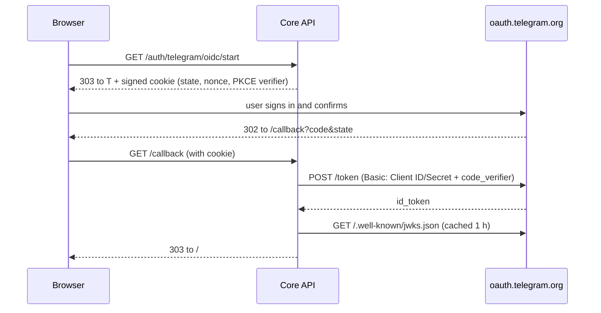

# Telegram login setup (Admin panel → Settings → Telegram login)

> Persian version: [TELEGRAM-LOGIN-SETUP-FA.md](TELEGRAM-LOGIN-SETUP-FA.md)

Status: implemented · no new migration · code: `apps/api/melorin/modules/identity/telegram_oidc*.py`, `apps/api/melorin/modules/admin/integrations.py`, `apps/admin-web/src/TelegramLoginSettings.jsx`

## Two methods, one account

| | Method 1 — approve in the bot | Method 2 — direct login (OpenID Connect) |
|---|---|---|
| Customer experience | site → Telegram bot → pick a number → back | site → Telegram's official page → "Confirm" → back |
| Data needed from BotFather | **none** | Client ID + Client Secret |
| Phishing resistance | number matching + device/IP shown + "that was not me" | Telegram's consent screen + PKCE + state |
| Customer browser needs | only the Telegram app | reach `oauth.telegram.org` |
| Technical doc | `docs/TELEGRAM-WEB-LOGIN.md` | this document |

Both identify the customer by the **numeric Telegram ID** (`Identity(provider="telegram")`), so someone created through the bot or the Mini App signs in to the **same account** with either method. **Admins cannot sign in with Telegram** (`admin_use_panel`); they use password + TOTP.

With no configuration (an existing install after upgrading) the previous behaviour is kept: method 1 on, method 2 off, lifetime and number matching from `.env`. As soon as an admin saves in the panel, the panel value wins.

## Step by step

### Method 1 — approve in the bot
1. Admin panel → **Settings** → "Login with Telegram" card.
2. Turn on the master switch, "Customer login" and "Method 1".
3. (Optional) keep number matching on and set the request lifetime (60–600 s).
4. **Save** → **Test connection** (works on the saved values: checks the main bot token with `getMe`, compares the username with the store, and fails when the store has no bot username - without it no login link can be built).

### Method 2 — direct login
1. In Telegram open the [BotFather mini app](https://t.me/botfather?startapp) → pick the bot → **Bot Settings → Web Login** (older name: *Login Widget*) → **OpenID Connect**.
2. Under **Allowed URLs** register every URL the panel card lists (one per row, https, no trailing slash):
   - the store origin, e.g. `https://shop.example.com`
   - the callback, e.g. `https://shop.example.com/api/v1/auth/telegram/oidc/callback`
   - for each active reseller with its own domain, that origin and callback too (the panel lists them).
3. Copy the **Client ID** (a number = the bot ID = the part of the bot token before ":") and the **Client Secret**.
4. Keep the **signing algorithm** at `RS256` (default) or `ES256`. `EdDSA`/`ES256K` only allow the bare `openid` scope and return no user ID, so login cannot work with them.
5. In the panel turn on "Method 2", paste Client ID and Secret → **Save** → **Test connection**. The test also checks the store URL: it must be a public https address (not localhost) and the callback URL it shows must be registered in BotFather.
6. In a private window try store → "Log in" → "Direct login with Telegram".

> Melorin requests only `openid profile` (ID, name, username). It does **not** ask for the phone number or permission for the bot to message the user.

## Technical flow (method 2)

Security rules (all covered by `apps/api/tests/test_r01_telegram_login_settings.py`):

- `state`, `nonce` and the PKCE verifier live in a signed (HS256), HttpOnly, `SameSite=Lax`, 10-minute cookie; no database row is created. The cookie is cleared after every outcome. If `state` differs from the cookie the code is never exchanged and a `tg_oidc_state_mismatch` security event is recorded.
- The `id_token` signature is verified against Telegram's JWKS; only `RS256`/`ES256` are accepted (no algorithm confusion); `iss`, `aud` (= Client ID), `exp`, `iat` are required and, when Telegram echoes a `nonce`, it must match.
- The account key is the `id` claim (the real Telegram user ID), not `sub`; without `id` the login is refused so no duplicate accounts appear.
- The **Client Secret** is Fernet-encrypted, used server-side only and never returned to the browser or written to the audit log.
- Admins, disabled accounts, closed registration (new accounts only) and the emergency `bot` flag behave exactly like method 1.
- Responses are `Cache-Control: no-store`; no token ever appears in a URL (the session is handed over by the refresh cookie and `POST /auth/refresh`).

## API

| Route | Caller | Notes |
|---|---|---|
| `GET /api/v1/auth/telegram/config` | storefront (public) | `{bot_login, oidc_login}`; no Client ID/Secret |
| `GET /api/v1/auth/telegram/oidc/start?store_id=` | browser | redirect to Telegram; 20/min rate limit |
| `GET /api/v1/auth/telegram/oidc/callback` | Telegram → browser | code exchange, session; 30/min rate limit |
| `GET /api/v1/admin/integrations` | admin | `telegram` key (no secret, `client_secret_set` flag) |
| `PUT /api/v1/admin/integrations/telegram` | admin | save; `client_secret`: omitted/null = keep, `""` = clear |
| `POST /api/v1/admin/integrations/telegram/test` | admin | Discovery, JWKS, Client ID, credentials, `getMe` |

Storage: `SystemSetting` key `integration.telegram_login` (like Google/SMTP/S3; hidden from the generic `/admin/settings`).

## Error codes (`/?tg_error=…` on the storefront)

| Code | Meaning |
|---|---|
| `user_denied` | the user declined in Telegram |
| `session_expired` | flow cookie missing/expired (over 10 min, cookies blocked, different host) |
| `origin_mismatch` | the visited host differs from `MELORIN_STORE_WEB_URL` / the reseller domain |
| `unavailable` | method off or incomplete, store inactive, or emergency `bot` flag |
| `failed` | bad state, wrong Secret, invalid token, or missing `id` |
| `unreachable` | the server could not reach Telegram |
| `registration_closed` / `account_disabled` / `admin_use_panel` | account rules (same as method 1) |

## Upgrade and rollback

1. Apply the patch; **no migration** (one `SystemSetting` row is created on first save).
2. Restart `api` and `telegram_main`; rebuild `store_web` and `admin_web`.
3. Caddy/CSP is unchanged (the flow is pure redirects; no third-party script is loaded).
4. Rollback: revert the patch. The setting row is harmless and ignored.
