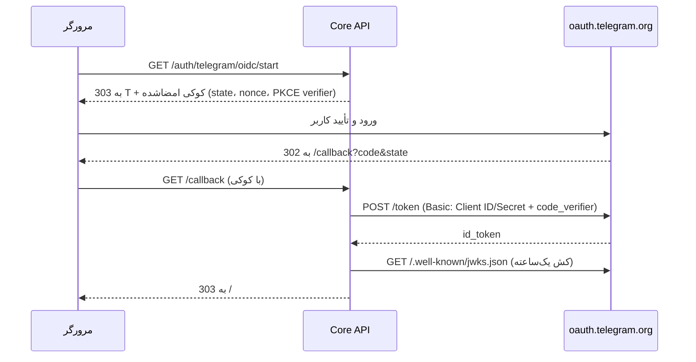

# راه‌اندازی ورود با تلگرام (پنل ادمین ← تنظیمات ← ورود با تلگرام)

> English version: [TELEGRAM-LOGIN-SETUP-EN.md](TELEGRAM-LOGIN-SETUP-EN.md)

وضعیت: پیاده‌سازی‌شده · بدون migration جدید · کد: `apps/api/melorin/modules/identity/telegram_oidc*.py`، `apps/api/melorin/modules/admin/integrations.py`، `apps/admin-web/src/TelegramLoginSettings.jsx`

## دو روش، یک حساب

| | روش ۱ — تأیید در ربات | روش ۲ — ورود مستقیم (OpenID Connect) |
|---|---|---|
| تجربهٔ مشتری | سایت ← ربات تلگرام ← انتخاب عدد ← برگشت | سایت ← صفحهٔ رسمی تلگرام ← «تأیید» ← برگشت |
| داده‌ی لازم از BotFather | **هیچ** | Client ID + Client Secret |
| ضدفیشینگ | تطبیق عدد + نمایش دستگاه/IP + «این من نبودم» | تأییدیهٔ رسمی تلگرام + PKCE + state |
| نیاز مرورگر مشتری | فقط اپ تلگرام | دسترسی به `oauth.telegram.org` |
| سند فنی | `docs/TELEGRAM-WEB-LOGIN.md` | همین سند |

هر دو روش کاربر را با **شناسهٔ عددی تلگرام** (`Identity(provider="telegram")`) می‌شناسند؛ یعنی مشتری‌ای که قبلاً با ربات یا Mini App ساخته شده، با هر دو روش به **همان حساب** وارد می‌شود. ورود **ادمین** از تلگرام وجود ندارد (`admin_use_panel`)؛ ادمین فقط با رمز + TOTP وارد می‌شود.

بدون هیچ تنظیمی (نصب موجود، بعد از به‌روزرسانی) رفتار قبلی حفظ می‌شود: روش ۱ روشن، روش ۲ خاموش، مدت اعتبار و تطبیق عدد از `.env`. به‌محض اینکه ادمین در پنل «ذخیره» بزند، مقدار پنل مقدم است.

## راه‌اندازی گام‌به‌گام

### روش ۱ — تأیید در ربات
1. پنل ادمین ← **تنظیمات** ← کارت «ورود با تلگرام».
2. کلید اصلی و «ورود مشتریان» و «روش ۱» را روشن کنید.
3. (اختیاری) تطبیق عدد را روشن نگه دارید و مدت اعتبار (۶۰ تا ۶۰۰ ثانیه) را تنظیم کنید.
4. **ذخیره** ← **تست اتصال**. تست روی مقدار ذخیره‌شده کار می‌کند: توکن ربات اصلی را با `getMe` می‌سنجد، نام کاربری را با فروشگاه مقایسه می‌کند و اگر نام کاربری ربات روی فروشگاه خالی باشد خطا می‌دهد (بدون آن لینک ورود ساخته نمی‌شود).

### روش ۲ — ورود مستقیم
1. در تلگرام [BotFather Mini App](https://t.me/botfather?startapp) را باز کنید ← ربات را انتخاب کنید ← **Bot Settings ← Web Login** (نام قدیمی‌تر: *Login Widget*) ← حالت **OpenID Connect**.
2. در **Allowed URLs** همهٔ آدرس‌هایی را که کارت پنل نشان می‌دهد ثبت کنید (هر ردیف جدا، https، بدون «/» پایانی):
   - origin فروشگاه، مثل `https://shop.example.com`
   - آدرس بازگشت، مثل `https://shop.example.com/api/v1/auth/telegram/oidc/callback`
   - برای هر نمایندهٔ فعال با دامنهٔ اختصاصی، origin و callback آن دامنه هم (در فهرست پنل می‌آید).
3. **Client ID** (عدد؛ همان شناسهٔ ربات = عدد قبل از «:» در توکن ربات) و **Client Secret** را کپی کنید.
4. **الگوریتم امضا** را روی `RS256` (پیش‌فرض) یا `ES256` نگه دارید. `EdDSA`/`ES256K` فقط scope پایهٔ `openid` می‌دهند و شناسهٔ کاربر را برنمی‌گردانند؛ با آن‌ها ورود کار نمی‌کند.
5. در پنل «روش ۲» را روشن کنید، Client ID و Secret را بچسبانید ← **ذخیره** ← **تست اتصال**. تست آدرس فروشگاه را هم می‌سنجد: باید https عمومی باشد (نه localhost) و همان آدرس بازگشتِ نشان‌داده‌شده در BotFather ثبت شده باشد.
6. در پنجرهٔ ناشناس از فروشگاه «ورود» ← «ورود مستقیم با تلگرام» را امتحان کنید.

> ملورین فقط `openid profile` درخواست می‌کند (شناسه، نام، نام‌کاربری). شمارهٔ تلفن و اجازهٔ پیام‌دادن ربات درخواست **نمی‌شود**.

## جریان فنی روش ۲

قواعد امنیتی (همه با تست پوشش داده شده‌اند: `apps/api/tests/test_r01_telegram_login_settings.py`):

- `state`، `nonce` و PKCE verifier در کوکی HttpOnly، `SameSite=Lax`، امضاشده (HS256) و ۱۰ دقیقه‌ای نگه‌داری می‌شوند؛ هیچ ردیف دیتابیسی ساخته نمی‌شود. کوکی بعد از هر نتیجه پاک می‌شود. اگر `state` با کوکی یکی نباشد، کد اصلاً مبادله نمی‌شود و رخداد امنیتی `tg_oidc_state_mismatch` ثبت می‌شود.
- امضای `id_token` با JWKS تلگرام بررسی می‌شود؛ الگوریتم‌های مجاز فقط `RS256`/`ES256` (ضد algorithm-confusion)؛ `iss`، `aud` (= Client ID)، `exp`، `iat` اجباری‌اند و در صورت بازگشت `nonce` باید با نشست یکی باشد.
- کلید حساب، claim `id` (شناسهٔ واقعی تلگرام) است، نه `sub`؛ اگر `id` نباشد ورود رد می‌شود تا حساب تکراری ساخته نشود.
- **Client Secret** با Fernet رمزنگاری و فقط سمت سرور مصرف می‌شود؛ هرگز به مرورگر یا لاگ Audit برنمی‌گردد.
- ادمین، حساب غیرفعال، ثبت‌نام بسته (فقط حساب جدید) و پرچم اضطراری `bot` مثل روش ۱ اعمال می‌شوند.
- پاسخ‌ها `Cache-Control: no-store` دارند و هیچ توکنی در URL نمی‌آید (نشست از کوکی refresh و `POST /auth/refresh` تحویل داده می‌شود).

## API

| مسیر | مصرف‌کننده | توضیح |
|---|---|---|
| `GET /api/v1/auth/telegram/config` | فروشگاه (عمومی) | `{bot_login, oidc_login}`؛ بدون Client ID/Secret |
| `GET /api/v1/auth/telegram/oidc/start?store_id=` | مرورگر | ریدایرکت به تلگرام؛ rate limit ‏۲۰/دقیقه |
| `GET /api/v1/auth/telegram/oidc/callback` | تلگرام ← مرورگر | مبادلهٔ کد، ساخت نشست؛ rate limit ‏۳۰/دقیقه |
| `GET /api/v1/admin/integrations` | ادمین | کلید `telegram` (بدون secret، با `client_secret_set`) |
| `PUT /api/v1/admin/integrations/telegram` | ادمین | ذخیره؛ `client_secret`: نبودن = نگه‌داشتن، `""` = حذف |
| `POST /api/v1/admin/integrations/telegram/test` | ادمین | Discovery، JWKS، Client ID، اعتبارنامه، `getMe` |

ذخیره‌سازی: `SystemSetting` با کلید `integration.telegram_login` (مثل Google/SMTP/S3؛ از `/admin/settings` عمومی پنهان است).

## کدهای خطا (`/?tg_error=…` در فروشگاه)

| کد | معنی |
|---|---|
| `user_denied` | کاربر در تلگرام رد کرد |
| `session_expired` | کوکی نشست نبود/منقضی شد (بیش از ۱۰ دقیقه، کوکی بسته، دامنهٔ متفاوت) |
| `origin_mismatch` | دامنهٔ بازدید با `MELORIN_STORE_WEB_URL`/دامنهٔ نماینده یکی نیست |
| `unavailable` | روش خاموش یا ناقص است، فروشگاه غیرفعال، یا پرچم اضطراری `bot` |
| `failed` | state نامعتبر، Secret اشتباه، توکن نامعتبر، یا نبود `id` |
| `unreachable` | سرور به تلگرام نرسید |
| `registration_closed` / `account_disabled` / `admin_use_panel` | قواعد حساب (مثل روش ۱) |

## به‌روزرسانی و بازگشت

1. اعمال پچ؛ **migration لازم نیست** (فقط یک ردیف `SystemSetting` ساخته می‌شود).
2. ریستارت `api` و `telegram_main`؛ build مجدد `store_web` و `admin_web`.
3. Caddy/CSP تغییر نمی‌کند (جریان کاملاً ریدایرکتی است؛ اسکریپت شخص ثالث لود نمی‌شود).
4. بازگشت: برگرداندن پچ. ردیف تنظیمات بی‌ضرر است و نادیده گرفته می‌شود.
