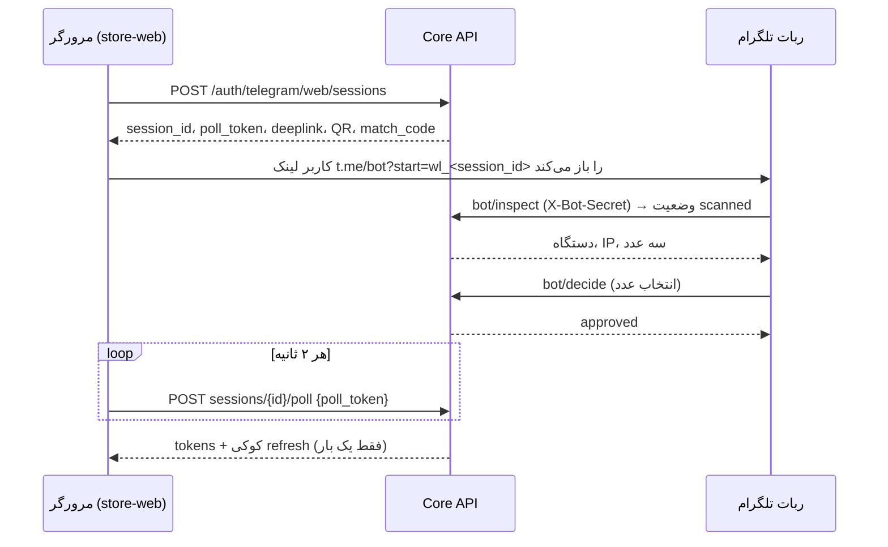

# ورود به وب‌سایت با تأیید هویت در ربات تلگرام

وضعیت: پیاده‌سازی‌شده (migration `0019_telegram_web_login`) · کد: `apps/api/melorin/modules/identity/telegram_web*.py`، `apps/telegram-main/runner.py`، `apps/store-web/src/TelegramLogin.jsx`

## چرا این طراحی؟

قبلاً تلگرام فقط برای «اتصال حساب» (`/link`) و Mini App (`/auth/telegram/webapp`) استفاده می‌شد و ورود به وب‌سایت فقط با ایمیل/گوگل ممکن بود. این جریان، الگوی **Device Authorization** (شبیه RFC 8628 و ورود با QR در پیام‌رسان‌ها) را با سه تقویت امنیتی پیاده می‌کند:

1. **اتصال به مرورگر درخواست‌دهنده (browser binding):** مرورگر دو مقدار می‌گیرد؛ `session_id` (عمومی، داخل لینک/QR) و `poll_token` (محرمانه، فقط در حافظهٔ همان تب؛ در دیتابیس فقط SHA-256 آن ذخیره می‌شود). هر کسی لینک را ببیند نمی‌تواند نشست را تحویل بگیرد.
2. **تطبیق عدد (number matching):** وب‌سایت یک عدد دو رقمی نشان می‌دهد و ربات سه گزینه؛ کاربر باید همان عدد را انتخاب کند. لینکِ فرستاده‌شده به قربانی (فیشینگ) بدون دیدن عدد روی صفحهٔ مهاجم بی‌فایده است. دو انتخاب اشتباه = بسته‌شدن درخواست + `SecurityEvent`.
3. **نمایش زمینهٔ درخواست در ربات:** دستگاه، آی‌پی و زمان درخواست، همراه با دکمهٔ «⛔ این من نبودم» (که خودش سیگنال فیشینگ ثبت می‌کند).

## جریان

وضعیت‌ها: `pending → scanned → approved → consumed`، یا `denied` / `expired` در هر مرحلهٔ باز. تبدیل `approved → consumed` با قفل ردیف (`SELECT … FOR UPDATE`) اتمیک است؛ دو poll هم‌زمان هرگز دو نشست نمی‌سازند.

## API

| مسیر | مصرف‌کننده | محافظت |
|---|---|---|
| `POST /api/v1/auth/telegram/web/sessions` | مرورگر | rate limit ‏۱۰/دقیقه/IP |
| `POST /api/v1/auth/telegram/web/sessions/{id}/poll` | مرورگر | rate limit ‏۱۲۰/دقیقه/IP، نیازمند `poll_token` در body |
| `POST /api/v1/auth/telegram/web/sessions/{id}/cancel` | مرورگر | `poll_token` (بستن دیالوگ، لینک را باطل می‌کند) |
| `POST /api/v1/auth/telegram/web/bot/inspect` | ربات | `X-Bot-Secret` + تطبیق `store_id` |
| `POST /api/v1/auth/telegram/web/bot/decide` | ربات | `X-Bot-Secret` + تطبیق `store_id` + همان حساب تلگرامِ inspect |

پاسخ‌های مرورگر `Cache-Control: no-store` دارند. توکن هرگز در URL نمی‌آید.

## قواعد امنیتی (همه با تست پوشش داده شده‌اند)

- جلسه به **فروشگاه** گره خورده است: لینکِ ساخته‌شده برای ربات اصلی در ربات نمایندهٔ دیگر کار نمی‌کند (`STORE_MISMATCH`)؛ ربات‌های نماینده خودکار با `store_id` خودشان صدا می‌زنند.
- جلسه به **اولین حساب تلگرامی** که لینک را باز کرد قفل می‌شود (`SESSION_BUSY` برای حساب دیگر).
- طول عمر پیش‌فرض ۱۸۰ ثانیه (قابل تنظیم ۶۰ تا ۶۰۰)، یک‌بارمصرف، پاک‌سازی خودکار یک روز پس از انقضا (`telegram_login_gc_job`).
- **ادمین‌ها** از این مسیر وارد نمی‌شوند (`admin_use_panel`)؛ ورود ادمین فقط با رمز + TOTP در پنل مدیریت، مطابق ورود گوگل.
- حساب غیرفعال رد می‌شود؛ اگر پرچم `registration` خاموش باشد، فقط حساب‌های **جدید** رد می‌شوند.
- پرچم اضطراری `bot` و `system` ساخت نشست جدید را می‌بندد.
- حداکثر ۱۰ تأیید در ساعت برای هر حساب تلگرام.
- رخدادهای Audit: `tg_web_login.started|approved|denied|consumed`. رخدادهای امنیتی: `tg_web_login_denied_by_user`، `…_wrong_code`، `…_admin_refused`، `…_rate_limited`، `…_other_account`.

### ریسک باقی‌مانده
اگر مهاجم قربانی را قانع کند هم عدد را از او بگیرد و هم تأیید کند (مهندسی اجتماعی کامل)، نشست برای مهاجم صادر می‌شود. کاهش: نمایش آی‌پی/دستگاه، هشدار متنی در ربات، و ثبت «این من نبودم». قفل کامل‌تر در آینده: تأیید با passkey یا محدودسازی بر اساس کشور.

## تنظیمات

از این نسخه، روشن/خاموش‌کردن، تطبیق عدد و مدت اعتبار از **پنل ادمین ← تنظیمات ← ورود با تلگرام** قابل تغییر است (راهنما: [TELEGRAM-LOGIN-SETUP.md](TELEGRAM-LOGIN-SETUP.md)). مقدارهای `.env` زیر فقط تا وقتی ادمین چیزی در پنل ذخیره نکرده پیش‌فرض‌اند.

| متغیر | پیش‌فرض | توضیح |
|---|---|---|
| `MELORIN_TELEGRAM_WEB_LOGIN_TTL_SECONDS` | `180` | عمر درخواست، بین ۶۰ و ۶۰۰ |
| `MELORIN_TELEGRAM_WEB_LOGIN_NUMBER_MATCH` | `true` | خاموش‌کردن فقط برای عیب‌یابی توصیه می‌شود |

دکمهٔ «ورود با تلگرام» فقط وقتی در سایت دیده می‌شود که فروشگاه `bot_username` داشته باشد.

نام کاربری ربات اصلی از **پنل ادمین ← تنظیمات ← ورود با تلگرام ← ربات اصلی فروشگاه** ثبت می‌شود: دکمهٔ «تشخیص خودکار از توکن» (getMe) یا ورود دستی؛ API: `PUT /api/v1/admin/integrations/telegram/main-bot-username` (بدنهٔ خالی/`username: null` = تشخیص خودکار). نام دستی با ربات واقعیِ توکن تطبیق داده می‌شود و نام تکراری (فروشگاه دیگر) رد می‌شود.

## راه‌اندازی و بازگشت

1. اعمال پچ، سپس `alembic upgrade head` (جدول جدید `telegram_login_sessions`؛ هیچ جدول موجودی تغییر نمی‌کند).
2. ریستارت `api`، `worker`، ربات‌ها و بیلد مجدد `store_web`.
3. بازگشت: `alembic downgrade 0018_reseller_two_step` و برگرداندن پچ. ورودهای قبلی (ایمیل/گوگل/Mini App) دست‌نخورده‌اند.
